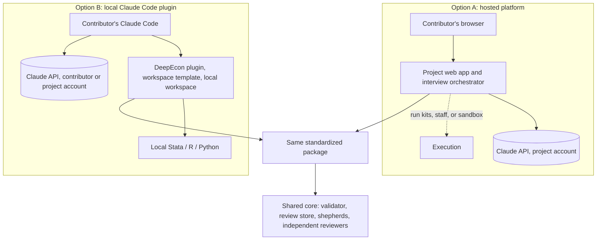

# Architecture Decision Brief: How Economists Will Contribute

**DeepEcon Research Benchmark (working title) · Deliverable 7 · Draft v0.2 for discussion with collaborators · 2026-11-05**

| | |
|---|---|
| **Status** | **Proposed.** Nothing here is decided. The research lead and collaborators decide; see the [decision log](../decisions/decision-log.md). |
| **Question** | Should economists contribute through a **hosted web platform we operate** (Option A), through a **Claude Code plugin they run locally** (Option B), or should we pilot both first? |
| **Basis** | [Option A design](option-a-hosted-platform.md) · [Option B design](option-b-local-skill.md) · [cost and effort model](cost-and-effort-model.md) · [submission](submission-mechanisms.md) · [bilingual design](bilingual-design.md) · [construction protocol](../methodology/benchmark-construction-protocol.md) · [interview protocol](../interview/expert-interview-protocol.md) · [evidence notes R1–R9](../research/evidence/) |

---

## 1. Executive summary

**What we are deciding.** Only the *contributor-facing layer*: where the AI-guided interview runs, where code runs, who pays for the model, and who holds the materials. The scientific method is the same under both options and is specified separately: the interview protocol, the correct and flawed packages, verifier validation, and independent review.

**What the analysis shows.**

1. **The interface matters less than the shared method.** Both options run the same interview protocol, produce the same schema-valid package, and feed the same internal pipeline. In that pipeline a benchmark-team *shepherd* turns each candidate into a verified task. The shared core, about 9–16 engineer-weeks, is needed whichever option we choose.
2. **Money is not the main differentiator.** At API list prices the AI interview costs about **$17 per contribution** (range $6–46) under either option, or about $3,400 for 200 contributions. Hosting a platform costs about $13–210 a month. Human effort dominates: about **20 shepherd hours per admitted task**, roughly 4,000 hours at 200 contributions.
3. **Five real differences separate the options:**

   | Difference | Option A (hosted) | Option B (local) |
   |---|---|---|
   | Access | A browser is enough for the interview | Claude Code (terminal, or the desktop app's Code tab), a paid plan from $20 a month or project-provided access, and a plugin plus a workspace template |
   | Code execution | Run kits on the contributor's machine, staff execution, or a hosted R/Python sandbox | The contributor's own environment, including Stata, which appears in 71.6% of economics replication packages |
   | Consistency and data terms | One pinned model; commercial terms (Anthropic "may not train" on customer content) | A plugin cannot enforce the model. Consumer plans train on inputs unless the user opts out. Both are uniform only with project-provided commercial access, whose terms need confirming |
   | Custody | The project holds unpublished code and transcripts, with GDPR and security duties | Materials stay local, but Anthropic still receives everything the model reads |
   | Upkeep | A web service to operate (≈ 0.1–0.25 FTE) | A plugin to keep compatible with a client that ships several releases a week, plus more varied support |

4. **Two facts constrain both options equally.**
   - **Regional policy.** Anthropic's Supported Regions Policy (effective 2026-11-12) does not cover mainland China, Hong Kong, or Macau. Its Usage Policy prohibits facilitating access there "(including end users)". Neither option can serve contributors located there with Claude. That matters for a bilingual project, and it needs legal review.
   - **AI influence on experts.** In a 2026 study, analysts with causal-inference experience followed an AI agent's secretly randomized lean on design choices 86% of the time and rarely credited it. The interview protocol therefore *measures* influence rather than trusting self-reports.
5. **Other shared risks:** shepherd capacity; contamination of tasks derived from public papers; and a name collision with an existing econometrics package called "deepecon".

**Recommendation (argued in §9, after the comparison).**
- Build the shared core first.
- Start the legal and terms inquiries now, because they gate every path (O-007, O-018).
- Then pilot **thin slices of both options on the same paper**, with decision thresholds agreed in advance.
- If the group must choose before the pilot, the expected contributor population should decide:
  - a largely non-technical, senior cohort points to **Option A** (hosted interview; execution by run kits or staff);
  - a technically fluent cohort with limited engineering capacity points to **Option B with project-provided commercial access**.

**Decisions needed now** (§10):
- pilot both or choose one;
- release policy;
- who pays for model access;
- legal and terms review;
- shepherd staffing;
- contributor credit;
- project name.

## 2. The two options in brief

**Option A — hosted platform.** The contributor signs in with an e-mail link or ORCID, uploads the paper and code, and conducts the interview in the browser. A progress display and a live dossier panel show who said what. Code runs by one of three routes:
- *run kits* on the contributor's or a research assistant's machine (A1);
- on staff machines during shepherding;
- in a hosted R/Python sandbox for public data (A2).

The project pays for one pinned model under commercial terms.

**Option B — local plugin.** The contributor installs Claude Code, adds the DeepEcon plugin, and creates a workspace from the project's template next to the replication package. The model reads the local paper and code, drafts flawed variants in a separate folder, and runs them in the contributor's own Stata, R, or Python. Layered safeguards keep the original package untouched, with a checksum check as the backstop. Model access comes from the contributor's paid plan unless the project provides it.

## 3. Side-by-side comparison

*Table 1. Comparison on the research lead's twelve dimensions.* Ratings are qualitative judgments on verified evidence; † marks dimensions the pilot is designed to test.

| Dimension | (1) Option A — hosted platform | (2) Option B — local plugin |
|---|---|---|
| **Scientific quality: consistency** | **Strong.** One pinned model, configuration, and protocol version. | **Moderate.** A plugin cannot enforce the model; the model and client versions vary unless the project provides access. |
| **Scientific quality: evidence anchoring** | **Good.** The model reads uploaded code with line references; execution is indirect. | **Strong.** The model reads and runs code in the real environment, including Stata. |
| **Contributor accessibility** † | **High for the interview** (browser only). Code execution still needs a contributor, RA, staff member, or sandbox. | **Lower.** Paid plan, installation, plugin, and template. The desktop app's Code tab is a no-terminal path; Cowork is unsuitable because it cannot run local Stata. |
| **Expert engagement** † | Guided and structured; less hands-on with code. | Hands-on, code-level discussion; suits fluent experts. Setup may deter others. |
| **Development effort** (beyond the shared core) | ≈ 12–19 engineer-weeks (A1 + staff execution); +3–6 for a sandbox | ≈ 8–14 engineer-weeks |
| **Operating costs (project)** | ≈ $17 inference per contribution; hosting ≈ $13–210 a month; 0.1–0.25 FTE operations. | Near-zero hosting; $0 inference unless access is provided; 0.05–0.15 FTE maintenance; more support time. |
| **Cost distribution** | The project pays everything. | Contributors pay for a plan (from $20 a month) unless the project provides access. |
| **Privacy and confidentiality** | The project holds code and transcripts (GDPR standard contractual clauses; API data at rest in the US); no data upload is needed with run kits. | Materials stay local, except what the model reads. Consumer plans train unless the user opts out, with feedback and safety exceptions. |
| **Reproducibility** | Uniform: staff or central re-runs, or uploaded outputs. | Heterogeneous environments; metadata captured; everything re-run at intake. |
| **Quality control** | Enforced centrally: protocol version, budgets, validation at upload. | Local plus intake validation; version drift is possible because marketplaces do not auto-update. |
| **Version management** | Instant central updates; protocol pinned per contribution. | Manual plugin updates with a pre-flight check; version recorded per package. |
| **Scalability and sustainability** | Linear inference cost; central support; needs funded operations and a sunset plan. | Uses contributors' resources; support grows with environment diversity; depends on a fast-moving client. |

*Notes:* FTE = full-time equivalent. Engineering figures are planning estimates [U]. Prices are Anthropic and vendor list prices verified on 2026-11-05. The regional policy applies equally to both columns.

## 4. Key trade-offs

1. **Consistency versus reach.** Option A gives every contributor the same interviewer, which makes contributions comparable and the protocol testable. Option B reaches people in their own tools, but consistency must be bought back with project-provided commercial access. That access also removes most of B's cost advantage, and its terms for external contributors need confirming.
2. **Who runs the code.** Building a flawed variant and measuring its consequence is where Option B shines. Stata dominates economics packages, and B uses the contributor's own installation and licence. Option A routes execution through run kits, staff, or an R/Python sandbox. If shepherds and research assistants do most of the execution anyway, B's advantage matters most for them, not for the economist. *Good Benchmarks* argues that domain experts and task builders are different roles.
3. **Custody versus dispersion.** Option A concentrates unpublished code and transcripts on project servers, with security and data-protection duties. Option B leaves them on contributors' machines, but Anthropic still receives whatever the model reads: local execution is not local inference.
4. **Building and operating versus supporting.** Option A costs more engineering and ongoing operations. Option B costs less to build but more to support: operating systems, software setups, plan limits, and a client with frequent releases whose default "auto mode" discourages pausing for questions.
5. **Who pays, and on what terms.** Inference is cheap either way. The substantive question is whether contributor sessions run under commercial terms (no training on inputs) or consumer terms (training unless the user opts out). For a benchmark with hidden answers, that is a question of scientific integrity as well as cost.

## 5. Costs and effort

| Category | Option A | Option B | Shared core (either) |
|---|---|---|---|
| Initial development | 12–19 engineer-weeks; +3–6 for a sandbox | 8–14 engineer-weeks | 9–16 engineer-weeks |
| Fixed operating | Hosting ≈ $13–210 a month; 0.1–0.25 FTE | Near zero; 0.05–0.15 FTE | Internal review store: small |
| Variable per contribution (project) | ≈ $17 inference ($6–46) | $0, or ≈ $17 with project-provided access; reimbursing one month of Pro for 200 contributors costs $4,000 | — |
| Contributor-side | Time | Time; a paid plan unless provided (Pro $20 a month, Max $100, Team $25 a seat); own software | — |
| Human effort per admitted task | — | — | ≈ 20 shepherd hours (10–40) and ≈ 8 review hours |

**At 200 contributions (central estimates):**

| Item | Estimate |
|---|---|
| Inference | ≈ $3,400 |
| Shepherding | ≈ 4,000 hours |
| Independent review | ≈ 1,600 hours |
| Support | ≈ 100 hours (A) versus ≈ 200 hours (B) |

Funding sources exist for model use, for example AI for Science credits of up to $50k per project. All assumptions are in the [cost and effort model](cost-and-effort-model.md).

## 6. Major risks

| Risk | Affects | Severity | Mitigation |
|---|---|---|---|
| Contributors in mainland China, Hong Kong, or Macau cannot be served with Claude | Both | High for that group; certain for those located there | Legal review (O-007); a non-Claude route (another provider or a human interviewer using the same protocol), without model parity |
| Interview leads experts or fabricates errors (experts followed a planted AI lean 86% of the time in a 2026 study) | Both | High | Free-recall lock before suggestions; exposure tracking; measured influence and known-valid controls; independent status classification; human-authored task text; randomized suggestion phase in the pilot |
| Non-technical economists do not complete setup | B | High if the cohort is senior and non-technical | Desktop app; research-assistant mode; onboarding sessions; hosted onboarding |
| Interview degraded by the client's defaults (auto mode, context compaction) | B | Medium–High | Explicit wait-for-answer rules; template permission mode; core rules early in the skill; state re-injection; testing under defaults |
| Hand-offs stall the operationalization of errors | A (run kits) | Medium–High | Staff execution; sandbox for public data; research-assistant mode |
| Inconsistent interviewer (model or version drift) | B | Medium–High | Project-provided access; pre-flight checks; per-model evaluations |
| Breach of unpublished code or transcripts | A | High impact, lower likelihood | Minimal retention; encryption; security review; no data upload with run kits |
| Hidden materials enter model training through consumer accounts | B | High impact | Project-provided commercial access, or verified opt-out with residual-risk disclosure |
| Terms block project-paid access for external contributors, or the server-side Agent SDK variant | B; hybrid H2 | Medium | Ask Anthropic or counsel (O-018); the Messages-API path for Option A is unaffected |
| Shepherd capacity limits throughput (Stata-to-R/Python ports add work) | Both | High | Staffing plan; tooling; quality over quantity |
| Tasks from public papers become solvable by memory or lookup | Both | High | Offline environments; effect-injected or semi-synthetic data; re-execution on hidden data; private held-out set |
| Name collision ("deepecon" Python package) | Both | Medium | Rename before public launch |

## 7. When each option is preferable

**Option A is preferable if:**
- most contributors are senior and not fluent with developer tools;
- comparability of interviews across contributors is itself a research goal;
- the project can fund engineering and multi-year operations;
- contributors are comfortable entrusting unpublished code to the project;
- shepherds or research assistants will handle most code execution.

**Option B is preferable if:**
- most contributors, or their research assistants, are technically fluent;
- packages depend heavily on local environments such as Stata;
- engineering and operations capacity is small;
- the project can provide commercial-terms access (subject to O-018), or contributors already have commercial accounts;
- contributors prefer that materials never sit on project servers.

**Neither option removes:**
- the regional constraint;
- the need for shepherds and independent reviewers;
- the release-policy decision;
- the contamination controls.

## 8. Hybrid strategies (considered, not substitutes for the A/B comparison)

| Hybrid | Idea | Main benefit | Main cost or risk |
|---|---|---|---|
| H1 Website plus plugin | Option B with hosted onboarding, documentation, and submission | Better first impression and support for B | Still requires local setup and a plan |
| H2 One protocol, two hosts | The same six-field skill runs locally (B) and server-side through the Claude Agent SDK (A) | One interview codebase; cheap to prototype both | Technically feasible, but Anthropic's terms for running Claude Code in products bar the customer from paying for end users' usage. Needs confirmation (O-018). A shared *protocol* with separate hosts (the Messages API for A) avoids this. |
| H3 Split by role | Economists use the hosted interview; RAs and shepherds use the local plugin to operationalize errors | Plays to each option's strength; matches the division between domain expert and task builder | Two surfaces to maintain; a hand-over between them |
| H4 Split by contributor | Hosted interview for non-technical contributors, local plugin for technical ones | Maximizes reach | Two interviewer configurations to keep comparable |

Terminal-Bench-Science already runs a hybrid of this family. Contributors start with hosted intake (a web form, community channels, office hours), then build and test tasks locally and submit them as pull requests [P-full].

## 9. Recommendation

1. **Build the architecture-independent core now:** protocol assets, schema, validator, packager, and internal review store. Every scenario needs them, and scientific quality depends on them most.
2. **Start the legal and terms inquiries immediately.** Ask about the regional policy's application to the intended contributors (O-007), and about whether the project may provide or pay for access in the ways each option needs (O-018). The answers may rule out variants of both options.
3. **Pilot thin slices of both options** on one paper, using the crossover design and the pre-registered thresholds in the [pilot plan](../pilot/pilot-evaluation-plan.md). *Why both:* the decisive questions are empirical. Will senior economists complete setup? Do hand-offs stall? Do the options differ in output quality or measured AI influence? With the core in place, the second slice costs roughly 4–9 engineer-weeks [U], which is small next to building the wrong full system.
4. **If a choice must be made before the pilot:**
   - for a mostly senior, non-technical cohort, the evidence leans toward **Option A** (run kits plus staff execution), where accessibility, consistency, and uniform commercial terms matter most;
   - for fluent early adopters with limited engineering capacity, it leans toward **Option B with project-provided commercial access**.
5. **The end state may be H3**: a hosted interview for economists, with local tooling for operationalization. Adopt it only if the pilot supports it.

## 10. Decisions needed before implementation

| ID | Decision | Why now |
|---|---|---|
| O-002 | Pilot both slices, or choose one option now | Determines the scope of Phase 5 |
| O-007 | Legal review: regional policy and the intended contributors | Gates recruitment under both options |
| O-018 | Terms review: project-provided access for external contributors; the server-side Agent SDK variant | Gates Option B with provided access, and H2 |
| O-001 | Release policy: public, private, or public development set plus private held-out set | Constrains submission channels and leakage controls |
| O-006 | Who pays for contributors' model access in Option B | Determines B's consistency, terms, and cost |
| O-009 | Shepherd and reviewer staffing | The dominant cost and throughput constraint |
| O-005 | Contributor credit and incentives | Recruitment of senior economists |
| O-003 · O-004 · O-017 | First-release task scope; "one-sentence-fact" tasks; whether the interview offers AI suggestions | Shapes what the interview must elicit |
| O-008 · O-013 | Pilot paper; ethics review | Prerequisites for the pilot |
| O-014 | Project name | Before any public launch |
