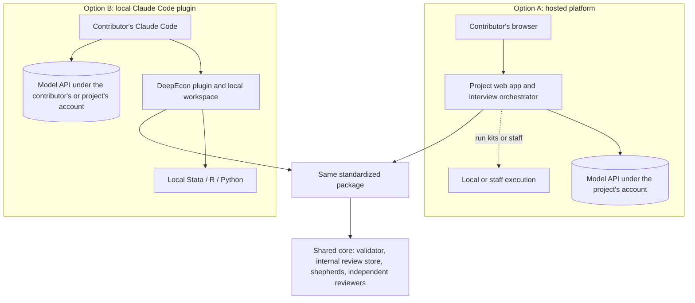

# Architecture Decision Brief: How Economists Will Contribute

**DeepEcon Research Benchmark (working title) · Deliverable 7 · Draft for discussion with collaborators · 2026-11-05**

| | |
|---|---|
| **Status** | **Proposed.** Nothing here is decided. The research lead and collaborators decide; see the [decision log](../decisions/decision-log.md). |
| **Question** | Should economists contribute through a **hosted web platform we operate** (Option A) or through a **Claude Code plugin they run locally** (Option B) — or should we pilot both first? |
| **Basis** | [Option A design](option-a-hosted-platform.md) · [Option B design](option-b-local-skill.md) · [cost and effort model](cost-and-effort-model.md) · [submission](submission-mechanisms.md) · [bilingual design](bilingual-design.md) · [construction protocol](../methodology/benchmark-construction-protocol.md) · [interview protocol](../interview/expert-interview-protocol.md) · [evidence notes](../research/evidence/) |

---

## 1. Executive summary

**What we are deciding.** Only the *contributor-facing layer*: where the AI-guided interview runs, where code runs, who pays for the model, and who holds the materials. The scientific method — interview protocol, correct and flawed packages, verifier validation, independent review — is the same under both options and is specified separately.

**What the analysis shows.**

1. **The interface matters less than the shared method.** Both options run the same interview protocol, produce the same schema-valid contribution package, and feed the same internal pipeline, in which a benchmark-team *shepherd* turns each candidate into a verified task. That shared core is roughly 9–16 engineer-weeks of work and is needed whichever option we choose.
2. **Money is not the main differentiator.** At API list prices, the AI interview costs about **$17 per contribution** (range $6–46) under either option — about $3,400 for 200 contributions. Human effort dominates: about **20 shepherd hours per admitted task**, or roughly 4,000 hours at 200 contributions. Option B's inference saving is small in absolute terms, and it disappears if the project pays for contributors' model access (which it may want to do for consistency and data-use terms).
3. **Five real differences separate the options:**

   | Difference | Option A (hosted) | Option B (local) |
   |---|---|---|
   | Access | A browser is enough for the interview | Requires Claude Code, a suitable plan or project-provided access, and a plugin install |
   | Code execution | Through hand-off "run kits", staff, or a hosted R/Python sandbox | The contributor's own environment, Stata included |
   | Consistency and data-use terms | One pinned model, commercial terms for everyone | Uniform only if the project provides model access |
   | Custody | The project holds unpublished code and transcripts | Materials stay local (the model provider still receives what the model reads) |
   | Upkeep | A web service to operate | A plugin that must track a fast-moving client, plus more varied support |

4. **The hardest risks are shared.** Both options face: access for contributors in mainland China, which requires legal review; shepherd capacity; contamination of tasks derived from public papers; and a name collision with an existing econometrics package called "deepecon".

**Recommendation (argued in §9, after the comparison).**
- Build the shared core first.
- Then pilot **thin slices of both options on the same paper**, with decision thresholds agreed in advance.
- The key uncertainties are empirical, and once the core exists the second slice costs a few engineer-weeks.
- If the group must choose before the pilot, choose by expected contributor population:
  - a largely non-technical, senior, bilingual cohort points to **Option A** (hosted interview; execution by research assistants or staff);
  - a technically fluent cohort with limited engineering capacity points to **Option B with project-provided model access**.

**Decisions needed now** (§10): pilot both or choose one; benchmark release policy; who pays for model access; legal review for China; shepherd staffing; contributor credit; project name.

## 2. The two options in brief

- **Option A — hosted platform.** The contributor signs in, uploads the paper and code, and conducts the interview in the browser with a progress display and a live dossier panel. Code runs in one of three ways: on the contributor's or a research assistant's machine via generated **run kits** (A1); on **staff machines** during shepherding; or in a hosted R/Python **sandbox** for public data (A2). The project pays for one pinned model under commercial terms.
- **Option B — local plugin.** The contributor installs Claude Code and the DeepEcon plugin, opens a folder beside the replication package, and runs the interview there. The model reads the local paper and code, drafts flawed variants in a separate folder, and runs them in the contributor's own Stata, R, or Python. Originals are protected by layered safeguards. Model access comes from the contributor's plan unless the project provides it.

## 3. Side-by-side comparison

*Table 1. Comparison on the research lead's twelve dimensions.* Ratings are qualitative judgments on the evidence assembled so far; the pilot is designed to test the ones marked †.

| Dimension | (1) Option A — hosted platform | (2) Option B — local plugin |
|---|---|---|
| **Scientific quality: consistency** | **Strong.** One pinned model, configuration, and protocol version for all contributors | **Moderate.** Model and client version vary unless the project provides access; per-model protocol evaluations needed |
| **Scientific quality: evidence anchoring** | **Good.** The model reads uploaded code with line references; execution is indirect (run kits, staff, or sandbox) | **Strong.** The model reads and runs code in the real environment, including Stata |
| **Contributor accessibility** † | **High for the interview** (browser only). Execution still needs someone to run code, unless staff or a sandbox does it | **Lower.** Install, plan, plugin. Eased by the desktop app [pending R2] and by research-assistant mode |
| **Expert engagement** † | Guided, structured, polished; less hands-on with code | Hands-on, concrete code-level discussion; suits fluent experts; setup may deter others |
| **Development effort** (beyond the shared core) | ≈ 11–18 engineer-weeks (A1); +3–6 for a hosted sandbox | ≈ 7–12 engineer-weeks |
| **Operating costs (project)** | Inference ≈ $17 per contribution; hosting from tens to low hundreds of dollars per month [pending R9]; 0.1–0.25 FTE operations | Near-zero hosting; inference $0 unless the project provides access; 0.05–0.15 FTE plugin maintenance; more support time |
| **Cost distribution** | Project pays everything | Contributors pay model access unless the project provides it (Open question O-006) |
| **Privacy and confidentiality** | Project custody of code and transcripts (security and data-protection obligations); no data upload needed in A1 | Materials stay local except what the model reads, which goes to the provider under the contributor's terms; consumer-plan training settings are a contamination risk [pending R3] |
| **Reproducibility** | Uniform; central re-runs (A2, staff) or uploaded outputs (A1) | Heterogeneous local environments; captured environment metadata; everything re-run at intake |
| **Quality control** | Enforced centrally: protocol version, budgets, validation at upload | Local validation plus intake validation; version drift possible |
| **Version management** | Instant central updates; protocol pinned per contribution | Marketplace updates; contributors may lag; versions recorded per package |
| **Scalability** | Linear inference cost; centralized support; site reachability matters internationally | Uses contributors' resources; support grows with environment diversity; model availability by region matters |
| **Long-term sustainability** | Needs funded operations and a sunset plan | Lighter operations, but depends on a fast-moving third-party client |

*Notes:* "FTE" = full-time equivalent. Engineering figures are planning estimates [U], not measurements. Inference prices are Anthropic list prices cached 2026-10-06; the computation is reproducible in [`cost-model/`](cost-model/).

## 4. Key trade-offs

1. **Consistency versus reach.** Option A gives every contributor the same interviewer — the property that makes contributions comparable and the protocol testable. Option B reaches people in their own tools and environments, but consistency must be bought back by providing model access, which also removes most of B's cost advantage.
2. **Who runs the code.** Operationalizing a mistake — building the flawed variant and measuring its consequence — is where Option B shines: the real package runs locally, Stata included. Option A must route execution through run kits, staff, or a sandbox. However, *Good Benchmarks* (§9) argues that domain experts and task builders are different roles. If shepherds or research assistants do most execution anyway, B's advantage matters most for them, not for the economist.
3. **Custody versus dispersion of sensitive material.** Option A concentrates unpublished code and interview transcripts on project servers, bringing security and data-protection duties (GDPR; China's cross-border rules [pending R9]). Option B leaves them on contributors' machines, but anything the model reads still goes to the model provider. Local execution is not local inference.
4. **Building and operating versus supporting.** Option A costs more engineering and ongoing operations. Option B costs less to build but more to support: operating systems, software setups, plan limits, and client updates that can break plugins.
5. **Who pays, and on what terms.** Inference is cheap either way. The real question is whether contributors' sessions run under commercial terms (no training on inputs by default) or consumer terms (where training use depends on the user's setting [pending R3]). For a benchmark with hidden answers, this is a scientific-integrity issue as well as a cost issue.

## 5. Costs and effort

| Category | Option A | Option B | Shared core (either) |
|---|---|---|---|
| Initial development | 11–18 engineer-weeks (A1); +3–6 for A2 | 7–12 engineer-weeks | 9–16 engineer-weeks |
| Fixed operating | Hosting: tens to low hundreds of dollars per month [pending R9]; 0.1–0.25 FTE | Near zero; 0.05–0.15 FTE | Internal review store: small |
| Variable, per contribution (project) | ≈ $17 inference (range $6–46) | $0, or ≈ $17 if access is provided | — |
| Contributor-side | Time | Time; model plan unless provided [pending R3]; own software | — |
| Human effort, per admitted task | — | — | ≈ 20 shepherd hours (10–40) and ≈ 8 review hours |

**At 200 contributions** (central): inference ≈ $3,400; shepherding ≈ 4,000 hours; independent review ≈ 1,600 hours; support ≈ 100 hours (A) versus ≈ 200 hours (B). Every assumption is listed in the [cost and effort model](cost-and-effort-model.md).

## 6. Major risks

| Risk | Affects | Severity | Mitigation |
|---|---|---|---|
| Non-technical economists do not complete setup | B (mostly) | High if the cohort is senior and non-technical | Desktop app; research-assistant mode; onboarding sessions; hosted onboarding |
| Hand-offs stall the operationalization of errors | A1 | Medium–High | Staff execution; sandbox for public data; research-assistant mode |
| Inconsistent interviewer (model or version drift) | B | Medium–High | Project-provided access; pre-flight checks; per-model evaluations |
| Breach of unpublished code or transcripts | A | High impact, lower likelihood | Minimal retention, encryption, security review; no data upload in A1 |
| Hidden materials enter model training via consumer accounts | B | High impact | Project-provided access or documented opt-out [pending R3] |
| Contributors in mainland China cannot participate | Both | High for that group | Legal review; alternative models with validation caveats; RA- or staff-led routes |
| Shepherd capacity limits throughput | Both | High | Staffing plan; tooling; quality over quantity |
| Contamination: tasks from public papers become solvable by memory or lookup | Both | High | Offline environments; perturbed or semi-synthetic data; re-execution on hidden data; private held-out set |
| Interview leads experts or fabricates errors | Both | High | Contributor-first rules; provenance; LLM-origin monitoring; human-authored instructions |
| Name collision ("deepecon" Python package) | Both | Medium | Rename before public launch |

## 7. When each option is preferable

**Option A is preferable if:**
- most contributors are senior and not fluent with developer tools;
- comparability of interviews across contributors is a research goal in itself;
- the project can fund engineering and multi-year operations;
- contributors are comfortable entrusting unpublished code to the project;
- the provider's terms and network reachability allow serving all target regions [pending R3, R9].

**Option B is preferable if:**
- most contributors (or their research assistants) are technically fluent;
- packages depend heavily on local software environments such as Stata or proprietary setups;
- engineering and operations capacity is small;
- the project can provide or verify commercial-terms model access;
- contributors prefer that materials never sit on project servers.

**Neither option removes:** the need for shepherds and independent reviewers; legal review for China; the release-policy decision; or the contamination controls.

## 8. Hybrid strategies (considered, not substitutes for the A/B comparison)

| Hybrid | Idea | Main benefit | Main cost or risk |
|---|---|---|---|
| H1 Lightweight website plus downloadable plugin | Option B with hosted onboarding, documentation, and submission | Better first impression and support for B | Still requires local setup |
| H2 One protocol, two hosts | The same skill runs locally (B) and server-side in the Claude Agent SDK (A) [pending R2] | One interview codebase; cheap to prototype both | Server-side containers to operate |
| H3 Split by role | Economists use the hosted interview; RAs and shepherds use the local plugin to operationalize errors | Matches *Good Benchmarks*' division of labour; plays to each option's strength | Two surfaces to maintain; hand-over between them |
| H4 Split by contributor | Hosted for non-technical contributors, local for technical ones | Maximizes reach | Two interviewer configurations; comparability needs care |

Terminal-Bench-Science already works as a hybrid of this family: hosted intake (a web form, community channels, office hours), then local technical building and pull-request submission ([R1](../research/evidence/R1-terminal-bench-science.md)) [P-full].

## 9. Recommendation

1. **Build the architecture-independent core now:** protocol assets, schema, validator, packager, internal review store. It is needed in every scenario, and it is what scientific quality depends on most.
2. **Pilot thin slices of both options** on one paper, using the crossover design in the [pilot plan](../pilot/pilot-evaluation-plan.md), with decision thresholds agreed in advance. *Why both:* the decisive questions are empirical. Will senior economists complete setup? Do hand-offs stall? Do the options differ in output quality or ownership? Answering them by argument would be guesswork. With the core in place, the second slice costs roughly 4–9 engineer-weeks [U], small next to building the wrong full system.
3. **If a choice must be made before the pilot:**
   - For a cohort that is mostly senior, non-technical, and bilingual, the evidence leans toward **Option A (A1, with staff or research-assistant execution)**, because accessibility and consistency matter most there.
   - For a cohort of fluent early adopters with limited engineering capacity, it leans toward **Option B with project-provided model access**.
4. **Expect the end state may be H3** (hosted interview for economists, local tooling for operationalization) — but adopt it only if the pilot supports it.

## 10. Decisions needed before implementation

| ID | Decision | Why now |
|---|---|---|
| O-002 | Pilot both slices, or choose one option now | Determines Phase 5 scope |
| O-001 | Release policy: public, private, or public development set plus private held-out set | Constrains submission channels and leakage controls |
| O-006 | Who pays for contributors' model access under Option B | Determines B's consistency, terms, and cost |
| O-007 | Legal review of access for contributors in mainland China | Affects recruitment under both options |
| O-009 | Shepherd and reviewer staffing | The dominant cost and throughput constraint |
| O-005 | Contributor credit and incentives | Recruitment of senior economists |
| O-003, O-004 | First-release task scope; treatment of "one-sentence-fact" tasks | Shapes what the interview must elicit |
| O-008, O-013 | Pilot paper; ethics review | Prerequisites for the pilot |
| O-014 | Project name | Before any public launch |
