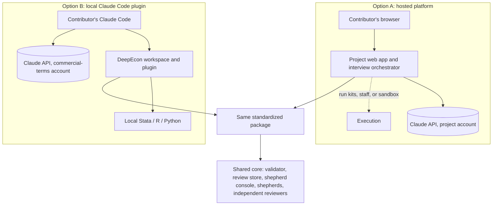

# Architecture Decision Brief: How Economists Will Contribute

**DeepEcon Research Benchmark (working title) · Deliverable 7 · Draft v0.3.0 for discussion with collaborators · 2026-11-05**

| | |
|---|---|
| **Status** | **Proposed.** Nothing here is decided. The research lead and collaborators decide; see the [decision log](../decisions/decision-log.md). v0.3.0 integrates four independent reviews: an advocate for each option, an econometrician, and a benchmark methodologist (§11). |
| **Question** | Should economists contribute through a **hosted web platform we operate** (Option A), through a **Claude Code plugin they run locally** (Option B), or should we pilot both first? |
| **Basis** | [Option A design](option-a-hosted-platform.md) · [Option B design](option-b-local-skill.md) · [cost and effort model](cost-and-effort-model.md) · [submission](submission-mechanisms.md) · [bilingual design](bilingual-design.md) · [construction protocol](../methodology/benchmark-construction-protocol.md) · [verifier validation](../methodology/verifier-validation-protocol.md) · [interview protocol](../interview/expert-interview-protocol.md) · [pilot plan](../pilot/pilot-evaluation-plan.md) · [evidence notes R1–R9](../research/evidence/) |

---

## 1. Executive summary

**What we are deciding.** Only the *contributor-facing layer*: where the AI-guided interview runs, where code runs, who pays for the model, and who holds the materials. The scientific method is the same under both options and is specified separately: the interview protocol, the correct and flawed packages, verifier validation, and independent review.

**What the analysis shows.**

1. **The interface matters less than the shared method.** Both options run the same interview protocol, produce the same schema-valid package, and feed the same internal pipeline, in which a benchmark-team *shepherd* turns each candidate into a verified task. The shared core costs about 10–17.5 engineer-weeks whichever option we choose. **Beyond it, engineering effort is comparable:** about 12–19.5 engineer-weeks for A and 11.5–20.5 for B.
2. **Money is not the main differentiator.** The AI interview costs about **$13–17 per contribution** at API list prices (range $5–46), or about $3,400 for 200 contributions. Human effort and validation dominate: about **8,000 shepherd-team hours**, 3,000 outside-economist hours, and **$100,000 of validation-trial compute** at 200 contributions (central estimates [U]). Whether the architecture changes shepherd hours is untested and could outweigh every other cost difference.
3. **Five real differences separate the options:**

   | Difference | Option A (hosted) | Option B (local) |
   |---|---|---|
   | Access | A browser; about 15–35 minutes before the interview, nothing to install | Claude Code (terminal, or the desktop app's Code tab) and a downloadable workspace; about 31–66 minutes before the interview |
   | Code execution | The contributor's own environment, including Stata, through run kits (a round trip per run); staff machines; optional R/Python sandbox | The contributor's own environment, including Stata, with the model iterating in the session |
   | Consistency | The whole interviewer configuration (prompt, tools, model, effort) fixed server-side | Model pinned, switch-blocked, and recorded; client version and contributors' user-level configuration vary and are recorded |
   | Custody | The project and its processors hold uploads, drafts, and transcripts from the first session | Drafts stay local; the project receives the same package at submission; local hidden-tier copies persist unless purged |
   | Research on the interview | All consented sessions observable, including abandoned ones; randomization on the server | Metrics only from submitted packages; assignments visible to the contributor |

   Under both options Anthropic receives whatever the model reads.
4. **Three constraints bind both options.**
   - **Regional policy.** Anthropic's Supported Regions Policy (effective 2026-11-12) does not cover mainland China, Hong Kong, or Macau, and its Usage Policy prohibits facilitating access there "(including end users)". Neither option can serve contributors located there with Claude. The constraint is equal; the fallbacks are not (§6).
   - **AI influence on experts.** In a 2026 study, analysts with causal-inference experience followed an AI agent's secretly randomized lean on design choices 86% of the time and rarely credited it. The interview protocol therefore *measures* influence rather than trusting self-reports.
   - **Exposure of hidden material.** The proposed rule is that any session that sees flawed variants or answer keys runs under commercial no-training terms. Option A meets it by construction. **Option B then needs commercial-terms access** from the project (if Anthropic's terms permit it, O-018) or from contributors' institutions; consumer plans are not enough.
5. **Other shared risks:** shepherd capacity; contamination of tasks derived from public papers; and a name collision with an existing econometrics package called "deepecon".

**Recommendation (argued in §9, after the comparison).**
- Build the shared core first.
- Start the legal and terms inquiries now; they gate both options (O-007, O-018).
- Pilot **thin slices of both options on the same paper**, with symmetric thresholds registered in advance, plus a methodology arm that tests the construction pipeline itself.
- If the group must choose before the pilot, contributors' fluency with developer tools decides. For the senior cohort the brief targets, the lower-downside choice is **Option A** until the pilot's setup test shows that they or their research assistants are fluent. For a fluent cohort, **Option B with commercial-terms access**.

**Decisions needed now** (§10): pilot both or a cheaper variant; the exposure rule; release policy; who pays for model access; legal and terms review; shepherd staffing; contributor credit; project name.

## 2. The two options in brief

**Option A — hosted platform.** The contributor signs in with an e-mail link or ORCID, attests their location, uploads the paper and code, and conducts the interview in the browser. A progress display and a live dossier panel show who said what. Code runs by one of three routes:
- *run kits* on the contributor's or a research assistant's machine, including Stata (A1);
- on staff machines during shepherding;
- in a hosted R/Python sandbox for public data (A2).

The project pays for one pinned model under commercial terms. Variants under study: materials held in the browser until submission, an EU-region model route, and in-browser execution (Option A §3.3).

**Option B — local plugin.** The contributor installs Claude Code, downloads the DeepEcon workspace (which registers the plugin), places the replication package in it, and opens it. The model reads the local paper and code, drafts flawed variants in a separate folder, and runs them in the contributor's own Stata, R, or Python. Layered safeguards keep the original package untouched, with a checksum check as the backstop. Variants: Claude Code on the web for public-data R/Python packages, Remote Control or SSH sessions that keep execution on a research assistant's machine, and deferring operationalization to staff (Option B §3.2).

## 3. Side-by-side comparison

*Table 1. Comparison on the research lead's twelve dimensions, plus one the reviews added.* Ratings are qualitative judgments on verified evidence; † marks dimensions the pilot is designed to test.

| Dimension | (1) Option A — hosted platform | (2) Option B — local plugin |
|---|---|---|
| **Scientific quality: consistency** | **Strong.** The whole interviewer configuration is fixed: prompt, tools, model, effort level. A flagged turn may be answered by a fallback model unless refusals are left to stand (the same for B). | **Moderate.** The model is pinned, switch-blocked, and recorded by the workspace, and enforced only with managed settings or a gateway. The client version, Claude Code's own system prompt, and contributors' user-level instructions, skills, plugins, and MCP servers vary; they are recorded per package. |
| **Scientific quality: evidence anchoring** | **Good.** Line-referenced discussion of uploaded code; execution happens outside the conversation. | **Strong.** The model reads and runs code in the real environment, including Stata, and iterates in the session. |
| **Contributor accessibility** † | **High for the interview:** browser only, about 15–35 minutes before it starts. Code execution still needs a contributor, RA, staff member, or sandbox. | **Lower:** about 31–66 minutes of setup and commercial-terms access. The desktop app's Code tab is the no-terminal path for the conversation, but the workspace is still required. Variants: web sessions for public-data R/Python; Remote Control or SSH so execution stays on an RA's machine (these need Team or Enterprise seats under the exposure rule); deferring execution to staff. |
| **Expert engagement** † | Guided, with line-referenced code discussion. | Hands-on, with in-session execution. |
| **Development effort** (beyond the shared core) | ≈ 12–19.5 engineer-weeks (A1 + staff execution); sandbox +1.5–3 (managed) or +3–6 (self-built) | ≈ 11.5–20.5 engineer-weeks, including the upload endpoint, project page, subagents, and helper binaries |
| **Operating costs (project)** | ≈ $13 inference per contribution (A1, staff), $17 with a sandbox; hosting ≈ $13–210 a month; 0.1–0.25 FTE; evaluation inference ≈ $1,500 a year | ≈ $17 inference per contribution with project-provided access, $0 with institutional access; hosting ≈ $0–5 a month; 0.1–0.2 FTE; evaluation inference ≈ $3,100 a year; more support time |
| **Cost distribution** | The project pays for inference, hosting, operations, and staff or sandbox execution; contributors provide their time and, under A1, their own software and compute. | The project or contributors' institutions pay for commercial-terms access; contributors provide their own software and time. |
| **Privacy and confidentiality** | The project and its processors (hosting, database, storage, tracing, error tracking) hold uploads, drafts, and consented transcripts from the first session; EU hosting proposed, API data at rest in the US; deletion on withdrawal. No data upload with run kits. | Nothing reaches the project before submission; it then receives the same package as under A. Unread files stay local; hidden-tier copies persist on the contributor's machine unless purged. |
| **Reproducibility** | Final verification is identical under both options: central re-runs and a clean-room check. Contributor-side outputs come from heterogeneous machines under A1, and from project machines under staff execution and A2. | As A for final verification. Contributor-side outputs come from heterogeneous machines, with metadata captured. |
| **Quality control** | The free-recall lock, suggestion gate, and role separation are enforced server-side; the taxonomy and known-valid controls never reach the contributor; validation at upload. | Enforced by the helper's state machine, subagents, and instructions; the taxonomy and controls are readable in the plugin unless served from a project endpoint; local and intake validation. |
| **Version management** | Instant central updates; protocol pinned per contribution. | Auto-update enabled by the workspace (to be tested), on the client's stable channel; protocol pinned per contribution by the workspace snapshot; versions recorded per package. |
| **Scalability and sustainability** | Linear inference cost; central support; needs funded operations and a sunset plan. The model provider is replaceable behind the orchestrator. | Uses contributors' compute; support grows with environment diversity; tied to Claude Code (another tool loses hooks, permissions, and packaging), but the portable skill runs elsewhere without project hosting. |
| **Research on the interview** (influence, drop-off, protocol experiments) | **Strong.** All consented sessions observable, including abandoned ones; randomization on the server. Every AI-interview platform reviewed is hosted. | **Limited.** Metrics only from submitted packages; assignments sit in files the contributor can read. |

*Notes:* FTE = full-time equivalent. Engineering figures and setup times are planning estimates [U]. Prices are Anthropic and vendor list prices verified on 2026-11-05. The regional policy applies to both columns.

## 4. Key trade-offs

1. **Consistency versus reach.** Option A gives every contributor the same interviewer, which makes contributions comparable and the protocol testable. Option B reaches people in their own tools and pins and records the model, but project-provided access standardizes only the data terms and, with managed settings, the model, not the client or contributors' own configuration. Provided access moves inference (about $3,400 at 200 contributions) to the project. With comparable engineering, B's remaining cost advantages are small hosting costs and lighter custody during drafting, partly offset by more support and onboarding.
2. **Who runs the code.** Both options can use the contributor's own Stata. Option B lets the model iterate on a run within the session, which is where building a flawed variant and measuring its consequence is easiest; A1 needs a round trip per run, and staff execution moves the work onto shepherds. If research assistants do most of the execution, B's execution advantage matters most for them. Symmetrically, if research assistants install and operate Claude Code, B's setup burden also falls mostly on them, although the economist still installs Claude Code for the interview unless a Remote Control setup proves workable [U]. *Good Benchmarks* argues that domain experts and task builders are different roles.
3. **Custody versus dispersion.** Under both options Anthropic receives whatever the model reads, and the project receives the submitted package. Option A additionally holds drafts, abandoned contributions, and transcripts on project servers and processors, with the security and data-protection duties that brings. Option B leaves drafts, and hidden-tier copies, on contributors' machines.
4. **Building and operating versus supporting.** Engineering effort is comparable. Option A operates and secures a web service and its project API account. Option B supports varied operating systems and software, keeps a plugin compatible with a client that ships several releases a week (on its stable channel), runs a small upload service, and spends more on re-evaluating the interviewer per certified client release.
5. **Who pays, and on what terms.** Inference is cheap either way. The substantive question is whether contributor sessions run under commercial terms (no training on inputs) or consumer terms (training unless the user opts out). For a benchmark with hidden answers that is a question of scientific integrity, so the proposed exposure rule requires commercial terms wherever hidden material is handled. Option A satisfies it by construction; Option B depends on project-provided access (O-018) or institutional accounts.
6. **Studying the interview.** The protocol's influence and drop-off measures are research outputs in their own right. Option A can observe every consented session and randomize centrally; Option B sees only what contributors submit.

## 5. Costs and effort

| Category | Option A | Option B | Shared (either option) |
|---|---|---|---|
| Initial development | ≈ 12–19.5 engineer-weeks; sandbox +1.5–3 (managed) or +3–6 (self-built) | ≈ 11.5–20.5 engineer-weeks | Core ≈ 10–17.5 engineer-weeks, including the shepherd console |
| Fixed operating | Hosting ≈ $13–210 a month; 0.1–0.25 FTE | Hosting ≈ $0–5 a month; 0.1–0.2 FTE | Internal review store: small |
| Variable per contribution (project) | ≈ $13 inference (A1, staff) or ≈ $17 (A2) | ≈ $17 with project-provided access; $0 with institutional access | Validation-trial compute ≈ $500 per admitted task ($250–750) |
| Evaluation inference (interviewer regression suite) | ≈ $1,500 a year | ≈ $3,100 a year (monthly certification) | — |
| Contributor-side | Time; under A1, own compute and software | Time; installation; own software | — |
| Human effort | Staff execution adds ≈ 4 shepherd hours per contribution | Contributors pre-run part of the operationalization [U] | ≈ 10 shepherd-team hours per contribution for screening, plus ≈ 30 per admitted task; ≈ 8 reviewer and ≈ 15 outside-economist hours per admitted task |

**At 200 contributions (central estimates [U]):**

| Item | Estimate |
|---|---|
| Interview inference | ≈ $3,400 (≈ $2,600 under A1 or staff execution) |
| Validation-trial compute | ≈ $100,000 ($10,000–225,000) |
| Shepherd-team effort | ≈ 8,000 hours (1,600–22,000), plus ≈ 800 under A's staff execution |
| Reviewers | ≈ 1,600 hours |
| Outside economists (blind solves, classification, calibration) | ≈ 3,000 hours |
| Support | ≈ 150 hours (A) versus ≈ 200 hours (B) |

v0.2 of this brief understated human effort (it counted 20 shepherd hours per admitted task and ignored dropped candidates, outside economists, and validation compute) and overstated the engineering gap between the options. Funding sources exist for model use, for example AI for Science credits of up to $50k per project; they matter most for validation compute. All assumptions are in the [cost and effort model](cost-and-effort-model.md).

## 6. Major risks

Rows cover every risk the reviews identified as decision-relevant for either option. Each option's full register, under one inclusion rule, is in its design document.

| Risk | Affects | Likelihood | Impact | Mitigation |
|---|---|---|---|---|
| Contributors in mainland China, Hong Kong, or Macau cannot be served with Claude | Both | Certain for those located there | High for that group | Legal review (O-007). Fallbacks are unequal: A needs a second provider integration, a China-reachable host, and duties as custodian under China's Personal Information Protection Law (PIPL); B's portable skill runs in other agent tools without project hosting. Neither has model parity |
| Interview leads experts or fabricates errors (experts followed a planted AI lean 86% of the time in a 2026 study) | Both | High without safeguards | High | Free-recall lock before suggestions; exposure tracking; measured influence with known-valid controls; independent status classification; human-authored task text; randomized suggestion experiment in the pilot |
| Shepherd capacity limits throughput (≈ 8,000 hours at 200 contributions; Stata ports add work) | Both | High | High | Staffing plan (O-009); tooling; quality over quantity |
| Tasks from public papers become solvable by memory or recognition | Both | High | High | Offline environments; recognition probe; restructured presentations; answer-changing hidden variants on data the agent never sees; private held-out split |
| Hidden material reaches model training or the public | Both; B more exposed (account types, local copies) | Low if the exposure rule holds | High | Commercial no-training terms for every session that sees hidden material; exposure log; purge of local copies (B) |
| Engineering takes longer than planned | A (Medium–High); B (Medium) | See left | Medium | Narrow minimum viable products (MVPs); proven components (A); early tests of the client features B relies on (B) |
| Non-technical economists do not complete setup | B | Medium–High; high if the cohort is senior and non-technical | High | Desktop app; typing-free workspace; research-assistant mode; onboarding sessions; hosted onboarding (H1) |
| Hand-offs stall the operationalization of errors | A (run kits) and B (research-assistant mode) | Medium | Medium–High | Staff execution under either option; sandbox or web sessions for public data; Remote Control or SSH (B) |
| Interviewer configuration drifts (client version, user-level configuration) | B | Medium | Medium–High | Pinned and recorded model; configuration recorded per package; pre-flight warnings; per-model evaluations |
| Long interview degraded by context compaction | B | Medium | Medium | Core rules first in the skill; state re-injection |
| Breach of unpublished code, drafts, or transcripts | A (held from upload); B (submitted packages, local copies) | Low–Medium | High | Encryption, minimal retention, processor agreements (A); purge step and deletion agreement (B) |
| Project API account suspended or capped (one user's breach can suspend the account) | A; B with project-provided keys | Low–Medium | High: interviews stop | Location attestation and country checks; separate evaluation workspace; spend alerts; Scale tier before recruitment waves |
| Operating burden persists after the grant period | A | Medium | Medium | Small stack; managed services; sunset plan |
| Interview less evidence-anchored than with local code access | A | Medium | Medium | Code index and viewer; staff execution; sandbox; research-assistant mode |
| Terms do not allow project-provided access for external contributors | B | Low–Medium: a definitional question about "authorized users" | High: B then depends on institutional accounts or on relaxing the exposure rule | Ask Anthropic (O-018); identify institutional accounts early |
| Terms bar the server-side Agent SDK variant (H2) | Hybrid H2 | Medium–High: an explicit bar on paying for end users' usage | Medium | Use a shared protocol with separate hosts instead; ask Anthropic (O-018) |
| Name collision ("deepecon" Python package) | Both | Certain | Medium | Rename before public launch (O-014) |

## 7. When each option is preferable

**Option A is preferable if:**
- most contributors are senior and not fluent with developer tools, and their research assistants will not operate such tools either;
- comparability of interviews, and research on the interview itself, are research goals;
- the project can fund engineering and multi-year operations;
- contributors are comfortable entrusting drafts and unpublished code to the project from the first session;
- shepherds will handle most code execution.

**Option B is preferable if:**
- most contributors, or their research assistants, are technically fluent;
- packages depend heavily on local environments such as Stata, and in-session iteration on flawed variants matters;
- commercial-terms access is available, from the project (subject to O-018) or from contributors' institutions;
- contributors prefer that drafts never sit on project servers;
- operations capacity after the grant period is small.

**Neither option removes:**
- the regional constraint;
- the need for shepherds, outside economists, and independent reviewers;
- the release-policy decision;
- the contamination controls and the exposure rule.

## 8. Hybrid strategies (considered, not substitutes for the A/B comparison)

| Hybrid | Idea | Main benefit | Main cost or risk |
|---|---|---|---|
| H1 Website plus plugin | Option B with hosted onboarding, documentation, and submission | Better first impression and support for B | Still requires local setup and commercial-terms access |
| H2 One protocol, two hosts | The same six-field skill runs locally (B) and server-side through the Claude Agent SDK (A) | One interview codebase; cheap to prototype both | Technically feasible, but Anthropic's terms for running Claude Code in products bar the customer from paying for end users' usage. Needs confirmation (O-018). A shared *protocol* with separate hosts (the Messages API for A) avoids this. |
| H3 Split by role | Economists use the hosted interview; RAs and shepherds use the local plugin to operationalize errors | Plays to each option's strength; matches the division between domain expert and task builder | Two surfaces to maintain; a hand-over between them |
| H4 Split by contributor | Hosted interview for non-technical contributors, local plugin for technical ones | Maximizes reach | Two interviewer configurations to keep comparable |

Terminal-Bench-Science already runs a hybrid of this family. Contributors start with hosted intake (a web form, community channels, office hours), then build and test tasks locally and submit them as pull requests [P-full].

## 9. Recommendation

1. **Build the architecture-independent core now:** protocol assets, schema, validator, packager, internal review store, and shepherd console. Every scenario needs them, and scientific quality depends on them most.
2. **Start the legal and terms inquiries immediately.** Ask how the regional policy applies to the intended contributors and what diligence is expected (O-007), and whether the project may provide API access to external contributors as its "authorized users" (O-018). Under the proposed exposure rule, the second answer decides whether Option B can run as designed without institutional accounts.
3. **Pilot thin slices of both options** on one paper, using the [pilot plan](../pilot/pilot-evaluation-plan.md)'s symmetric thresholds, registered before the first session. *Why both:* the decisive questions are empirical. Will senior economists, with designed onboarding, complete setup? Do run kits and research-assistant hand-offs stall? Do the options differ in validated variants, output quality, or measured AI influence? With the core in place, the second slice costs roughly **8–14 engineer-weeks** [U] (v0.2 said 4–9), which is still small next to building the wrong full system and operating it for years.
   - If engineering capacity is the binding constraint, a cheaper variant builds one slice plus setup and hand-off probes of the other. It cannot compare output quality or influence between the options (O-019).
   - Either way, add the pilot's **methodology arm**: every candidate that reaches a run flawed variant with a material consequence (or a random sample of at least six, stratified by arm) goes through validation rungs L0–L12, because the construction pipeline's yield and cost are at least as uncertain as the architecture.
4. **If a choice must be made before the pilot,** contributors' fluency with developer tools decides:
   - The brief targets senior economists. Until the setup test shows that they or their research assistants are fluent, the lower-downside choice is **Option A** (run kits plus staff execution). Its main failure mode, stalled hand-offs, comes after the interview and has a staff fallback; B's, abandoned setup, comes before any content exists.
   - For a fluent cohort, or one whose research assistants are fluent and will operate the tools, **Option B with commercial-terms access** (from the project if O-018 permits, or from institutions) offers better evidence anchoring and in-session execution at comparable engineering cost.
5. **The end state may be H1, H3, or H4.** Choose on pilot evidence.

## 10. Decisions needed before implementation

| ID | Decision | Why now |
|---|---|---|
| O-002 · O-019 | Pilot both slices, choose one option now, or pilot one slice plus probes of the other | Determines the scope and cost of Phase 5 |
| P-026 | Approve or relax the exposure rule for hidden material | Determines Option B's access requirements and the private split's integrity |
| O-007 | Legal review: regional policy, expected diligence, and the intended contributors | Gates recruitment under both options |
| O-018 | Terms review: project-provided access for external contributors; the server-side Agent SDK variant | Gates Option B as designed, and H2 |
| O-001 | Release policy: public, private, or public development set plus private held-out set | Constrains submission channels and leakage controls |
| O-006 | Who pays for contributors' model access in Option B | Determines B's consistency, terms, and cost |
| O-009 | Shepherd, reviewer, and outside-economist staffing | The dominant cost and throughput constraint |
| O-005 | Contributor credit and incentives | Recruitment of senior economists |
| O-003 · O-004 · O-017 | First-release task scope; "one-sentence-fact" tasks; whether the interview offers AI suggestions | Shapes what the interview must elicit |
| O-008 · O-013 | Pilot paper; ethics review | Prerequisites for the pilot |
| O-014 | Project name | Before any public launch |

## 11. Changes from v0.2

Four independent reviews (2026-11-05) found that v0.2 compared the options on unequal assumptions in several places, and understated the shared human effort. Corrections:
- **Engineering** is comparable once Option B's upload endpoint, project page, subagents, and binaries are counted, the shepherd console moves to the shared core, and A's run kits get the same cross-platform testing as B (v0.2: 12–19 against 8–14 engineer-weeks).
- **Custody** is stated symmetrically: both options send what the model reads to Anthropic, and the project receives the same package; A also holds drafts with its processors, B leaves copies on contributors' machines.
- **Consistency** credits B's documented pin, block, and record controls, and states what provided access does not standardize.
- **Accessibility** adds B's variants and both options' setup times; **code execution** credits A1's use of the contributor's Stata.
- New dimensions and risks: research on the interview (A's advantage); quality control enforced server-side versus by instructions; A's engineering, operating, and account-suspension risks; B's hidden-tier copies and research-assistant hand-offs; unequal China fallbacks; the terms risk split between project-provided keys and H2. The auto-mode risk was removed (the workspace disables auto mode).
- **The exposure rule** makes commercial-terms access a requirement for B.
- **Costs:** shepherd-team effort doubled to include dropped candidates; outside-economist hours and validation-trial compute added; route-specific inference; maintenance and evaluation inference for both options.
- **Recommendation:** the research-assistant argument is applied symmetrically; the end state is left open among H1, H3, and H4; the second pilot slice is costed at 8–14 engineer-weeks, with a cheaper variant as an open question.
