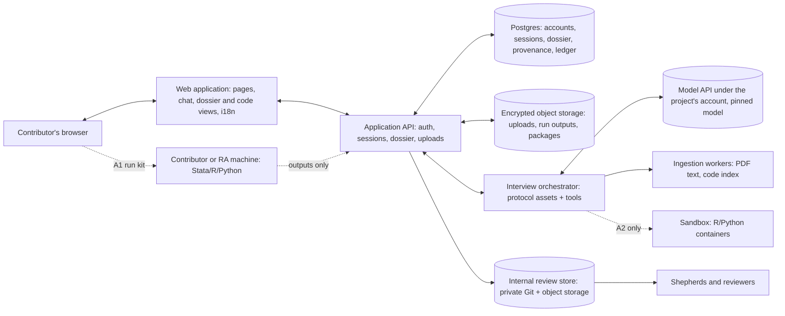

# Deliverable 5 — Option A: Hosted Contributor Platform

| | |
|---|---|
| **Status** | **Proposed design** v0.1.0 (2026-11-05). One of two candidate architectures; **not selected**. Comparable in depth and assumptions to [Option B](option-b-local-skill.md). |
| **Shared foundations** | [Construction protocol](../methodology/benchmark-construction-protocol.md) · [Interview protocol](../interview/expert-interview-protocol.md) · [Schema](../../schemas/README.md) · [Submission](submission-mechanisms.md) · [Bilingual design](bilingual-design.md) · [Cost and effort model](cost-and-effort-model.md) |
| **Evidence** | Hosted stack and compliance: [R9](../research/evidence/R9-hosted-stack-and-compliance.md). Access and policy: [R3](../research/evidence/R3-access-pricing-policy-portability.md). Claude API facts come from Anthropic's API reference as of 2026-10-06. Items marked [U] await confirmation. |

---

## 1. Summary

The project operates a **bilingual web application**. A contributor signs in, uploads the paper and the replication code, and conducts the interview in the browser. The model runs on the project's API account with a pinned version and fixed settings. The application keeps the dossier in a database with full provenance and produces the same standardized package as Option B.

The decisive design question is **code execution**. A hosted interview does **not** require hosted execution, so two variants are specified:

- **A1 — hosted interview, execution under the contributor's control.** The platform generates "run kits" (patch plus run script); the contributor or their research assistant runs them locally and uploads the *outputs*, never the data.
- **A2 — hosted interview plus a hosted sandbox** for R and Python, when the data are public and redistributable.

**Proposed MVP: A1**, with A2 added if the pilot shows that hand-offs stall operationalization (pilot PQ4).

| Property | Option A |
|---|---|
| Where the interview runs | Project servers → model API under the project's account |
| Where code runs | A1: contributor's or RA's machine; A2: project-operated sandbox (R/Python only) |
| Who pays for inference | The project |
| What the project operates | Web application, database, file storage, model orchestration, (A2) sandbox, internal review pipeline, support |
| Model consistency | Enforced: one pinned model and configuration for everyone |

## 2. Contributor experience

### 2.1 Journey (the brief's 10 steps, refined)

| # | Step | What the contributor sees and does | Typical time [U: to be measured in the pilot] |
|---|---|---|---|
| 1 | Open the site | Landing page (English / 中文) | — |
| 2 | Read the introduction | Motivation, what a contribution involves, credit policy, data-flow summary | 5–10 min |
| 3 | Choose a language | Switcher on every page; remembered | — |
| 4 | Sign in, consent | E-mail magic link (optionally ORCID [U]); consent and data-flow disclosure (S0) | 3–5 min |
| 5 | Choose a paper | Curated collection (Path A) or own paper (Path B) | 2–5 min |
| 6 | Provide materials | Upload the paper PDF and the replication code (ZIP); declare data availability; restricted data are not uploaded | 5–15 min |
| 7 | Interview | Stages S1–S4 and S6 in a chat pane, with a progress bar and a live dossier panel showing provenance badges; a code viewer highlights cited files and lines | 1.5–3 h, across sessions |
| 8 | Operationalize | A1: download a run kit, run it (or have an RA run it), upload outputs; A2: the sandbox runs reference and variant | A1: 0.5–2 h, possibly days of waiting; A2: minutes |
| 9 | Review | Dossier review screen in the contributor's language; edit, reject, withdraw | 15–30 min |
| 10 | Submit | One button; confirmation e-mail; later, shepherd feedback in the platform | 1 min |

### 2.2 Research-assistant mode

The economist invites an RA to the contribution. The RA sees the run kits and the hand-off specification, executes them, and uploads outputs. The economist approves the results in the review screen. Provenance attributes each action.

## 3. Architecture

### 3.1 Diagram

### 3.2 Reference stack and alternatives (pending R9)

| Layer | Reference choice (proposed) | Alternatives |
|---|---|---|
| Web and API | TypeScript web framework with server rendering and API routes (e.g., Next.js) [U] | Separate Python API (e.g., FastAPI) with a lighter frontend |
| Internationalization | ICU-message library integrated with the framework (e.g., `next-intl`) [U] | `react-i18next`, FormatJS |
| Authentication | E-mail magic links via an auth library or service; optional ORCID sign-in [U] | Institution SSO later |
| Database | Managed Postgres | — |
| File storage | S3-compatible object storage, server-side encryption, presigned uploads | — |
| Orchestration | Claude API with tool use (tools: read file, search code, update dossier, record suggestion, request execution), streaming, prompt caching | Claude Agent SDK running the **same skill** as Option B on the server, each session in an isolated container [U: feasibility per R2]; or Anthropic Managed Agents (beta) |
| Sandbox (A2) | Container sandbox service with per-session isolation and resource limits [U: provider per R9] | Managed Agents' per-session container ($0.08 per session-hour plus tokens; beta; first-party API only) |
| Observability | Error tracking plus LLM tracing (token use, cost per session) | Self-hosted tracing |
| E-mail | Transactional e-mail service | — |

**Simplest credible alternative.** Build Option A's orchestration on the Claude Agent SDK running the *same* plugin as Option B inside per-session containers. This would make the two options share almost all interview code, at the price of operating containers even for A1 [U: per R2].

## 4. Functional decomposition (identical to Option B's table)

| Function | How Option A provides it | Runs where | Who pays |
|---|---|---|---|
| F1 Onboarding and consent | Web pages + S0 screen | Project | Project |
| F2 Identity | Accounts (magic link, optional ORCID) | Project | Project |
| F3 Materials ingestion | Upload; PDF text extraction; code indexing | Project | Project |
| F4 Interview engine | Orchestrator + pinned model | Project → model API | Project |
| F5 State and provenance store | Database | Project | Project |
| F6 Code execution | A1: contributor/RA machine via run kits; A2: sandbox | A1 local; A2 project | A1 contributor; A2 project |
| F7 Validation | Server-side validator (schema, leakage, comparisons) | Project | Project |
| F8 Packaging | Server-side packager | Project | Project |
| F9 Submission | In-app submit → internal review store | Project | Project |
| F10 Review and feedback | Shepherd console; comments; follow-up sessions | Project | Project |
| F11 Internationalization | i18n framework + locale assets | Project | Project |
| F12 Telemetry and cost control | Per-session token budgets, rate limits, cost dashboards | Project | Project |
| F13 Support and updates | Central deployment; documentation; support inbox | Project | Project |

## 5. How the expert interview operates

### 5.1 Protocol hosting

The orchestrator assembles the system prompt from the shared protocol assets (stage cards, probe library, pitfall taxonomy, glossary) for the chosen locale. The model reaches the materials through tools rather than by holding everything in context: file listing, file reading with line numbers, code search, and PDF page retrieval. The model updates the dossier only through schema-validated tool calls (`update_dossier`, `record_suggestion`, `record_prediction`), which enforce provenance.

### 5.2 Model selection, consistency, and cost control

- **One pinned model** (e.g., Claude Opus 5.5 at a fixed effort level) and one protocol version per release. Every contributor gets the same interviewer, which makes contributions comparable and protocol evaluations meaningful.
- **Prompt caching** for the stable prefix (protocol, paper, code index). The one-hour cache lifetime suits human response gaps (writes cost 2× base input, reads 0.05× on Opus 5.5).
- **Budgets:** per-session token and dollar caps, with graceful checkpointing when a cap is reached.
- **Refusal handling:** server-side fallback configuration, per the provider's guidance.

### 5.3 State, provenance, and resumption

The dossier, suggestion ledger, and checkpoints live in the database. Sessions resume from the last contributor-confirmed summary. Transcripts are retained only with consent.

### 5.4 Bilingual behaviour

Per the [bilingual design](bilingual-design.md): framework message catalogs for the interface; locale assets for probes and templates; glossary-anchored model output; originals preserved; English working translations labelled.

## 6. Replication materials

### 6.1 Ingestion and protection of originals

Uploaded originals are stored immutably (write-once objects with checksums). Variants are stored as patches against them. Nothing on the server ever edits an original.

### 6.2 Execution variants

| | A1 — execution under the contributor's control | A2 — hosted sandbox |
|---|---|---|
| What runs where | Run kit (patch, run script for Stata/R/Python, output template) on the contributor's or RA's machine | Isolated R/Python containers operated by the project |
| Data movement | None: only outputs (results JSON, logs) are uploaded | Public, redistributable data uploaded and run server-side |
| Stata | Works under the contributor's licence | Needs a Stata licence valid for server or container use [U: per R9]; otherwise R/Python only |
| Contributor effort | Manual step; possible days of delay; RA-friendly | None |
| Engineering | Run-kit generator, output parser | Sandbox integration, quotas, security hardening |
| Risk | Hand-off friction may stall S5 | Security of executing uploaded code; cost; licensing |

### 6.3 Restricted data

The S0 disclosure forbids uploading restricted or confidential microdata (DP-28). Upload screens require a data-availability declaration and reject data-file types unless the data are declared public. Run kits make it unnecessary to upload any data for A1.

## 7. How correct and flawed packages are produced

| Artifact | Produced by | How |
|---|---|---|
| Reference implementation | Contributor/RA (A1) or sandbox (A2) | A1: run kit executes the original package; outputs uploaded. A2: sandbox run |
| Independent check | Shepherd | Cross-language re-implementation in the internal pipeline |
| Flawed variants | The model drafts the minimal diff; the contributor approves it in a diff viewer | Stored as a patch; executed through a run kit (A1) or the sandbox (A2) |
| Consequence evidence | Server-side comparison | Pre-registered materiality rule; optional resampling (A2) |

## 8. Validation

Server-side: schema validation, leakage scan, integrity checks, comparisons against predictions. Results are shown to the contributor immediately and repeated in the internal pipeline.

## 9. Submission

In-app submission writes the package directly into the internal review store; no separate submission database is needed beyond the application's own. Contributors can also download their package at any time.

## 10. Privacy, confidentiality, and licensing

| Data | Leaves the contributor's machine? | To whom | Under which terms |
|---|---|---|---|
| Paper, code, declarations, interview text | Yes | Project servers (region to be chosen) | Project privacy notice and retention policy |
| The same, as needed for each turn | Yes | Model provider, under the **project's** commercial account | Commercial terms: no training on inputs by default [U: confirm current terms and default retention per R3]; data residency options for US-only inference at a 1.1× price |
| Data (A1) | No | — | — |
| Data (A2), public only | Yes | Project sandbox | Project terms |

**Key points.**

- The project becomes the custodian of unpublished code and interview transcripts. That brings security obligations and, for EU and Chinese contributors, data-protection obligations (GDPR; China's cross-border transfer rules) [U: per R9].
- In exchange, data-use terms are uniform and favourable for benchmark integrity: no consumer-account training exposure.

## 11. Third-party dependencies

| Dependency | Role | Risk |
|---|---|---|
| Model provider API | Inference | Pricing and model changes; refusals; regional policy for serving end users (O-007) |
| Hosting platform, database, object storage | Application | Vendor lock-in (moderate); cost growth (small at this scale) |
| Sandbox provider (A2) | Execution | Security; cost; licensing |
| Auth and e-mail services | Identity | Deliverability in some regions [U] |
| Observability services | Operations | Data handling of traces (transcripts) |

## 12. Costs (assumptions shared with Option B; details in the [cost model](cost-and-effort-model.md))

| Cost | Who pays | Order of magnitude |
|---|---|---|
| Inference per contribution | Project | About $6–46 at Opus 5.5 list prices with prompt caching, central ≈ $17 |
| Hosting (app, database, storage, e-mail, observability) | Project | Tens to low hundreds of dollars per month at pilot-to-200-contributor scale [U: per R9] |
| Sandbox (A2) | Project | Small per contribution; for example, Managed Agents' session-hour charge is $0.08 plus tokens |
| Development | Project | See §13 |
| Operations and security | Project | Ongoing fraction of an engineer; periodic security review |
| Contributor-side | Contributor | None beyond time (A1: their own compute and Stata licence for run kits) |
| Shepherding and review | Project | Same as Option B; likely the largest cost |

## 13. MVP build plan

| Component | Effort (engineer-weeks) [U: planning estimates] |
|---|---|
| Shared core: protocol assets, schema tooling, validator, packager, internal review pipeline | 9–16 (shared with Option B; counted once) |
| Web app shell, auth, i18n, layout and design system | 2–3 |
| Uploads, ingestion workers (PDF text, code index), materials viewer | 1.5–2.5 |
| Interview orchestrator: tools, state machine, streaming chat, caching, budgets | 2.5–4 |
| Dossier panel, provenance badges, review and diff screens | 1.5–2.5 |
| Run-kit generator and output intake (A1) | 1–1.5 |
| Shepherd console (minimal) | 1–1.5 |
| Security hardening, privacy notice, deployment, monitoring | 1.5–3 |
| **Option A-specific total (A1)** | **≈ 11–18**, plus the shared core |
| Hosted sandbox (A2), if added | +3–6 |

**Milestones:** (1) sign-in, upload, and S0–S1 with design map; (2) S2–S4 with dossier and provenance; (3) run kits and S5; (4) review and submission; (5) security review and pilot release.

## 14. Operations and maintenance

- **Versioning:** one deployment serves everyone; the protocol version is pinned per contribution, so updates never break sessions in progress.
- **Monitoring:** uptime, errors, token spend per session, cost dashboards, abuse protection.
- **Security:** dependency updates, access reviews, backups, incident response, deletion requests.
- **Support:** a single environment to support, plus A1 run-kit questions.

## 15. Scalability

From 10 to 200 contributors, the load (a few concurrent interviews) is modest for any modern hosting platform; costs grow roughly linearly with inference. API rate limits depend on the account's usage tier [U]. Project effort scales with shepherding (as in Option B) and, more slowly, with support. International reach depends on site reachability and on the provider's terms for serving users in each region (O-007).

## 16. Risks

| Risk | Likelihood | Impact | Mitigation |
|---|---|---|---|
| Engineering takes longer than planned | Medium–High | Medium | Narrow MVP (A1); reuse an open-source AI-interview platform or the Agent SDK [U: per R9/R2] |
| Breach of unpublished code or transcripts | Low–Medium | High | Encryption, minimal retention, access control, security review; no data upload in A1 |
| A1 hand-offs stall operationalization | Medium [U: pilot] | Medium–High | RA mode; reminders; A2 for public-data papers |
| Site unreachable or slow for some regions | Depends on population | High there | Hosting/CDN choice; legal review (O-007) |
| Provider terms restrict serving end users in some regions | Unknown [U: per R3] | High there | Legal review before recruitment |
| Operating burden persists after the grant period | Medium | Medium | Keep the stack small; managed services; a sunset plan |
| Interview less evidence-anchored than with local code access | Medium | Medium | Code index and viewer; A2; RA mode |

## 17. The brief's stated advantages and disadvantages, assessed

| Claim in the brief | Assessment |
|---|---|
| "More accessible experience for senior economists who do not use terminal-based AI tools." | **Likely true for the interview itself** (browser only, no installation). **Not automatically true for operationalization**: A1 still asks someone to run code locally. A2 removes that only for public-data, R/Python packages. |
| "Consistent model behaviour, centralized version control, standardized interactions, easier contribution management." | **True.** This is Option A's strongest scientific advantage: one model, one configuration, one protocol version, uniform data-use terms. |
| "Significant costs for inference, hosting, engineering, security, storage, maintenance, support." | **Mixed.** Inference and hosting are small in absolute terms (≈ $17 per contribution; modest monthly hosting). **Engineering, security, and maintenance are the real costs** (≈ 11–18 engineer-weeks beyond the shared core, plus ongoing operations). |
| "Handling of potentially sensitive research materials may be particularly challenging." | **True**, but bounded by design: A1 keeps data local; uploads are limited to code and documents; retention can be short. Unpublished code (Path B) remains the sensitive case. Under Option B the same code is sent to the model provider anyway, so the difference is the project's custody, not whether the material leaves the contributor's machine. |

## 18. Open questions specific to Option A

1. A1 or A2 for the MVP — or A1 now and A2 only for public-data papers later?
2. Build on the Claude API directly, on the Agent SDK with the shared plugin, or on Managed Agents (beta)? (R2, R9)
3. Hosting region(s), given EU and Chinese contributors, and the corresponding data-protection obligations (R9, O-007).
4. Retention period for uploads and transcripts.
5. Who operates and pays for the platform after the initial project period?
