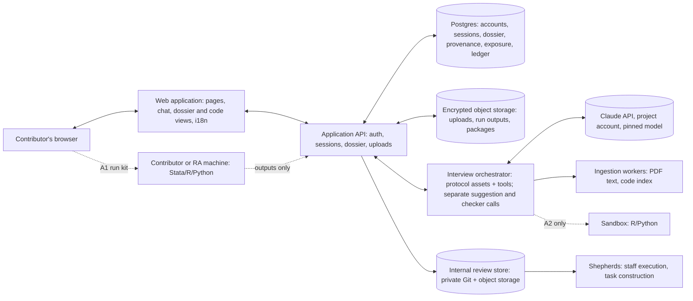

# Deliverable 5 — Option A: Hosted Contributor Platform

| | |
|---|---|
| **Status** | **Proposed design** v0.2.0 (2026-11-05). One of two candidate architectures; **not selected**. Comparable in depth and assumptions to [Option B](option-b-local-skill.md). v0.2.0 replaces v0.1.0's unverified claims with verified facts (§19). |
| **Shared foundations** | [Construction protocol](../methodology/benchmark-construction-protocol.md) · [Interview protocol](../interview/expert-interview-protocol.md) · [Schema](../../schemas/README.md) · [Submission](submission-mechanisms.md) · [Bilingual design](bilingual-design.md) · [Cost and effort model](cost-and-effort-model.md) |
| **Evidence** | Hosted stack, costs, compliance: [R9](../research/evidence/R9-hosted-stack-and-compliance.md). Terms and regions: [R3](../research/evidence/R3-access-pricing-policy-portability.md). Agent SDK: [R2](../research/evidence/R2-claude-code-platform.md). Software and data facts: [R8](../research/evidence/R8-replication-standards-and-econometric-pitfalls.md). Labels: [P-full], [P-page], [S], [U]. |

---

## 1. Summary

The project operates a **bilingual web application**. A contributor signs in, uploads the paper and the replication code, and conducts the interview in the browser. The model runs on the project's Claude API account, with a pinned model and fixed settings. The application keeps the dossier in a database with full provenance and produces the same standardized package as Option B.

The decisive design question is **who runs code**. A hosted interview does **not** require hosted execution. Stata appears in 71.6% of economics replication packages [S], and a hosted Stata deployment raises licensing problems. Three execution routes are therefore specified:

- **A1 — run kits under the contributor's control.** The platform generates a patch and run script. The contributor or a research assistant runs it locally and uploads the *outputs*, never the data.
- **Staff execution.** Shepherds run reference and variants on project machines during task construction. These are machines the project licenses for Stata where it holds suitable licences.
- **A2 — hosted R/Python sandbox.** For public, redistributable data only.

**Proposed MVP:** A1 together with staff execution. Add A2 if the pilot shows that hand-offs stall operationalization (pilot PQ4).

| Property | Option A |
|---|---|
| Where the interview runs | Project servers, calling the Claude API under the project's commercial account |
| Where code runs | A1: contributor's or RA's machine. Staff: project machines. A2: project sandbox (R/Python). |
| Who pays for inference | The project |
| What the project operates | Web application, database, file storage, model orchestration, (A2) sandbox, internal review pipeline, support |
| Model consistency | Enforced: one pinned model and configuration for everyone |

## 2. Contributor experience

### 2.1 Journey (the brief's 10 steps, refined)

| # | Step | What the contributor sees and does | Typical time [U: measure in the pilot] |
|---|---|---|---|
| 1 | Open the site | Landing page (English / 中文) | — |
| 2 | Read the introduction | Motivation, what a contribution involves, credit policy, data-flow summary, eligibility by location (§10.3) | 5–10 min |
| 3 | Choose a language | Switcher on every page; the choice is remembered | — |
| 4 | Sign in and consent | E-mail magic link, or ORCID sign-in (ORCID supports OpenID Connect; review the terms of its public API [S]); consent and data-flow disclosure (S0) | 3–5 min |
| 5 | Choose a paper | Curated collection (Path A) or own paper (Path B) | 2–5 min |
| 6 | Provide materials | Upload the paper PDF and the replication code (ZIP); declare data availability; restricted data are never uploaded | 5–15 min |
| 7 | Interview | Protocol stages S1–S4 and S6 (v0.2.0) in a chat pane, in sessions of at most 45–60 minutes. A progress bar and a live dossier panel show provenance and exposure badges; a code viewer highlights cited files and lines **after** the contributor has located them (ask before pointing) | 1.5–3 h over 3+ sessions |
| 8 | Operationalize | A1: download a run kit, run it or have an RA run it, upload outputs. Staff: the shepherd runs it later. A2: the sandbox runs it. | A1: 0.5–2 h, possibly days of waiting; A2: minutes |
| 9 | Review | Dossier review screen in the contributor's language; edit, reject, or withdraw anything | 15–30 min |
| 10 | Submit | One button; confirmation e-mail; shepherd feedback later in the platform | 1 min |

### 2.2 Research-assistant mode

The economist invites an RA to the contribution. The RA sees the run kits and the hand-off specification, executes them, and uploads outputs. The economist approves the results in the review screen. Provenance attributes each action.

## 3. Architecture

### 3.1 Diagram

### 3.2 Reference stack (proposed) and alternatives

Based on [R9](../research/evidence/R9-hosted-stack-and-compliance.md) §9. A custom application fits the staged, stateful interview better than generic chat frameworks:
- Chainlit has been community-maintained since 2025-05;
- Open WebUI's licence restricts removing its branding above 50 users;
- the Vercel AI SDK routes through Vercel's gateway by default unless the Anthropic provider package is used directly [P-page].

| Layer | Reference choice | Notes |
|---|---|---|
| Web and API | Next.js with server routes | — |
| Internationalization | `next-intl` (current 4.x) | Lingui if translators work in standard translation-management tools [P-page] |
| Authentication | Better Auth (successor to Auth.js): e-mail magic links; ORCID via OpenID Connect | ORCID public-API terms need review [S] |
| Database | Neon Postgres ($0.106 per compute-unit hour plus $0.35 per GB-month) [P-page] | Alternative: Supabase Pro ($25/month) [P-page] |
| File storage | Cloudflare R2 in the EU jurisdiction ($0.015 per GB-month, no egress fees) [P-page] | Encrypted; presigned uploads |
| Model access | Anthropic SDK called directly (Messages API with tools, streaming, prompt caching) | The standard developer model: the project pays for its own application's usage |
| LLM tracing | Langfuse (EU; Core $29/month) [P-page] | Traces contain transcripts: same data handling as the database |
| Errors | Sentry | Plan pricing unverified [U] |
| Hosting | Fly.io in the EU (from $2.19/month; a 2 GB performance machine is $33/month) [P-page] | — |

**Alternatives.**

1. **Supabase-integrated.** Authentication, database, and storage from one vendor: fewer moving parts, more lock-in.
2. **Managed-Agents-centric.** Anthropic runs the agent loop and a per-session container. It is billed at model tokens plus $0.08 per session-hour while running, with hard per-session dollar budgets. It is in beta on the Claude API, on Claude Platform on AWS, and on Anthropic-managed Google Cloud. The sandbox has Python but no R pre-installed (apt and pip installs are allowed). Transcripts are kept until deleted, and the service is not covered by zero data retention [P-page].
3. **Claude Agent SDK running the same skill as Option B on the server (hybrid H2).** Technically feasible: the SDK loads the same plugin, skills, and hooks, with one subprocess per session and API-key authentication [P-full/P-page, R2]. However, Anthropic's terms for "running Claude Code in your products or services (e.g. in hosted sandboxes or other agent infrastructure)" state: "Customers may not pay for, resell, or intermediate Claude usage on their end users' behalf. Each end user must authenticate with their own … credential" [P-full, R3]. That conflicts with "the project pays". **Ask Anthropic or counsel before adopting this variant** (O-018).

## 4. Functional decomposition (identical to Option B's table)

| Function | How Option A provides it | Runs where | Who pays |
|---|---|---|---|
| F1 Onboarding and consent | Web pages + S0 screen | Project | Project |
| F2 Identity | Accounts (magic link, optional ORCID) | Project | Project |
| F3 Materials ingestion | Upload; PDF text extraction; code indexing | Project | Project |
| F4 Interview engine | Orchestrator + pinned model | Project → Claude API | Project |
| F5 State and provenance store | Database (with exposure and ledger tables) | Project | Project |
| F6 Code execution | A1 run kits; staff execution; A2 sandbox | A1 local; staff and A2 on project infrastructure | A1 contributor; staff and A2 project |
| F7 Validation | Server-side validator (schema, leakage, comparisons) | Project | Project |
| F8 Packaging | Server-side packager | Project | Project |
| F9 Submission | In-app submit → internal review store | Project | Project |
| F10 Review and feedback | Shepherd console; comments; follow-up sessions | Project | Project |
| F11 Internationalization | i18n framework + locale assets | Project | Project |
| F12 Telemetry and cost control | Per-session token and dollar caps, rate limits, cost dashboards | Project | Project |
| F13 Support and updates | Central deployment; documentation; support inbox | Project | Project |

## 5. How the expert interview operates

### 5.1 Protocol hosting

The orchestrator assembles the interviewer's instructions from the shared protocol assets for the chosen locale. The model reaches the materials through tools rather than holding everything in context: file listing, file reading with line numbers, code search, and PDF page retrieval.

The interviewer updates the dossier only through schema-validated tool calls (`update_dossier`, `record_recall_list`, `record_prediction`, `record_suggestion`), which enforce provenance and exposure tracking. The suggestion generator and the checkers (citations, triviality, leakage) are **separate model calls with restricted inputs** (protocol v0.2.0 §10).

### 5.2 Model selection, consistency, and cost control

- **One pinned model** (e.g., Claude Opus 5.5 at a fixed effort level) and one protocol version per release. Every contributor gets the same interviewer, which makes contributions comparable and protocol evaluations meaningful.
- **Prompt caching** for the stable prefix. A one-hour cache lifetime suits human response gaps; writes cost 2× base input, and reads cost 0.05× on Opus 5.5.
- **Budgets:** per-session token and dollar caps, with graceful checkpointing. API usage tiers carry monthly spend caps [P-page, R9], which are ample at the expected scale (≈ $17 per contribution).
- **Refusal handling:** server-side fallback configuration, per the provider's guidance.

### 5.3 State, provenance, and resumption

The dossier, free-recall lists, suggestion ledger, and checkpoints live in the database. Sessions resume from the last contributor-confirmed summary. Transcripts are kept only with consent and for a defined retention period.

### 5.4 Bilingual behaviour

Per the [bilingual design](bilingual-design.md):
- framework message catalogs for the interface;
- locale assets for probes and templates;
- glossary-anchored model output;
- originals preserved, with English working translations labelled.

A full Chinese webfont (Noto Sans SC) is 17.8 MB [P-page], so the platform uses system fonts or self-hosted subsets.

## 6. Replication materials

### 6.1 Ingestion and protection of originals

Uploaded originals are stored immutably (write-once objects with checksums). Variants are stored as patches against them. Nothing on the server edits an original.

### 6.2 Execution routes

| | A1 — run kits under the contributor's control | Staff execution | A2 — hosted sandbox |
|---|---|---|---|
| What runs where | Patch, run script (Stata/R/Python), and output template on the contributor's or RA's machine | Shepherd machines, during task construction | Isolated R/Python containers |
| Data movement | None: only outputs (results JSON, logs) are uploaded | Public data only, unless a data-use agreement covers staff | Public, redistributable data only |
| Stata | Works under the contributor's licence | Needs project licences valid for that use [U: StataCorp terms not verified] | Needs licences valid for server or container use [U]; AEA's Stata images require a licence mounted at run time [P-page, R8] |
| Feedback to the contributor | Within the session or days later | Days later; predictions are pre-registered either way | Minutes |
| Engineering | Run-kit generator, output parser | None beyond the internal pipeline | Sandbox integration, quotas, security hardening. Managed Agents' container has Python but no R by default; Anthropic's code-execution tool is Python 3.11 only, with no internet, at $0.05 per container-hour after 1,550 free hours a month [P-page] |
| Risk | Hand-off friction may stall S5 | Shepherd time; slower loop | Security of executing uploaded code; licensing |

### 6.3 Restricted data

About 72% of AEA intake cases involve some access restriction [P-full, R8]. The S0 disclosure forbids uploading restricted or confidential microdata (DP-28). Upload screens require a data-availability declaration and reject data-file types unless the data are declared public. With A1 and staff execution, no data upload is needed at all.

## 7. How correct and flawed packages are produced

| Artifact | Produced by | How |
|---|---|---|
| Reference implementation | Contributor or RA (A1), staff, or sandbox (A2) | Run the original; outputs uploaded or recorded |
| Independent check | Shepherd | Cross-language re-implementation in the internal pipeline, on at least two platforms where Stata is involved |
| Flawed variants | The model drafts the minimal diff; the contributor approves it in a diff viewer | Stored as a patch; executed through a run kit, staff, or the sandbox |
| Consequence evidence | Server-side comparison | Pre-registered materiality rule; effect-injection and resampling checks where data permit |

## 8. Validation

Server-side checks: schema validation, leakage scan, integrity checks, and comparison against the pre-registered predictions. Results are shown to the contributor immediately and repeated in the internal pipeline.

## 9. Submission

In-app submission writes the package directly into the internal review store; no separate submission database is needed. Contributors can download their package at any time.

## 10. Privacy, confidentiality, licensing, and regional terms

### 10.1 Data flows

| Data | Leaves the contributor's machine? | To whom | Under which terms |
|---|---|---|---|
| Paper, code, declarations, interview text | Yes | Project servers (EU hosting proposed) | Project privacy notice and retention policy |
| Content needed for each turn | Yes | Anthropic, under the project's commercial account | Anthropic "may not train models on Customer Content". A data processing addendum with EU standard contractual clauses (plus UK and Swiss addenda) is part of the terms. API data at rest is stored in the US; inference is global by default, or US-only at 1.1× price. Standard retention is stated inconsistently across Anthropic's documentation (30 days versus "not retained by default"); zero data retention is available to qualified organizations through sales [P-page, R3/R9] |
| Data (A1, staff) | No | — | — |
| Data (A2), public only | Yes | Project sandbox | Project terms |

### 10.2 Obligations that come with custody

- **Unpublished code and transcripts.** The project becomes their custodian, which requires security controls, minimal retention, and deletion on withdrawal.
- **EU contributors (GDPR).** Personal data goes to the US under the standard contractual clauses.
- **Contributors in mainland China (PIPL).** China's Personal Information Protection Law (Articles 3(2), 39, and 53) would apply. The 2024 exemption for transfers involving fewer than 100,000 people still leaves consent duties [S, unofficial copies]. Hosting inside mainland China would require an ICP filing [S].

### 10.3 Regional availability

The Usage Policy in force (2025-09-15) prohibits facilitating "account or API access to Claude to persons, entities, or users in violation of our Supported Regions Policy". The version effective 2026-11-12 adds "(including end users)". The Commercial Terms bind "Customer and its Users" to that policy. The Supported Regions Policy does not list mainland China, Hong Kong, or Macau [P-full/P-page, R3/R9].

A Claude-based hosted platform therefore **cannot serve contributors located in those regions**. The same constraint applies to Option B. Serving them would need a non-Claude route: another model provider (and a China-reachable host) or a human interviewer using the same protocol. That route has no model parity and needs legal review (O-007).

## 11. Third-party dependencies

| Dependency | Role | Risk |
|---|---|---|
| Claude API | Inference | Pricing and model changes; refusals; regional policy |
| Hosting, database, object storage | Application | Moderate lock-in; small cost at this scale |
| Sandbox provider (A2) | Execution | Security; cost; licensing; beta status for Managed Agents |
| Auth and e-mail services | Identity | Deliverability in some regions [U] |
| Observability services | Operations | Traces contain transcripts |

## 12. Costs (assumptions shared with Option B; details in the [cost model](cost-and-effort-model.md))

| Cost | Who pays | Order of magnitude |
|---|---|---|
| Inference per contribution | Project | ≈ $17 central ($6–46) at Opus 5.5 list prices with prompt caching |
| Hosting (app, database, storage, tracing) | Project | ≈ $13–210 a month from pilot to 200 contributors, excluding inference, e-mail, and paid error tracking [R9 estimate from verified anchors] |
| Sandbox (A2) | Project | ≈ $32 in total for 200 contributions at Managed Agents' session-hour rate [R9 estimate] |
| Development | Project | §13 |
| Operations and security | Project | 0.1–0.25 FTE; periodic security review |
| Contributor-side | Contributor | Time only (A1: their own compute and Stata licence) |
| Shepherding and review | Project | Same as Option B; likely the largest cost |

## 13. MVP build plan

| Component | Effort (engineer-weeks) [U: planning estimates] |
|---|---|
| Shared core: protocol assets, schema tooling, validator, packager, internal review pipeline | 9–16 (shared with Option B; counted once) |
| Web app shell, authentication, i18n, layout | 2–3 |
| Uploads, ingestion workers (PDF text, code index), materials viewer | 1.5–2.5 |
| Interview orchestrator: tools, recall locks, exposure tracking, separate suggestion and checker calls, streaming, caching, budgets | 3–4.5 |
| Dossier panel, provenance and exposure badges, review and diff screens | 1.5–2.5 |
| Run-kit generator and output intake (A1) | 1–1.5 |
| Shepherd console (minimal) | 1–1.5 |
| Security hardening, privacy notice and processor agreements, deployment, monitoring | 1.5–3 |
| **Option A-specific total (A1 plus staff execution)** | **≈ 12–19**, plus the shared core |
| Hosted sandbox (A2), if added | +3–6 |

**Milestones**
1. Sign-in, upload, and S0–S1 with the design map.
2. S2–S4 with recall locks, dossier, provenance, and exposure tracking.
3. Run kits and S5.
4. Review and submission.
5. Security review and pilot release.

## 14. Operations and maintenance

- **Versioning.** One deployment serves everyone. The protocol version is pinned per contribution, so updates never break sessions in progress.
- **Monitoring.** Uptime, errors, token spend per session, cost dashboards, and abuse protection.
- **Security.** Dependency updates, access reviews, backups, incident response, and deletion requests.
- **Support.** One environment to support, plus questions about A1 run kits.

## 15. Scalability

From 10 to 200 contributors the load is a few concurrent interviews, which is modest; costs grow roughly linearly with inference. API usage tiers carry monthly spend caps, so the account tier must match the planned volume [P-page]. Project effort scales with shepherding, as in Option B, and more slowly with support. International reach is bounded by the regional policy (§10.3) and by whether the site can be reached from each region.

## 16. Risks

| Risk | Likelihood | Impact | Mitigation |
|---|---|---|---|
| Engineering takes longer than planned | Medium–High | Medium | Narrow MVP (A1 + staff execution); proven components; reuse ideas, not code, from open interview platforms (non-commercial licences: CC BY-NC 4.0, PolyForm Noncommercial; Wuttke et al.'s is CC0 [P-page]) |
| Breach of unpublished code or transcripts | Low–Medium | High | Encryption, minimal retention, access control, security review; no data upload in A1 |
| A1 hand-offs stall operationalization | Medium [U: pilot] | Medium–High | Staff execution; RA mode; reminders; A2 for public-data papers |
| Contributors in mainland China, Hong Kong, or Macau cannot be served with Claude | Certain under the current policy for those located there | High for that group | Legal review; non-Claude route with validation caveats (O-007) |
| Agent SDK variant (H2) conflicts with end-user payment terms | Plausible | Medium | Prefer the Messages API path; ask Anthropic (O-018) |
| Operating burden persists after the grant period | Medium | Medium | Small stack; managed services; a sunset plan |
| Interview less evidence-anchored than with local code access | Medium | Medium | Code index and viewer; staff execution; A2; RA mode |

## 17. The brief's stated advantages and disadvantages, assessed

| Claim in the brief | Assessment |
|---|---|
| "More accessible experience for senior economists who do not use terminal-based AI tools." | **Likely true for the interview** (browser only). **Not automatically true for operationalization:** A1 still asks someone to run code. Staff execution and A2 remove that, the first at the cost of shepherd time, the second only for public-data R/Python packages. |
| "Consistent model behaviour, centralized version control, standardized interactions, easier contribution management." | **True.** This is Option A's strongest scientific advantage: one model, one configuration, one protocol version, and uniform commercial data terms (no training on customer content). |
| "Significant costs for inference, hosting, engineering, security, storage, maintenance, support." | **Mixed.** Inference (≈ $17 per contribution) and hosting (≈ $13–210 a month) are small. **Engineering, security, and maintenance are the real costs:** ≈ 12–19 engineer-weeks beyond the shared core, plus ongoing operations. |
| "Handling of potentially sensitive research materials may be particularly challenging." | **True, but bounded by design.** A1 and staff execution keep data off the platform; uploads are limited to code and documents; retention can be short. Under Option B the same code reaches Anthropic anyway; the difference is project custody and its compliance duties. |

## 18. Open questions specific to Option A

1. A1 plus staff execution, or A2, for the MVP?
2. Build on the Claude API directly (reference), on Managed Agents (beta), or on the Agent SDK (terms question O-018)?
3. Hosting region and retention periods, given EU contributors (standard contractual clauses) and the US storage of API data.
4. Who operates and pays for the platform after the initial project period?

## 19. Changes from v0.1.0

- Reference stack and verified cost anchors from R9.
- Managed Agents corrected: not first-party-only; Python without R; transcripts retained until deleted.
- Agent SDK variant flagged for the end-user payment terms.
- Data terms specified: no training, a DPA with standard contractual clauses, US storage.
- Regional policy facts added.
- **Staff execution** added as an execution route.
- Stata dominance and the prevalence of restricted data noted.
- Interview orchestrator scope updated for protocol v0.2.0.
- Engineering estimate revised to 12–19 engineer-weeks.
