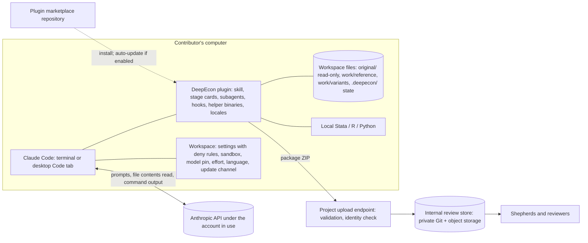

# Deliverable 6 — Option B: Local Claude Code Skill

| | |
|---|---|
| **Status** | **Proposed design** v0.2.2 (2026-11-05). One of two candidate architectures; **not selected**. Comparable in depth and assumptions to [Option A](option-a-hosted-platform.md). v0.2.0 replaced unverified platform claims with verified facts; v0.2.1 and v0.2.2 integrate the independent fairness reviews for both options (§19). |
| **Shared foundations** | [Construction protocol](../methodology/benchmark-construction-protocol.md) · [Interview protocol](../interview/expert-interview-protocol.md) · [Schema](../../schemas/README.md) · [Submission](submission-mechanisms.md) · [Bilingual design](bilingual-design.md) · [Cost and effort model](cost-and-effort-model.md) |
| **Evidence** | Claude Code facts: [R2](../research/evidence/R2-claude-code-platform.md) (official documentation for Claude Code v2.1.318, read 2026-11-05). Access, prices, terms: [R3](../research/evidence/R3-access-pricing-policy-portability.md). Hosting comparators: [R9](../research/evidence/R9-hosted-stack-and-compliance.md). Labels: [P-full], [P-page], [S], [U]. |

---

## 1. Summary

The project publishes a **DeepEcon Contributor plugin** for Claude Code, delivered inside a downloadable **workspace**. A contributor installs Claude Code, either in a terminal or through the Code tab of the desktop app, places their replication package in the workspace, opens it, and starts the contribution skill.

Everything happens on the contributor's computer: the interview, code inspection, construction of flawed variants, execution in Stata, R, or Python with the model iterating in the session, validation, and packaging. Model inference goes to Anthropic under the account in use. The output is the same standardized package as in Option A.

| Property | Option B |
|---|---|
| Where the interview runs | The contributor's Claude Code session |
| Where code runs | The contributor's machine, with their installed software, including Stata (used in 71.6% of economics replication packages [S], [R8](../research/evidence/R8-replication-standards-and-econometric-pitfalls.md)) |
| Model access | **Commercial-terms access is required for full contributions** under the proposed exposure rule (§10.2): provided by the project (subject to O-018) or by the contributor's institution. Every paid consumer plan includes Claude Code (Free does not) [P-full], but consumer terms are not sufficient for hidden-tier work. |
| Who holds materials during drafting | The contributor. The project receives the code, dossier, and consented transcript at submission; hidden-tier copies remain on the contributor's machine unless purged (§10.1) |
| What the project operates | Workspace and plugin distribution, a bilingual project page, an upload endpoint with validation and identity check, the internal review pipeline, and support |
| Model consistency | **Pinned, switch-blocked, and recorded** by the workspace; **enforceable** only with organization-managed settings or a gateway. Client version and contributors' user-level configuration vary and are recorded (§5.3) |

## 2. Contributor experience

### 2.1 Journey (the brief's 13 steps, refined)

| # | Step | What the contributor sees and does | Typical time [U: measure in the pilot] |
|---|---|---|---|
| 1 | Discover | Project page (English / 中文): motivation, what a contribution involves, credit policy | 5–10 min |
| 2 | Check requirements | Commercial-terms access (project-provided or institutional, §10.2); a supported location (§10.3); operating system; Stata, R, or Python as the paper needs. Python for the helper only where no helper binary exists for the platform | 5 min |
| 3 | Install Claude Code | **Terminal:** macOS 13+, Windows 10 1809+ (native or WSL), Ubuntu, Debian, Alpine. **No terminal:** the desktop app's Code tab runs the same engine and installs plugins from its interface [P-page]. The desktop app is the no-terminal path *for the conversation*; the workspace and its setup script are still required | 10–30 min; the main barrier for non-technical users |
| 4–5 | Get the workspace | **Default, typing-free:** download the project's **workspace**, place the replication package in `original/`, open the folder in Claude Code or the desktop app, and accept the trust dialog. The workspace's settings declare the project marketplace and enable the plugin (`extraKnownMarketplaces`, `enabledPlugins`, applied after trust), or embed the skill directly; it also carries the policy that plugins cannot ship (§6.1) [P-full/P-page, R2 §2.1, §8.7]. **Alternative:** `/plugin marketplace add <owner>/<repo>`, then `/plugin install deepecon-contributor@<marketplace-name>`; the marketplace name is declared in its `marketplace.json`, not the GitHub owner. Since v2.1.292 there is also a one-step form, `claude plugin install … --marketplace <owner>/<repo>`. Adding a third-party marketplace through the desktop app's own interface is not documented [U]. Restricted data stay **outside** the workspace (§6.3). | 5–15 min |
| 6 | Start | Run the skill, e.g. `/deepecon-contributor:contribute` | — |
| 7 | Choose language | English or Simplified Chinese, stored for resumption | 1 min |
| 8 | Consent | Data-flow disclosure for the account in use (§10); confidentiality instruction | 5 min |
| 9 | Interview | Protocol stages S1–S4 and S6 in sessions of at most 45–60 minutes; the model reads the paper and code locally and cites file and line | 1.5–3 h over 3+ sessions |
| 10 | Operationalize | The model drafts flawed variants in `work/variants/`; the contributor approves them; run wrappers execute reference and variant locally, and the model iterates on failures in the session | 0.5–2 h; in research-assistant mode, possibly days of waiting |
| 11 | Validate | A package doctor checks the schema, leakage, original-file integrity, and run outputs | 5 min |
| 12 | Review and approve | Dossier summary with provenance and exposure badges, in the contributor's language | 15–30 min |
| 13 | Export and submit | A ZIP package through a private upload link (default) or a private Git repository (optional); optional purge of local hidden-tier copies | 5 min |

**Before the interview starts** (steps 1–5, 7, and 8): about **31–66 minutes** [U: from this table; to be measured], plus obtaining commercial-terms access from the project (if O-018 permits) or the contributor's institution (§10.2). Option A's corresponding steps take about 15–35 minutes with nothing to install (Option A §2.1).

### 2.2 Research-assistant mode

A senior economist can do steps 6–9 and 12 in conversation, in the desktop app if preferred. **This does not remove the economist's own installation (steps 1–5).** A research assistant performs steps 10–11 on their own machine with the same plugin, working from the hand-off specification. Speakers and actions are attributed in the provenance record.

**Hand-off route.** The helper exports a hand-off bundle (session state, hand-off specification, and the `work/` repository; never data). The bundle contains hidden-tier material, so it is encrypted, transferred through the project's upload endpoint or an institutional drive, logged in the exposure log, and imported by the RA's helper. The hand-off can wait days on the RA's schedule, as in Option A's run kits. The Remote Control and SSH variants in §3.2 avoid the transfer: the economist converses while execution stays on the RA's or department's machine.

## 3. Architecture

### 3.1 Diagram



### 3.2 Surfaces

| Surface | Suitability | Evidence |
|---|---|---|
| Claude Code in a terminal | Full capability. OS-level sandboxing for shell commands is available on macOS, Linux, and WSL2, but **not native Windows**. | [P-page] |
| Desktop app, Code tab | **The no-terminal path for the conversation.** Same engine; installs plugins from its interface (not in WSL or cloud sessions); needs a paid plan. The workspace, its setup script, and the paper's software are still required. | [P-page] |
| Claude Cowork | **Not suitable as the main surface.** It loads plugin skills, agents, and hooks, but runs code on Anthropic's servers (Pro/Max/Ultra) or in a cloud/local VM (Team/Enterprise). It cannot use a contributor's local Stata installation or licence. | [P-page/P-full] |
| **B-web: Claude Code on the web** (cloud sessions) | A browser-only variant, the counterpart of Option A's hosted sandbox. A cloud session loads the repository's `.claude/settings.json` hooks and permission rules and its `.claude/skills/` (not marketplace plugins). Python is preinstalled; R comes through a setup script. Available on Pro, Max, Ultra, Team, and qualifying Enterprise seats, so under the exposure rule (§10.2) it needs a Team or Enterprise seat. **Limits:** only public-data R or Python packages; the materials must sit in a private GitHub repository; code runs in an Anthropic virtual machine; Stata is unavailable. | [P-page, R2 §8.4] |
| **Remote Control; desktop sessions over SSH** | The economist converses from the browser, mobile, or desktop app while execution and files stay on another machine: a local machine (Remote Control) or a research assistant's or department's machine that has Stata (desktop SSH sessions, where plugins install in local and SSH sessions). Remote Control needs a Pro, Max, Ultra, Team, or Enterprise sign-in and is **not available with API keys**, so under the exposure rule it needs a Team or Enterprise seat; while connected, its transcript is also stored on Anthropic's servers. | [P-page, R2 §8.2, §8.6] |
| **B-staff** | As in Option A, operationalization (S5) can be deferred to shepherds instead of being run locally. | Design choice |
| Other agent tools reading the Agent Skills format | The six-field skill is portable to tools in the agentskills.io client list, such as Codex, Gemini CLI, GitHub Copilot/VS Code, and Cursor. Kimi Code CLI and Qwen Code read `SKILL.md` according to their own documentation, not that list. Other models' interview quality is unvalidated (§5.3). | [P-full spec; P-page, R3 §4.3] |

## 4. Functional decomposition (identical to Option A's table)

| Function | How Option B provides it | Runs where | Who pays |
|---|---|---|---|
| F1 Onboarding and consent | Bilingual project page + skill's S0 | Static site + local | Project (static hosting) |
| F2 Identity | Contributor's name and e-mail in the package; verified at the upload endpoint | Local + upload endpoint | Project |
| F3 Materials ingestion | The model reads local files directly | Local | — |
| F4 Interview engine | Skill + stage cards + subagents + model | Local client, remote model | Project or institution (commercial access, §10.2) |
| F5 State and provenance store | `.deepecon/` files written through a schema-validating helper | Local | — |
| F6 Code execution | Local Stata, R, or Python through run wrappers | Local | Contributor (own compute and licences) |
| F7 Validation | Package doctor (schema, leakage, integrity, comparisons) | Local; repeated at intake | Project (development) |
| F8 Packaging | Helper builds the ZIP with checksums | Local | — |
| F9 Submission | Upload endpoint (validation, identity check) or private Git | Project endpoint | Project |
| F10 Review and feedback | Shepherd console (shared core); feedback by e-mail or follow-up session | Project | Project |
| F11 Internationalization | Locale assets; language set in the workspace and in the skill | Local | — |
| F12 Telemetry and cost control | Per-session metrics written into the package; spend limits only with project-provided access. Contributors who abandon are invisible to the project | Local | — |
| F13 Support and updates | Documentation, office hours, issue tracker; auto-update on the stable channel with a pre-flight version check | Project | Project |

## 5. How the expert interview operates

### 5.1 Packaging the protocol: plugin inside a workspace

Plugins **cannot ship permission rules**: of a plugin's settings, only `agent` and `subagentStatusLine` are honoured [P-full/P-page]. The design therefore has two parts, delivered as one download.

```
deepecon-contributor/                 # PLUGIN (distributed through a marketplace repository, or embedded)
├── .claude-plugin/plugin.json        # name required; version pins users to a release
├── skills/contribute/
│   ├── SKILL.md                      # specification-compliant frontmatter (six portable fields);
│   │                                 # core rules within the first ~5,000 tokens
│   ├── stages/  probes/  templates/
├── agents/                           # suggestion generator; citation, triviality, and leakage checkers
├── hooks/                            # PreToolUse protection of original/; state re-injection after compaction;
│                                     # PreModelSwitch confirmation; SessionStart / PostModelSwitch recording
├── bin/                              # helper CLI: state, provenance, exposure, ledger, run wrappers, doctor,
│                                     # packager, hand-off bundles; per-platform binaries, so Python is optional
├── locales/{en,zh-Hans}/
└── schemas/

deepecon-workspace/                   # WORKSPACE (downloaded; the replication package goes in original/)
├── .claude/settings.json             # Edit(/original/**) deny rule; sandbox; model, effortLevel, availableModels,
│                                     # switchModelsOnFlag:false; disableAutoMode:"disable"; language; autoMemory off;
│                                     # extraKnownMarketplaces + enabledPlugins (autoUpdate); autoUpdatesChannel:"stable";
│                                     # minimumVersion; promptCacheTtl:"1h"; statusLine; env DISABLE_FEEDBACK_COMMAND=1
├── original/      work/      .deepecon/
└── README.md / README.zh-Hans.md
```

- **Context budget.** A skill's description is always in context. Its body loads on invocation and stays; after compaction, only the first 5,000 tokens of each skill (25,000 in total) come back [P-full]. The core rules (conduct, free-recall lock, suggestion gate, exposure tracking) therefore live in the first part of `SKILL.md`. A hook re-injects the session state after compaction, and `.deepecon/` is the record of truth.
- **Portability.** Claude Code accepts 20 frontmatter fields. claude.ai and the Skills API accept only six (`name`, `description`, `license`, `compatibility`, `metadata`, `allowed-tools`) and reject any others [P-full]. Keeping the shared `SKILL.md` to those six fields lets the same file run elsewhere, including server-side for Option A. Claude-specific behaviour goes in hooks, subagents, and the workspace.
- **Role separation (interview protocol §10).** The suggestion generator and the checkers are **custom subagents** in `agents/`. A custom subagent starts from its own system prompt, which replaces Claude Code's default, with its own tool restrictions and model [P-page, R2]. The interviewer passes only a decision ID; each subagent fetches its permitted inputs through a helper command that returns only the fields its role may see, and its tools are limited to that command. [U: to be tested; the content of the delegation prompt is still written by the interviewer model.]
- **What remains instruction-level.** The free-recall lock and the suggestion gate are enforced by the helper's state machine and by instructions, not by a server. The vetted taxonomy and its known-valid controls would sit in the plugin directory, where the interviewer model and the contributor can read them. The design therefore **serves the suggestion set and the controls from a project endpoint** at the suggestion step, released only after the helper has recorded the recall lock for that decision (optional build item, §13). Without it, the false-endorsement rate (interview protocol §7) is a weaker measure under Option B, and this limit is reported with the influence metrics.

### 5.2 State, provenance, and resumption

- The model never writes the dossier free-hand. It calls the helper, which validates against the schema, timestamps entries, and records provenance and exposure. Records without provenance are refused.
- Free-recall lists, the suggestion ledger, and the influence metrics (interview protocol §4, §7) are maintained by the helper, not by the model's memory.
- **Transcripts.** The terminal client keeps transcripts locally in plaintext for 30 days [P-page]. Desktop-app transcripts are exempt from that limit by default, and their cleanup setting can be changed only in user or managed settings, not by the workspace [P-page, R2 §5.1]. The exporter therefore offers a purge step after export, and the disclosure says so. With consent, it includes a cleaned transcript in the package.
- **Auto memory** is turned off in the workspace, so that memories from other projects cannot bleed into the interview.
- **Progress display.** A status line shows the current stage and the dossier's state; a locally rendered dossier page shows provenance and exposure badges. Both are to be tested in the desktop app during the pilot.

### 5.3 Model selection and consistency

- **Defaults.** On paid plans, Claude Code defaults to Claude Opus 5.5 at effort `medium` [P-page]. The workspace can set a higher effort.
- **Pin, block, record.** No plugin or skill can *force* a model against a deliberate user choice; that needs organization-managed settings or a gateway [P-page]. But the workspace can do three things [P-page, R2 §6.2–6.3]:
  - **pin** the session: `model`, `effortLevel`, and `availableModels: ["claude-opus-5-5"]`;
  - **block** silent changes: with `switchModelsOnFlag: false`, a safety-flag event pauses and asks instead of switching, and a fallback model outside `availableModels` is not used. A plugin `PreModelSwitch` hook asks for confirmation before any switch;
  - **record** every change: `SessionStart` and `PostModelSwitch` hooks log the model actually used, and the package carries a deviation flag.
- **What provided access does and does not standardize.** Project-provided commercial access standardizes the data terms and, with organization-managed settings, the model. It does **not** standardize:
  - the client version (Claude Code shipped v2.1.300 on 2026-10-14 and v2.1.318 on 2026-11-04 [P-page, R2]);
  - Claude Code's own system prompt;
  - contributors' user-level configuration: their `CLAUDE.md` files, personal skills and skills synced from claude.ai, other plugins, MCP servers, and output styles [P-page/P-full, R2 §1.1, §9.1]. A user's own `agent` setting also overrides a plugin's [P-full, R2].

  The workspace disables auto memory; the rest is **recorded**: the doctor lists the client version and the user-level configuration loaded in the session (names and hashes, not contents) in each package. A plugin `agent` setting, enabled only in the DeepEcon workspace, would replace Claude Code's system prompt with the project's [P-page, R2]; this workspace-scoped use is to be tested [U]. Only Option A fixes the whole interviewer configuration.
- **Same caveat for Option A.** On the API, a classifier refusal is handled by retrying with another model; the same safety classifiers apply in both options, and they mostly flag cybersecurity and biology content, which economics interviews rarely touch [P-page].
- **Mitigations:** (a) project-provided access under an organization the project controls (subject to O-018); (b) a pre-flight check that warns about untested models, an outdated plugin, or unusual user-level configuration; (c) per-model protocol evaluations (interview protocol §15).
- **Non-Claude models.** Anthropic "doesn't support routing Claude Code to non-Claude models" [P-page]. Contributors without Claude access could run the six-field skill in another tool that reads the Agent Skills format (e.g., Kimi Code CLI, Qwen Code [P-page]). That interviewer would be unvalidated until it passes the protocol evaluations, it would lose the Claude-specific hooks, permissions, and packaging, and the regional and terms questions in §10.3 still apply.

### 5.4 Interaction with "auto mode"

Since v2.1.283, auto mode is the default permission mode in the terminal and VS Code. It "nudges Claude to keep working without stopping for clarifying questions", but "Claude still asks when your prompt or a skill explicitly relies on it" [P-page].

**The workspace removes the issue:** `disableAutoMode: "disable"` in any settings file removes auto mode [P-page, R2 §4.1]; that sessions then start in Manual mode is to be tested [U]. Setting `defaultMode` alone is weaker: the VS Code extension does not read a project's settings for its starting permission mode [P-page, R2 §8.3], and the desktop app's remembered per-folder mode outranks a project's `defaultMode` [P-page, R2 §4.1]. The skill also states that asking questions is the task. A test under each surface's defaults remains part of release checks.

### 5.5 Bilingual behaviour

Per the [bilingual design](bilingual-design.md): model-facing instructions in English, in one place; user-facing templates and probe phrasings per locale. Claude Code has a documented `language` setting. A plugin cannot set it, but the workspace can, and the skill also states the language explicitly [P-page].

## 6. Replication materials

### 6.1 Protecting the original package (D-011)

Defence in depth. The strength varies by operating system.

| Layer | Mechanism | Strength |
|---|---|---|
| 1 Layout | Original package in `original/`, made read-only by the setup script; all work on copies in `work/` | Basic |
| 2 Deny rules | Workspace `.claude/settings.json` with `Edit(/original/**)`. `Write(path)` rules "never match", so the rule must use `Edit` [P-page, R2 §4.1] | Robust for file-editing tools |
| 3 Hook | Plugin `PreToolUse` hook blocks any tool call targeting `original/`; exit code 2 or a deny decision blocks even in bypass mode. The hook declares `"onFailure": "block"`, because a failing hook otherwise lets the action through [P-page, R2 §3.1] | Robust for Edit/Write; **best-effort for shell commands** [P-page] |
| 4 Sandbox | OS-level filesystem sandbox for shell commands | macOS, Linux, WSL2 only; **not native Windows** [P-page] |
| 5 Integrity check | Checksum manifest of `original/` taken at setup and verified before export; any change blocks packaging | The backstop on every platform |
| 6 Audit trail | `work/` is a local Git repository; each variant is a commit or branch with a patch | Reviewability; also a local copy of hidden-tier material (§10.1) |

### 6.2 Execution

Run wrappers call `stata -b do`, `Rscript`, or `python`, capture logs and outputs, and record software versions. Stata results can change with the Stata version or the processor count [P-full, R8], so versions are always recorded. Stata runs under the contributor's own licence, and the model can iterate on failures within the session. This is Option B's distinctive strength, because Stata dominates economics replication packages; Option A's run kits also use the contributor's Stata, but without in-session iteration.

With auto mode disabled, the permission mode and an allowlist limited to the run wrappers determine what executes without the contributor's approval.

### 6.3 Restricted data

**Keep restricted data out of the workspace.** Read-deny rules reduce exposure but do not guarantee confidentiality: the documentation states that they "don't apply to … arbitrary subprocesses … like a Python or Node script" [P-page]. Rules shipped by a plugin are not honoured at all. The protocol therefore never asks for restricted microdata (P-015), and the S0 disclosure explains that anything the model reads is sent to Anthropic. Agent-facing material from restricted sources can only be fully synthetic ([verifier protocol](../methodology/verifier-validation-protocol.md) §6).

## 7. How correct and flawed packages are produced

| Artifact | Produced by | How |
|---|---|---|
| Reference implementation | Contributor or RA, assisted by the model | Run the original (or a cleaned copy) locally; capture outputs and intermediate outputs |
| Independent check | Internal pipeline | A clean-room re-implementation or a correct blind solve ([verifier protocol](../methodology/verifier-validation-protocol.md) L3); the open-source port used in task environments is a separate artifact |
| Flawed variants | Model drafts the minimal diff in `work/variants/<id>/`; contributor approves | Patch plus files, run locally; consequence comparison by the helper |
| Consequence evidence | Helper | The benchmark-wide materiality rule ([rubric](../methodology/task-quality-rubric.md) RV-2); optional quick hidden-variant check where data permit |

## 8. Validation

Local checks: schema validation, leakage scan, original-file integrity, re-runs of the reference and variants, and comparison against the pre-registered predictions. Everything is re-run at intake. Local validation gives fast feedback but is never trusted on its own.

## 9. Submission

The package ZIP goes through a private upload link (the default) or a private Git repository (for technical contributors), per the [submission analysis](submission-mechanisms.md). The upload endpoint validates the package and verifies the contributor's identity. Option B does **not** require GitHub for submission.

## 10. Privacy, confidentiality, licensing, and regional terms

### 10.1 Data flows

| Data | Leaves the contributor's machine? | To whom | Under which terms |
|---|---|---|---|
| Prompts, the content of files the model reads, command outputs | Yes, on every request | Anthropic | The account's terms (§10.2) |
| Files the model never reads | No | — | — |
| Drafts and abandoned contributions | No | — | — |
| Final package (code, dossier, consented transcript, hidden-tier material in `internal/` and `hidden/`) | Yes, at submission | Project, in the same internal review store as Option A | Project privacy notice; licence records |
| Hidden-tier copies after submission (`work/`, `.deepecon/`, local transcripts) | No, but they **persist on the contributor's machine** | — | Purge step after export; the contributor agreement asks for deletion after acceptance |
| Client telemetry | Optional | Anthropic | Can be disabled [P-page] |

### 10.2 Consumer versus commercial terms, and the exposure rule

| Account | Training on inputs | Retention | Source |
|---|---|---|---|
| Consumer (Free, Pro, Max, Ultra) | **Yes, unless the user opts out.** Feedback and safety-flagged content may be used even after opting out | 5 years if training is on; 30 days if off | [P-page/P-full] |
| Commercial (Team, Enterprise, API) | Anthropic "may not train" on customer content | 30 days in the Claude Code documentation; "not retained by default" in the API documentation (the two disagree); zero data retention for qualified organizations through sales | [P-page/P-full] |

**The exposure rule.** The [verifier protocol](../methodology/verifier-validation-protocol.md) §10 (Proposed) requires that any session that sees hidden-tier material runs under commercial no-training terms; consumer accounts, even after an opt-out, may handle only agent-tier or public material. Failure modes, flawed variants, and answer keys are created **inside** the interview from stage S2 onwards. **Option B therefore needs commercial-terms access for full contributions**, provided:
- by the project, through a Console workspace with API keys, if Anthropic confirms that external contributors count as the customer's "authorized users" (O-018); or
- by the contributor's institution, for example a university agreement governing Claude for Education [P-page, R3 §6.2].

If neither is available, the research lead must choose between relaxing the rule (accepting a contamination risk for the private split) and not using Option B as designed. The feedback path is closed in any case: the workspace sets `DISABLE_FEEDBACK_COMMAND=1`, and feedback is uploaded only on an explicit action [P-page, R2 §9.2]. The account type is recorded in `consent.contributor_account_terms`.

### 10.3 Regional availability

Anthropic's Supported Regions Policy, effective 2026-11-12, does **not** list mainland China, Hong Kong, or Macau, and names Claude Code among the covered products. Unsupported use includes "use by persons while physically located in an unsupported region". It also covers entities incorporated or headquartered there "and their users or personnel, regardless of whether such individuals are physically located in a supported region" [P-full, R3].

Under Option B, contributors located in those regions therefore cannot use Claude Code. How the entity clause applies to individual academics is ambiguous and needs legal review (O-007). **The constraint is the same as for Option A; the fallbacks differ:** B's portable skill runs in other agent tools without project hosting (unvalidated model, unknown provider terms, safeguards reduced to the helper's checks), whereas A needs a second provider integration, a China-reachable host, and PIPL duties as custodian (Option A §10.3). Running Claude Code against a third-party model from those regions raises a separate legal question [P-page].

## 11. Third-party dependencies

| Dependency | Role | Risk |
|---|---|---|
| Claude Code client | Host for the skill | Several releases a week; the workspace follows the stable channel; third-party marketplaces auto-update only if enabled [P-full]; plugin interfaces can change |
| Anthropic API (through keys or commercial plans) | Inference | Regional policy; terms (O-018); model changes |
| Plugin marketplace repository | Distribution | Reachability; fallback: downloadable archive, or a workspace that embeds the skill under `.claude/skills/` (loaded once the folder is trusted) |
| Upload endpoint | Submission | A small project service that receives hidden-tier packages; security and uptime duties |
| Python | Helper, only where no binary exists | Optional with per-platform binaries |
| Contributor's Stata, R, or Python | Execution | Version heterogeneity; Stata results can vary by version and processor count |

## 12. Costs (assumptions shared with Option A; details in the [cost model](cost-and-effort-model.md))

| Cost | Who pays | Order of magnitude |
|---|---|---|
| Model access, project-provided | Project | ≈ $17 per contribution at API list prices (central estimate), through a Console "Claude Code workspace" with per-user monthly spend limits [P-page]. With API keys, Claude Code's prompt cache lasts 5 minutes unless the workspace sets `promptCacheTtl: "1h"`; the $17 figure assumes the one-hour cache (cost model A7) [P-page, R2 §11]. Anthropic's Claude Code terms permit customers to provision API keys "for use by the customer's own authorized users"; whether external contributors count as authorized users is the open question (O-018). Team seats are named and not meant for rotation. |
| …or institutional | Contributor's institution | Existing commercial agreements (e.g., Claude for Education); no project cost |
| Consumer plans | Contributor | Pro $20 a month ($17 annually); Max $100; Ultra $200 [P-full]. Admissible only for agent-tier or public material under the exposure rule (§10.2). Reimbursing one month of Pro for 200 contributors would cost $4,000, against ≈ $3,400 of API inference |
| Workspace, plugin, helper, and endpoint development | Project | §13 |
| Hosting | Project | Static project page plus upload endpoint: ≈ $0–5 a month [R9 estimate] |
| Operations | Project | 0.1–0.2 FTE (§14) |
| Evaluation inference | Project | A simulated-contributor regression suite per certified client version on the stable channel (cost model §4) |
| Support | Project | Higher than Option A per contributor (environment diversity): ≈ 1 h against 0.75 h [U] |
| Shepherding and review | Project | Likely the largest cost. Contributors (or RAs) pre-do part of the operationalization by submitting variants they have already run, as under Option A's A1. Measured in the pilot (M9) |

## 13. MVP build plan

| Component | Effort (engineer-weeks) [U: planning estimates] |
|---|---|
| Shared core: protocol assets, schema tooling, validator, packager, internal review pipeline, shepherd console | 10–17.5 (shared with Option A; counted once) |
| Plugin skeleton; specification-compliant `SKILL.md` with core rules first; stage loading; locales | 2–3 |
| Workspace: settings, deny rules, sandbox, permission mode, model pin, update channel, setup script, checksum manifest | 1 |
| Helper CLI: state, provenance, exposure, ledger, doctor, hand-off bundles (partly shared core) | 2–3 |
| Hooks: protection; state re-injection; model-switch confirmation and recording | 0.5–1 |
| Suggestion and checker subagents with restricted inputs | 0.5–1.5 |
| Run wrappers and environment capture for Stata, R, Python | 1–2 |
| Per-platform helper binaries (Python optional) | 0.5–1 |
| Status line and locally rendered dossier page | 0.5–1 |
| Upload endpoint with package validation and identity check ([submission](submission-mechanisms.md) §3.3) | 1–2 |
| Bilingual project page | 0.25–0.5 |
| Privacy notice for the endpoint and package store | 0.25–0.5 |
| Installation and contributor guides (EN/ZH); desktop-app walkthrough | 1–2 |
| Test matrix: macOS / Windows (native and WSL) / Linux × Stata / R / Python; desktop app; surface defaults; workspace-scoped plugin `agent` | 1–2 |
| **Option B-specific total** | **≈ 11.5–20.5**, plus the shared core |
| Optional: suggestion-set and controls endpoint (§5.1) | +0.25–0.5 |

v0.2.1 counted ≈ 8–14 engineer-weeks; v0.2.2 adds the items B needs that were previously uncounted (endpoint, project page, privacy notice, subagents, binaries, status line). Engineering effort is now **comparable** to Option A's ≈ 12–19.5.

**Milestones**
1. The skill runs S0–S4 on a sample paper with state, provenance, exposure tracking, and subagents.
2. S5 with protection layers and run wrappers.
3. Packaging, doctor, upload endpoint, and bilingual assets.
4. Cross-platform and surface test pass.
5. Pilot release.

## 14. Operations and maintenance

- **Versioning.** Plugin and protocol follow semantic versioning, and packages record both. Sessions finish on the version they started with: each contribution's protocol version stays pinned by the workspace snapshot [U: design inference, R2 §2.2].
- **Updates.** The workspace enables auto-update for the project marketplace (`"autoUpdate": true` on its `extraKnownMarketplaces` entry; to be tested from a repository settings file) [P-full, R2 §2.1].
- **Client channel.** The workspace sets `autoUpdatesChannel: "stable"` ("typically about one week old, skipping releases with major regressions") and a `minimumVersion` [P-page]. The simulated-contributor regression suite is run per **certified** stable release; certifying less often than every stable release, and recording the client version per package, reduces the cost (cost model §4). A pre-flight version check remains as a backstop.
- **Effort.** About 0.1–0.2 FTE: plugin and workspace compatibility with the stable channel, the upload endpoint, and more varied support.
- **Support.** Documentation, office hours, and an issue form. Installation problems vary by operating system and software setup.

## 15. Scalability

Compute scales with contributors' own resources; inference scales with contributions on the account that pays. Project effort scales with **support**, because environments differ, and with **shepherding**, as in Option A. International reach is bounded by Anthropic's regional policy (§10.3).

## 16. Risks

The risk registers of both options use one inclusion rule: every risk rated Medium or higher in likelihood or impact is listed.

| Risk | Likelihood | Impact | Mitigation |
|---|---|---|---|
| Non-technical economists do not complete setup | Medium–High [U: pilot] | High | Desktop app; typing-free workspace; research-assistant mode; onboarding sessions; hosted onboarding (hybrid H1) |
| Engineering takes longer than planned | Medium | Medium | Narrow MVP; early tests of the client features the design relies on (workspace-scoped `agent`, auto-update from workspace settings, subagent input restriction) |
| Terms do not allow project-provided access for external contributors (O-018) | Low–Medium (a definitional question about "authorized users") | High: B then depends on institutional accounts or on relaxing the exposure rule | Ask Anthropic; institutional commercial accounts |
| Research-assistant hand-offs stall operationalization | Medium [U: pilot] | Medium–High | Remote Control or SSH variants; reminders; B-staff |
| Long interview degraded by context compaction | Medium | Medium | Core rules first in `SKILL.md`; state re-injection hook; `.deepecon/` as the record of truth |
| Interviewer configuration drifts (client version, user-level configuration) | Medium | Medium–High | Pinned and recorded model; doctor records configuration; pre-flight warnings; per-model evaluations |
| Taxonomy and controls readable in the plugin weaken the influence measures | Medium | Medium | Serve suggestion sets and controls from a project endpoint; report the limit |
| Hidden-tier copies persist on contributors' machines | Medium | Medium–High | Purge step after export; deletion after acceptance in the agreement; encrypted hand-off bundles |
| Hidden material enters training through consumer accounts | Low if the exposure rule is enforced; Plausible otherwise | High (contamination) | Commercial-terms access required (§10.2); the account type is recorded and checked at intake |
| Restricted data read by a subprocess despite deny rules | Low–Medium | High | Keep restricted data out of the workspace; never request it |
| Originals modified on native Windows (no OS sandbox) | Low | High | Checksum integrity check blocks export |
| Plugin breaks after a client update | Medium | Medium | Stable channel; pre-flight check; regression suite per certified release |
| Contributors in mainland China, Hong Kong, or Macau cannot use Claude Code | Certain under the current policy for those located there | High for that group | Legal review; portable skill in another tool, with validation caveats (O-007) |
| Support load exceeds capacity | Medium | Medium | Office hours; FAQ; a narrow supported-environment matrix |

## 17. The brief's stated advantages and disadvantages, assessed

| Claim in the brief | Assessment |
|---|---|
| "May substantially reduce our hosting and model-inference expenses." | **True but small in absolute terms, and largely gone under the exposure rule.** Hosting savings are modest (Option A's hosting is about $13–210 a month at this scale [R9]). Inference is ≈ $17 per contribution at API prices, so ≈ $3,400 for 200 contributions in the central case. Commercial-terms access moves that cost to the project, unless institutions provide it. |
| "Direct access to the contributor's local research environment." | **True and important.** Stata appears in 71.6% of economics replication packages [S]; local execution with in-session iteration is B's clearest advantage, especially for operationalizing errors. |
| "Focus development effort on interview, specification, and validation quality." | **Partly true.** There is no web application to build, but an upload endpoint, project page, subagents, binaries, and cross-platform support are still needed. Engineering effort is comparable to Option A's (≈ 11.5–20.5 against ≈ 12–19.5 engineer-weeks). |
| "Contributors need access to Claude Code, suitable models, and research software." | **True, and stricter than it sounds.** It requires commercial-terms access for full contributions and a supported region. |
| "Some senior economists may not want to install or operate such tools." | **Plausible; must be measured** (pilot PQ1). The typing-free workspace, the desktop app, and research-assistant mode reduce the burden, but the economist still installs Claude Code. |
| "Model behaviour may differ across versions, settings, and model access." | **True, but narrower than it sounds.** The model is pinned, switch-blocked, and recorded; enforcement needs managed settings or a gateway; the client version and user-level configuration still vary and are recorded. |
| "Local execution does not guarantee offline inference." | **True.** Every request sends prompts, file contents, and command outputs to Anthropic. The same holds for what the model reads under Option A. |

## 18. Open questions specific to Option B

1. May the project provide Console workspace keys to external contributors as its "authorized users" (O-018)? Which contributors have institutional commercial access (O-006)?
2. What is the supported environment matrix for the first release (operating systems, Stata versions, surfaces)?
3. Does a plugin `agent` setting enabled only in the workspace replace Claude Code's system prompt as documented, and how does it interact with a user's own `agent` and `/model`?
4. Should the suggestion sets and controls be served from a project endpoint (§5.1)?
5. How are contributors without Claude access served (O-007)?

## 19. Changes

**v0.2.2 (fairness review for Option A, 2026-11-05).**
- Exposure rule: commercial-terms access required for full contributions; consumer plans only for agent-tier or public material.
- Custody stated symmetrically: the project receives the same package at submission; hidden-tier copies persist locally (new risk and purge step).
- Consistency limits stated: provided access does not standardize the client version, Claude Code's system prompt, or user-level configuration; these are recorded; workspace-scoped plugin `agent` to be tested.
- Subagent design for the suggestion generator and checkers; the taxonomy and controls are readable unless served from a project endpoint.
- Research-assistant mode: the economist still installs; hand-off bundle route; possibly days of waiting.
- Build plan completed (upload endpoint, project page, privacy notice, subagents, binaries, status line): ≈ 11.5–20.5 engineer-weeks; shepherd console in the shared core.
- Maintenance 0.1–0.2 FTE, with evaluation inference per certified stable release; pre-interview setup time (31–66 minutes).

**v0.2.1 (fairness review for Option B).**
- The workspace becomes the default, typing-free delivery: it registers or embeds the plugin.
- Template controls added: pin, block, and record the model; disable auto mode; stable update channel and auto-update; feedback command off; one-hour prompt cache with API keys; status line.
- Corrected deny-rule syntax (`Edit(...)`) and hook `onFailure: block`.
- Desktop transcripts are exempt from the 30-day limit, so a purge step was added.
- Variants added: B-web (Claude Code on the web), Remote Control and desktop SSH sessions, and B-staff.
- Helper shipped as binaries, so Python is optional.
- Agent Skills tool list corrected.

**v0.2.0 (from v0.1.0).**

Verified or corrected against the official documentation and policies (R2, R3):
- Install syntax corrected; one-step install form added.
- **Workspace template** added, because plugins cannot ship permission rules.
- Read-deny is not a confidentiality guarantee.
- Hooks are robust for file edits but best-effort for shell commands.
- No OS sandbox on native Windows.
- **No plugin can require a model.**
- Auto mode is the default, and its effect on interviews is addressed.
- Cowork is unsuitable; the desktop Code tab is the no-terminal path.
- Marketplaces do not auto-update by default.
- Plan prices added; consumer training is opt-out, with feedback and safety exceptions.
- Regional policy added.
- Agent Skills portability limited to six fields.
- Engineering estimate revised to 8–14 engineer-weeks (template and auto-mode testing added).
