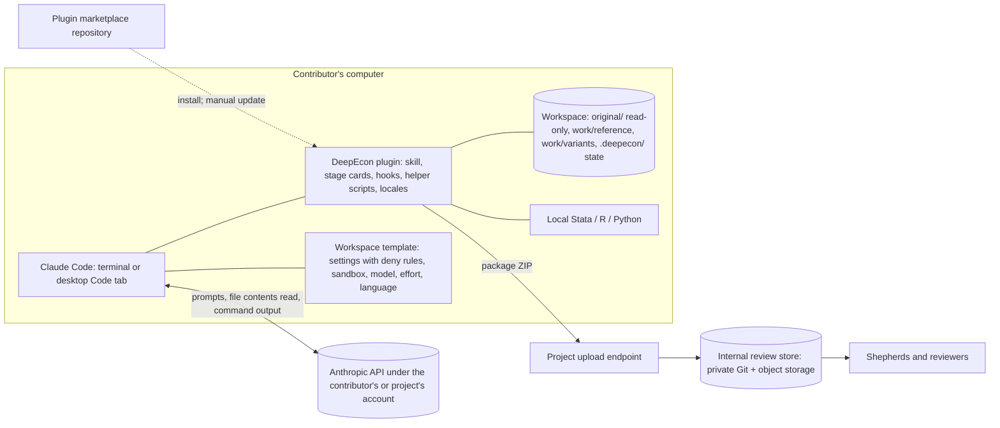

# Deliverable 6 — Option B: Local Claude Code Skill

| | |
|---|---|
| **Status** | **Proposed design** v0.2.1 (2026-11-05). One of two candidate architectures; **not selected**. Comparable in depth and assumptions to [Option A](option-a-hosted-platform.md). v0.2.0 replaced unverified platform claims with verified facts; v0.2.1 adds documented template controls and variants raised in the fairness review (§19). |
| **Shared foundations** | [Construction protocol](../methodology/benchmark-construction-protocol.md) · [Interview protocol](../interview/expert-interview-protocol.md) · [Schema](../../schemas/README.md) · [Submission](submission-mechanisms.md) · [Bilingual design](bilingual-design.md) · [Cost and effort model](cost-and-effort-model.md) |
| **Evidence** | Claude Code facts: [R2](../research/evidence/R2-claude-code-platform.md) (official documentation for Claude Code v2.1.318, read 2026-11-05). Access, prices, terms: [R3](../research/evidence/R3-access-pricing-policy-portability.md). Labels: [P-full], [P-page], [S], [U]. |

---

## 1. Summary

The project publishes a **DeepEcon Contributor plugin** for Claude Code, plus a **workspace template**. A contributor installs Claude Code, either in a terminal or through the Code tab of the desktop app. They create a workspace from the template next to their replication package and start the contribution skill.

Everything happens on the contributor's computer: the interview, code inspection, construction of flawed variants, execution in Stata, R, or Python, validation, and packaging. Model inference goes to Anthropic under the contributor's account, or under an account the project provides. The output is the same standardized package as in Option A.

| Property | Option B |
|---|---|
| Where the interview runs | The contributor's Claude Code session |
| Where code runs | The contributor's machine, with their installed software, including Stata (used in 71.6% of economics replication packages [S], [R8](../research/evidence/R8-replication-standards-and-econometric-pitfalls.md)) |
| Who pays for inference | The contributor by default (every paid plan includes Claude Code; Free does not [P-full]). The project pays if it provides access (§12; Open questions O-006, O-018). |
| What the project operates | Plugin and template distribution, a submission endpoint, the internal review pipeline, and support |
| Model consistency | Recommended and recorded, **not enforceable by a plugin** (§5.3) |

## 2. Contributor experience

### 2.1 Journey (the brief's 13 steps, refined)

| # | Step | What the contributor sees and does | Typical time [U: measure in the pilot] |
|---|---|---|---|
| 1 | Discover | Project page (English / 中文): motivation, what a contribution involves, credit policy | 5–10 min |
| 2 | Check requirements | A paid Claude plan (Pro is $20 a month, or $17 a month billed annually) or project-provided access; a supported location (§10.3); operating system; Python for helper scripts; Stata, R, or Python as the paper needs | 5 min |
| 3 | Install Claude Code | **Terminal:** macOS 13+, Windows 10 1809+ (native or WSL), Ubuntu, Debian, Alpine. **No terminal:** the desktop app's Code tab runs the same engine and installs plugins from its interface [P-page] | 10–30 min; the main barrier for non-technical users |
| 4–5 | Get the workspace | **Default, typing-free:** download the project's **workspace** (template), place the replication package in `original/`, open the folder in Claude Code or the desktop app, and accept the trust dialog. The workspace's settings declare the project marketplace and enable the plugin (`extraKnownMarketplaces`, `enabledPlugins`, applied after trust), or embed the skill directly; it also carries the policy that plugins cannot ship (§6.1) [P-full/P-page, R2 §2.1, §8.7]. **Alternative:** `/plugin marketplace add <owner>/<repo>`, then `/plugin install deepecon-contributor@<marketplace-name>`; the marketplace name is declared in its `marketplace.json`, not the GitHub owner. Since v2.1.292 there is also a one-step form, `claude plugin install … --marketplace <owner>/<repo>`. Adding a third-party marketplace through the desktop app's own interface is not documented [U]. Restricted data stay **outside** the workspace (§6.3). | 5–15 min |
| 6 | Start | Run the skill, e.g. `/deepecon-contributor:contribute` | — |
| 7 | Choose language | English or Simplified Chinese, stored for resumption | 1 min |
| 8 | Consent | Data-flow disclosure for the account in use (consumer or commercial terms, §10); confidentiality instruction | 5 min |
| 9 | Interview | Protocol stages S1–S4 and S6 (v0.2.0) in sessions of at most 45–60 minutes; the model reads the paper and code locally and cites file and line | 1.5–3 h over 3+ sessions |
| 10 | Operationalize | The model drafts flawed variants in `work/variants/`; the contributor approves them; run wrappers execute reference and variant locally | 0.5–2 h |
| 11 | Validate | A package doctor checks the schema, leakage, original-file integrity, and run outputs | 5 min |
| 12 | Review and approve | Dossier summary with provenance and exposure badges, in the contributor's language | 15–30 min |
| 13 | Export and submit | A ZIP package through a private upload link (default) or a private Git repository (optional) | 5 min |

### 2.2 Research-assistant mode

A senior economist can do steps 6–9 and 12 in conversation, in the desktop app if preferred. A research assistant performs steps 10–11 on their own machine with the same plugin, working from the hand-off specification in the session folder. Speakers and actions are attributed in the provenance record.

## 3. Architecture

### 3.1 Diagram



### 3.2 Surfaces

| Surface | Suitability | Evidence |
|---|---|---|
| Claude Code in a terminal | Full capability. OS-level sandboxing for shell commands is available on macOS, Linux, and WSL2, but **not native Windows**. | [P-page] |
| Desktop app, Code tab | **The no-terminal path.** Same engine; installs plugins from its interface (not in WSL or cloud sessions); needs a paid plan. | [P-page] |
| Claude Cowork | **Not suitable as the main surface.** It loads plugin skills, agents, and hooks, but runs code on Anthropic's servers (Pro/Max/Ultra) or in a cloud/local VM (Team/Enterprise). It cannot use a contributor's local Stata installation or licence. | [P-page/P-full] |
| **B-web: Claude Code on the web** (cloud sessions) | A browser-only variant, the counterpart of Option A's hosted sandbox. A cloud session loads the repository's `.claude/settings.json` hooks and permission rules and its `.claude/skills/` (not marketplace plugins). Python is preinstalled; R comes through a setup script. Available on Pro, Max, Ultra, Team, and qualifying Enterprise seats. **Limits:** only public-data R or Python packages; the materials must sit in a private GitHub repository; code runs in an Anthropic virtual machine; Stata is unavailable. | [P-page, R2 §8.4] |
| **Remote Control; desktop sessions over SSH** | The economist converses from the browser, mobile, or desktop app while execution and files stay on another machine: a local machine (Remote Control) or a research assistant's or department's machine that has Stata (desktop SSH sessions, where plugins install in local and SSH sessions). | [P-page, R2 §8.2, §8.6] |
| **B-staff** | As in Option A, operationalization (S5) can be deferred to shepherds instead of being run locally. | Design choice |
| Other agent tools reading the Agent Skills format | The six-field skill is portable to tools in the agentskills.io client list, such as Codex, Gemini CLI, GitHub Copilot/VS Code, and Cursor. Kimi Code CLI and Qwen Code read `SKILL.md` according to their own documentation, not that list. Other models' interview quality is unvalidated (§5.3). | [P-full spec; P-page, R3 §4.3] |

## 4. Functional decomposition (identical to Option A's table)

| Function | How Option B provides it | Runs where | Who pays |
|---|---|---|---|
| F1 Onboarding and consent | Project web page + skill's S0 | Static site + local | Project (static hosting) |
| F2 Identity | Contributor's name and e-mail in the package; verified at submission | Local + upload endpoint | Project |
| F3 Materials ingestion | The model reads local files directly | Local | — |
| F4 Interview engine | Skill + stage cards + model | Local client, remote model | Contributor or project (O-006) |
| F5 State and provenance store | `.deepecon/` files written through a schema-validating helper | Local | — |
| F6 Code execution | Local Stata, R, or Python through run wrappers | Local | Contributor (own compute and licences) |
| F7 Validation | Package doctor (schema, leakage, integrity, comparisons) | Local; repeated at intake | Project (development) |
| F8 Packaging | Helper builds the ZIP with checksums | Local | — |
| F9 Submission | Upload link or private Git | Project endpoint | Project |
| F10 Review and feedback | Internal pipeline; feedback by e-mail or follow-up session | Project | Project |
| F11 Internationalization | Locale assets; language set in the workspace template and in the skill | Local | — |
| F12 Telemetry and cost control | Per-session metrics written into the package; spend limits only with project-provided access | Local | — |
| F13 Support and updates | Documentation, office hours, issue tracker; manual plugin updates with a pre-flight version check | Project | Project |

## 5. How the expert interview operates

### 5.1 Packaging the protocol: plugin plus workspace template

Plugins **cannot ship permission rules**: of a plugin's settings, only `agent` and `subagentStatusLine` are honoured [P-full/P-page]. The design therefore has two parts.

```
deepecon-contributor/                 # PLUGIN (distributed through a marketplace repository)
├── .claude-plugin/plugin.json        # name required; version pins users to a release
├── skills/contribute/
│   ├── SKILL.md                      # specification-compliant frontmatter (six portable fields);
│   │                                 # core rules within the first ~5,000 tokens
│   ├── stages/  probes/  pitfalls/  templates/
├── hooks/                            # PreToolUse protection of original/; state re-injection after compaction
├── scripts/ and bin/                 # helper CLI: state, provenance, exposure, ledger, run wrappers, doctor, packager;
│                                     # shipped as per-platform binaries in bin/ so Python is optional [R2 §14.11]
├── locales/{en,zh-Hans}/
└── schemas/

deepecon-workspace-template/          # WORKSPACE (downloaded; the replication package goes in original/)
├── .claude/settings.json             # Edit(/original/**) deny rule; sandbox; model, effortLevel, availableModels,
│                                     # switchModelsOnFlag:false; disableAutoMode:"disable"; language; autoMemory off;
│                                     # extraKnownMarketplaces + enabledPlugins (autoUpdate); autoUpdatesChannel:"stable";
│                                     # minimumVersion; promptCacheTtl:"1h"; statusLine; env DISABLE_FEEDBACK_COMMAND=1
├── original/      work/      .deepecon/
└── README.md / README.zh-Hans.md
```

- **Context budget.** A skill's description is always in context. Its body loads on invocation and stays; after compaction, only the first 5,000 tokens of each skill (25,000 in total) come back [P-full]. The core rules (conduct, free-recall lock, suggestion gate, exposure tracking) therefore live in the first part of `SKILL.md`. A hook re-injects the session state after compaction, and `.deepecon/` is the record of truth.
- **Portability.** Claude Code accepts 20 frontmatter fields. claude.ai and the Skills API accept only six (`name`, `description`, `license`, `compatibility`, `metadata`, `allowed-tools`) and reject any others [P-full]. Keeping the shared `SKILL.md` to those six fields lets the same file run elsewhere, including server-side for Option A. Claude-specific behaviour goes in hooks and the template.

### 5.2 State, provenance, and resumption

- The model never writes the dossier free-hand. It calls the helper, which validates against the schema, timestamps entries, and records provenance and exposure. Records without provenance are refused.
- Free-recall lists, the suggestion ledger, and the influence metrics (protocol v0.2.0 §4) are maintained by the helper, not by the model's memory.
- **Transcripts.** The terminal client keeps transcripts locally in plaintext for 30 days [P-page]. Desktop-app transcripts are exempt from that limit by default, and their cleanup setting can be changed only in user or managed settings, not by the template [P-page, R2 §5.1]. The exporter therefore offers a purge step after export, and the disclosure says so. With consent, it includes a cleaned transcript in the package.
- **Auto memory** is turned off in the template, so that memories from other projects cannot bleed into the interview.
- **Progress display.** A status line (configurable in the template) shows the current stage and the dossier's state; a locally rendered dossier page shows provenance and exposure badges. Both are to be tested in the desktop app during the pilot.

### 5.3 Model selection and consistency

- **Defaults.** On paid plans, Claude Code defaults to Claude Opus 5.5 at effort `medium` [P-page]. The template can set a higher effort.
- **Pin, block, record.** No plugin or skill can *force* a model against a deliberate user choice; that needs organization-managed settings or a gateway [P-page]. But the workspace template can do three things [P-page, R2 §6.2–6.3]:
  - **pin** the session: `model`, `effortLevel`, and `availableModels: ["claude-opus-5-5"]`;
  - **block** silent changes: with `switchModelsOnFlag: false`, a safety-flag event pauses and asks instead of switching, and a fallback model outside `availableModels` is not used. A plugin `PreModelSwitch` hook asks for confirmation before any switch;
  - **record** every change: `SessionStart` and `PostModelSwitch` hooks log the model actually used, and the package carries a deviation flag.
- **Same caveat for Option A.** On the API, a classifier refusal is handled by retrying with another model; the same safety classifiers apply in both options, and they mostly flag cybersecurity and biology content, which economics interviews rarely touch [P-page].
- **Recording.** The helper records the model reported for the session where available [partly confirmed, R2]. Packages state the client version and plugin version.
- **Mitigations:** (a) project-provided access under an organization the project controls, which also standardizes data-use terms (subject to O-018); (b) a pre-flight check that warns about untested models or an outdated plugin; (c) per-model protocol evaluations (interview protocol §15).
- **Non-Claude models.** Anthropic "doesn't support routing Claude Code to non-Claude models" [P-page]. Contributors without Claude access could run the six-field skill in another tool that reads the Agent Skills format (e.g., Kimi Code CLI, Qwen Code [P-page]). That interviewer would be unvalidated until it passes the protocol evaluations, and the regional and terms questions in §10.3 still apply.

### 5.4 Interaction with "auto mode"

Since v2.1.283, auto mode is the default permission mode in the terminal and VS Code. It "nudges Claude to keep working without stopping for clarifying questions", but "Claude still asks when your prompt or a skill explicitly relies on it" [P-page].

**The template removes the issue:** `disableAutoMode: "disable"` in any settings file makes sessions start in Manual mode and makes auto mode unavailable [P-page, R2 §13.2]. Setting `defaultMode` alone is weaker: VS Code ignores a project's `defaultMode`, and the desktop app's remembered per-folder mode outranks it. The skill also states that asking questions is the task. A test under each surface's defaults remains part of release checks.

### 5.5 Bilingual behaviour

Per the [bilingual design](bilingual-design.md): model-facing instructions in English, in one place; user-facing templates and probe phrasings per locale. Claude Code has a documented `language` setting. A plugin cannot set it, but the workspace template can, and the skill also states the language explicitly [P-page].

## 6. Replication materials

### 6.1 Protecting the original package (D-011)

Defence in depth. The strength varies by operating system.

| Layer | Mechanism | Strength |
|---|---|---|
| 1 Layout | Original package in `original/`, made read-only by the setup script; all work on copies in `work/` | Basic |
| 2 Deny rules | Template `.claude/settings.json` with `Edit(/original/**)`. `Write(path)` rules "never match", so the rule must use `Edit` [P-page, R2 §4.1] | Robust for file-editing tools |
| 3 Hook | Plugin `PreToolUse` hook blocks any tool call targeting `original/`; exit code 2 or a deny decision blocks even in bypass mode. The hook declares `"onFailure": "block"`, because a failing hook otherwise lets the action through [P-page, R2 §3.1] | Robust for Edit/Write; **best-effort for shell commands** [P-page] |
| 4 Sandbox | OS-level filesystem sandbox for shell commands | macOS, Linux, WSL2 only; **not native Windows** [P-page] |
| 5 Integrity check | Checksum manifest of `original/` taken at setup and verified before export; any change blocks packaging | The backstop on every platform |
| 6 Audit trail | `work/` is a local Git repository; each variant is a commit or branch with a patch | Reviewability |

### 6.2 Execution

Run wrappers call `stata -b do`, `Rscript`, or `python`, capture logs and outputs, and record software versions. Stata results can change with the Stata version or the processor count [P-full, R8], so versions are always recorded. Stata runs under the contributor's own licence. This is Option B's distinctive strength, because Stata dominates economics replication packages.

Because auto mode can run commands without prompting, the template's permission mode, together with an allowlist limited to the run wrappers, determines what executes without the contributor's approval.

### 6.3 Restricted data

**Keep restricted data out of the workspace.** Read-deny rules reduce exposure but do not guarantee confidentiality: the documentation states that they "don't apply to … arbitrary subprocesses … like a Python or Node script" [P-page]. Rules shipped by a plugin are not honoured at all. The protocol therefore never asks for restricted microdata (DP-28), and the S0 disclosure explains that anything the model reads is sent to Anthropic.

## 7. How correct and flawed packages are produced

| Artifact | Produced by | How |
|---|---|---|
| Reference implementation | Contributor or RA, assisted by the model | Run the original (or a cleaned copy) locally; capture outputs and intermediate outputs |
| Independent check | Shepherd, later (or RA) | Cross-language re-implementation in the internal pipeline |
| Flawed variants | Model drafts the minimal diff in `work/variants/<id>/`; contributor approves | Patch plus files, run locally; consequence comparison by the helper |
| Consequence evidence | Helper | Comparison under the pre-registered materiality rule; optional quick resampling or effect-injection check |

## 8. Validation

Local checks: schema validation, leakage scan, original-file integrity, re-runs of the reference and variants, and comparison against the pre-registered predictions. Everything is re-run at intake. Local validation gives fast feedback but is never trusted on its own.

## 9. Submission

The package ZIP goes through a private upload link (the default) or a private Git repository (for technical contributors), per the [submission analysis](submission-mechanisms.md). Option B does **not** require GitHub for submission.

## 10. Privacy, confidentiality, licensing, and regional terms

### 10.1 Data flows

| Data | Leaves the contributor's machine? | To whom | Under which terms |
|---|---|---|---|
| Prompts, the content of files the model reads, command outputs | Yes, on every request | Anthropic | The account's terms: consumer or commercial (§10.2) |
| Files the model never reads | No | — | — |
| Final package | Yes, at submission | Project | Project privacy notice; licence records |
| Client telemetry | Optional | Anthropic | Can be disabled [P-page] |

### 10.2 Consumer versus commercial terms (a benchmark-integrity issue)

| Account | Training on inputs | Retention | Source |
|---|---|---|---|
| Consumer (Free, Pro, Max, Ultra) | **Yes, unless the user opts out.** Feedback and safety-flagged content may be used even after opting out | 5 years if training is on; 30 days if off | [P-page/P-full] |
| Commercial (Team, Enterprise, API) | Anthropic "may not train" on customer content | 30 days in the Claude Code documentation; "not retained by default" in the API documentation (the two disagree); zero data retention for qualified organizations through sales | [P-page/P-full] |

**Implication.** On consumer accounts with training enabled, hidden-tier material can enter training data: flawed variants, answer keys, error labels. That is a benchmark-contamination risk.

The feedback path can be closed: the template sets `DISABLE_FEEDBACK_COMMAND=1` in its `env`, and feedback is uploaded only on an explicit action anyway [P-page, R2 §9.2]. Only the safety-flag exception remains after an opt-out. Commercial access closes the gap entirely; it can be provided by the project (O-018) or by the contributor's institution, for example a university agreement governing Claude for Education. The account type is recorded in `consent.contributor_account_terms`.

### 10.3 Regional availability

Anthropic's Supported Regions Policy, effective 2026-11-12, does **not** list mainland China, Hong Kong, or Macau, and names Claude Code among the covered products. Unsupported use includes "use by persons while physically located in an unsupported region". It also covers entities incorporated or headquartered there "and their users or personnel, regardless of whether such individuals are physically located in a supported region" [P-full, R3].

Under Option B, contributors located in those regions therefore cannot use Claude Code. How the entity clause applies to individual academics is ambiguous and needs legal review (O-007). Running Claude Code against a third-party model from those regions raises a separate legal question [P-page].

## 11. Third-party dependencies

| Dependency | Role | Risk |
|---|---|---|
| Claude Code client | Host for the skill | Several releases a week; third-party marketplaces do **not** auto-update by default [P-full]; plugin interfaces can change |
| Anthropic API (through plans or keys) | Inference | Regional policy; terms; model changes |
| Plugin marketplace repository | Distribution | Reachability; fallback: downloadable archive, or a repository that embeds the skill under `.claude/skills/` (loaded once the folder is trusted) |
| Python | Helper scripts | No bundled runtime is documented, so Python is a stated prerequisite |
| Contributor's Stata, R, or Python | Execution | Version heterogeneity; Stata results can vary by version and processor count |

## 12. Costs (assumptions shared with Option A; details in the [cost model](cost-and-effort-model.md))

| Cost | Who pays | Order of magnitude |
|---|---|---|
| Model access | Contributor by default | A paid plan: Pro $20 a month ($17 annually); Max $100; Ultra $200; Team Standard $25 a month per seat [P-full]. The plan determines the usage limits. Free cannot run Claude Code. |
| …or project-provided | Project | ≈ $17 per contribution at API list prices (central estimate), through a Console "Claude Code workspace" with per-user monthly spend limits [P-page]. With API keys, Claude Code's prompt cache lasts 5 minutes unless the template sets `promptCacheTtl: "1h"`; the $17 figure assumes the one-hour cache (cost model A7) [P-page, R2 §11]. Anthropic's Claude Code terms permit customers to provision API keys "for use by the customer's own authorized users"; whether external contributors count as authorized users is the open question (O-018). Team seats are named and not meant for rotation. |
| Reimbursing plans instead | Project | One month of Pro for 200 contributors = $4,000, against ≈ $3,400 of API inference in the central estimate |
| Plugin, template, and helper development | Project | §13 |
| Hosting | Project | Static project page plus upload endpoint: small |
| Support | Project | Higher than Option A per contributor (environment diversity) |
| Shepherding and review | Project | Same as Option A; likely the largest cost |

## 13. MVP build plan

| Component | Effort (engineer-weeks) [U: planning estimates] |
|---|---|
| Shared core: protocol assets, schema tooling, validator, packager, internal review pipeline | 9–16 (shared with Option A; counted once) |
| Plugin skeleton; specification-compliant `SKILL.md` with core rules first; stage loading; locales | 2–3 |
| Workspace template: settings, deny rules, sandbox, permission mode, setup script, checksum manifest | 1 |
| Helper CLI: state, provenance, exposure, ledger, doctor (partly shared core) | 2–3 |
| Hooks: protection; state re-injection after compaction | 0.5–1 |
| Run wrappers and environment capture for Stata, R, Python | 1–2 |
| Installation and contributor guides (EN/ZH); desktop-app walkthrough | 1–2 |
| Test matrix: macOS / Windows (native and WSL) / Linux × Stata / R / Python; desktop app; default auto mode | 1–2 |
| **Option B-specific total** | **≈ 8–14**, plus the shared core |

**Milestones**
1. The skill runs S0–S4 on a sample paper with state, provenance, and exposure tracking.
2. S5 with protection layers and run wrappers.
3. Packaging, doctor, and bilingual assets.
4. Cross-platform and auto-mode test pass.
5. Pilot release.

## 14. Operations and maintenance

- **Versioning.** Plugin and protocol follow semantic versioning, and packages record both. Sessions finish on the version they started with.
- **Updates.** Third-party marketplaces do not auto-update by default. The workspace can enable auto-update (`"autoUpdate": true` on its `extraKnownMarketplaces` entry; to be tested from a repository settings file), and each contribution's protocol version stays pinned by the workspace snapshot [P-full, R2 §2.1–2.2].
- **Client channel.** The template sets `autoUpdatesChannel: "stable"` ("typically about one week old, skipping releases with major regressions") and a `minimumVersion` [P-page]. Regression runs of the simulated-contributor suite then follow stable releases, not every release. A pre-flight version check remains as a backstop.
- **Support.** Documentation, office hours, and an issue form. Installation problems vary by operating system and software setup.

## 15. Scalability

Compute and inference scale with contributors' own resources. Project effort scales with **support**, because environments differ, and with **shepherding**, as in Option A. International reach is bounded by Anthropic's regional policy (§10.3).

## 16. Risks

| Risk | Likelihood | Impact | Mitigation |
|---|---|---|---|
| Non-technical economists do not complete setup | Medium–High [U: pilot] | High | Desktop app; research-assistant mode; onboarding sessions; hosted onboarding (hybrid H1) |
| Long interview degraded by context compaction | Medium | Medium | Core rules first in `SKILL.md`; state re-injection hook; `.deepecon/` as the record of truth (auto mode is disabled by the template) |
| Inconsistent model or client versions | Medium | Medium–High | Project-provided access; pre-flight checks; per-model evaluations |
| Hidden material enters training through consumer accounts | Plausible (opt-out is the default regime) | High (contamination) | Project-provided commercial access, or verified opt-out plus residual-risk disclosure |
| Restricted data read by a subprocess despite deny rules | Low–Medium | High | Keep restricted data out of the workspace; never request it |
| Originals modified on native Windows (no OS sandbox) | Low | High | Checksum integrity check blocks export |
| Plugin breaks after a client update | Medium | Medium | Pre-flight check; regression suite per release |
| Contributors in mainland China, Hong Kong, or Macau cannot use Claude Code | Certain under the current policy for those located there | High for that group | Legal review; non-Claude route with validation caveats (O-007) |
| Support load exceeds capacity | Medium | Medium | Office hours; FAQ; a narrow supported-environment matrix |

## 17. The brief's stated advantages and disadvantages, assessed

| Claim in the brief | Assessment |
|---|---|
| "May substantially reduce our hosting and model-inference expenses." | **True but small in absolute terms.** Hosting savings are modest (Option A's hosting is about $13–210 a month at this scale [R9]). Inference is ≈ $17 per contribution at API prices, so ≈ $3,400 for 200 contributions in the central case. Reimbursing plans could cost more than paying for inference directly ($4,000 for one month of Pro each). |
| "Direct access to the contributor's local research environment." | **True and important.** Stata appears in 71.6% of economics replication packages [S]; local execution is B's clearest advantage, especially for operationalizing errors. |
| "Focus development effort on interview, specification, and validation quality." | **Largely true.** There is no web application to build and secure. Effort moves to cross-platform support, the workspace template, and tracking a fast-moving client. |
| "Contributors need access to Claude Code, suitable models, and research software." | **True, and stricter than it sounds.** It requires a paid plan or project-provided access, and a supported region. |
| "Some senior economists may not want to install or operate such tools." | **Plausible; must be measured** (pilot PQ1). The desktop app and research-assistant mode reduce the burden. |
| "Model behaviour may differ across versions, settings, and model access." | **True, and not fixable by the plugin itself.** Consistency needs project-controlled accounts or a gateway. |
| "Local execution does not guarantee offline inference." | **True.** Every request sends prompts, file contents, and command outputs to Anthropic. |

## 18. Open questions specific to Option B

1. Who pays for model access, and through which mechanism (O-006)? May the project provide Console workspace keys or Team seats to external contributors (O-018)?
2. Which permission mode should the template set, and how does the interview behave under the default auto mode?
3. What is the supported environment matrix for the first release (operating systems, Stata versions)?
4. How are contributors without Claude access served (O-007)?

## 19. Changes

**v0.2.1 (fairness review).**
- The workspace becomes the default, typing-free delivery: it registers or embeds the plugin.
- Template controls added: pin, block, and record the model; disable auto mode; stable update channel and auto-update; feedback command off; one-hour prompt cache with API keys; status line.
- Corrected deny-rule syntax (`Edit(...)`) and hook `onFailure: block`.
- Desktop transcripts are exempt from the 30-day limit, so a purge step was added.
- Variants added: B-web (Claude Code on the web), Remote Control and desktop SSH sessions, and B-staff.
- Helper shipped as binaries, so Python is optional.
- Agent Skills tool list corrected.

**v0.2.0 (from v0.1.0).**

Verified or corrected against the official documentation and policies (R2, R3):
- Install syntax corrected; one-step install form added.
- **Workspace template** added, because plugins cannot ship permission rules.
- Read-deny is not a confidentiality guarantee.
- Hooks are robust for file edits but best-effort for shell commands.
- No OS sandbox on native Windows.
- **No plugin can require a model.**
- Auto mode is the default, and its effect on interviews is addressed.
- Cowork is unsuitable; the desktop Code tab is the no-terminal path.
- Marketplaces do not auto-update.
- Plan prices added; consumer training is opt-out, with feedback and safety exceptions.
- Regional policy added.
- Agent Skills portability limited to six fields.
- Python is a prerequisite.
- Engineering estimate revised to 8–14 engineer-weeks (template and auto-mode testing added).
