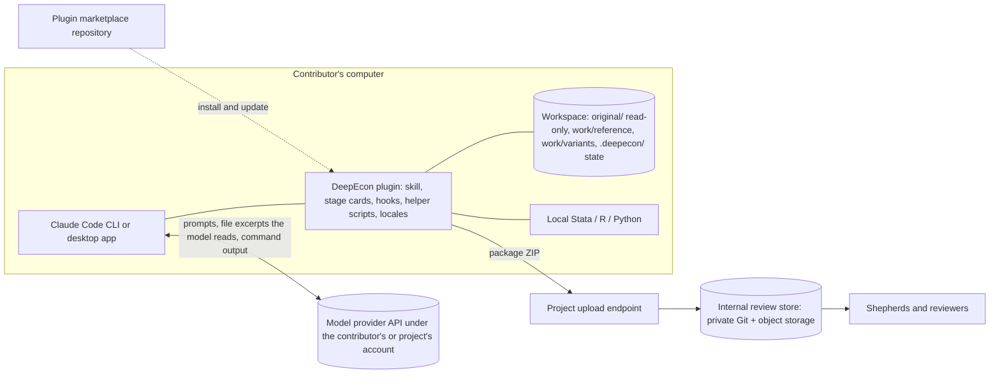

# Deliverable 6 — Option B: Local Claude Code Skill

| | |
|---|---|
| **Status** | **Proposed design** v0.1.0 (2026-11-05). One of two candidate architectures; **not selected**. Comparable in depth and assumptions to [Option A](option-a-hosted-platform.md). |
| **Shared foundations** | [Construction protocol](../methodology/benchmark-construction-protocol.md) · [Interview protocol](../interview/expert-interview-protocol.md) · [Schema](../../schemas/README.md) · [Submission](submission-mechanisms.md) · [Bilingual design](bilingual-design.md) · [Cost and effort model](cost-and-effort-model.md) |
| **Evidence** | Claude Code facts: [R2](../research/evidence/R2-claude-code-platform.md). Access, pricing, and policy: [R3](../research/evidence/R3-access-pricing-policy-portability.md). Items marked [U] await confirmation there. |

---

## 1. Summary

The project publishes a **DeepEcon Contributor plugin** for Claude Code. A contributor installs Claude Code (terminal or desktop app), adds the plugin, opens a working folder next to their replication package, and starts the contribution skill. The interview, the code inspection, the construction of flawed variants, local execution in Stata, R, or Python, validation, and packaging all happen on the contributor's computer. Model inference goes to the model provider under the contributor's account, or under an account the project provides. The output is the same standardized package as in Option A.

| Property | Option B |
|---|---|
| Where the interview runs | Contributor's Claude Code session |
| Where code runs | Contributor's machine, with their installed software (including Stata) |
| Who pays for inference | The contributor by default; the project if it provides seats or API access (Open question O-006) |
| What the project operates | Plugin distribution, a submission endpoint, the internal review pipeline, and support |
| Model consistency | Recommended, not enforced, unless the project provides model access (§5.3) |

## 2. Contributor experience

### 2.1 Journey (the brief's 13 steps, refined)

| # | Step | What the contributor sees and does | Typical time [U: to be measured in the pilot] |
|---|---|---|---|
| 1 | Discover | Project page (English / 中文): motivation, what a contribution involves, credit policy | 5–10 min |
| 2 | Check requirements | A short checklist: Claude access (own plan or project-provided), operating system, Stata, R, or Python as used by the paper | 5 min |
| 3 | Install Claude Code | Terminal installer or desktop app (§3.2); sign in | 10–30 min; the main barrier for non-technical users |
| 4 | Install the plugin | Two commands, e.g. `/plugin marketplace add <org>/deepecon-contributor` then `/plugin install deepecon-contributor@<org>` [U: exact syntax per R2]; or, in the desktop app, the equivalent UI | 2–5 min |
| 5 | Prepare a folder | Put (or point to) the replication package and the paper PDF in a working folder. The plugin never modifies the original package | 5 min |
| 6 | Start | Run the contribution skill, e.g. `/deepecon-contributor:contribute` | — |
| 7 | Choose language | English or Simplified Chinese; stored for resumption | 1 min |
| 8 | Consent | Data-flow disclosure tailored to the account in use; designation of any restricted-data folders, which the plugin then blocks from being read (§6.3) | 5 min |
| 9 | Interview | Stages S1–S4 and S6 of the protocol in conversation; the model reads the paper and code locally and cites file and line | 1.5–3 h, across sessions |
| 10 | Operationalize | The model drafts flawed variants in a separate folder; the contributor approves; the plugin runs reference and variant locally (Stata/R/Python) with permission prompts; results are compared | 0.5–2 h |
| 11 | Validate | A "package doctor" checks the schema, leakage, original-file integrity, and run outputs | 5 min |
| 12 | Review and approve | Dossier summary with provenance badges in the contributor's language; edits, rejections, withdrawals | 15–30 min |
| 13 | Export and submit | A ZIP package; upload through a private link (default) or a private Git repository (optional) | 5 min |

### 2.2 Research-assistant mode

A senior economist can do steps 6–9 and 12 in conversation, in the desktop app if they prefer, while a research assistant performs steps 10–11 on their own machine with the same plugin, using the hand-off specification written into the session folder. Speakers and actions are attributed in the provenance record.

## 3. Architecture

### 3.1 Diagram



### 3.2 Surfaces

| Surface | Suitability | Status |
|---|---|---|
| Claude Code in a terminal (macOS, Linux, Windows) | Full capability; familiar to technically fluent economists | [U: OS support details per R2] |
| Claude Code in the desktop app | Same agent without a terminal; plugins and skills supported [U: verify parity of plugins, hooks, and permission prompts] | Pending R2 |
| Claude Cowork or other non-developer surfaces | Potentially the most accessible option for non-technical economists, if they support plugins, local files, and code execution [U] | Pending R2 |
| Other agent tools that read the open Agent Skills format | Could run a portable subset of the skill with non-Anthropic models (e.g., where Claude is unavailable) [U] | Pending R3; consistency caveats in §5.3 |

## 4. Functional decomposition (identical to Option A's table)

| Function | How Option B provides it | Runs where | Who pays |
|---|---|---|---|
| F1 Onboarding and consent | Project web page + skill's S0 | Static site + local | Project (static hosting) |
| F2 Identity | Contributor's name and e-mail in the package; verified at submission | Local + upload endpoint | Project |
| F3 Materials ingestion | The model reads local files directly | Local | — |
| F4 Interview engine | Skill + stage cards + model | Local client, remote model | Contributor or project (O-006) |
| F5 State and provenance store | `.deepecon/` files written through a schema-validating helper | Local | — |
| F6 Code execution | Local Stata, R, or Python through run wrappers | Local | Contributor (own compute and licences) |
| F7 Validation | Package doctor (schema, leakage, integrity, comparisons) | Local; repeated at intake | Project (development) |
| F8 Packaging | Helper builds the ZIP with checksums | Local | — |
| F9 Submission | Upload link or private Git | Project endpoint | Project |
| F10 Review and feedback | Internal pipeline; feedback by e-mail or follow-up session | Project | Project |
| F11 Internationalization | Locale assets; model converses in the chosen language | Local | — |
| F12 Telemetry and cost control | Per-session metrics written into the package; spend controls only if the project provides model access | Local | — |
| F13 Support and updates | Documentation, office hours, issue tracker; plugin updates through the marketplace | Project | Project |

## 5. How the expert interview operates

### 5.1 Packaging the protocol as a skill

```
deepecon-contributor/                 # plugin root
├── .claude-plugin/plugin.json        # name, version, description [U: format per R2]
├── skills/
│   └── contribute/
│       ├── SKILL.md                  # orchestration: stance, stage policy, rules, tool usage
│       ├── stages/                   # stage cards S0–S7 (loaded on demand)
│       ├── probes/                   # probe library (IDs; phrasings per locale)
│       ├── pitfalls/                 # design-specific pitfall taxonomy with citations
│       └── templates/                # summaries, consent text, hand-off spec
├── hooks/                            # protect originals; record session metadata [U]
├── scripts/                          # helper CLI: state, provenance, run wrappers, doctor, packager
├── locales/{en,zh-Hans}/             # user-facing strings and templates
└── schemas/                          # copy of the contribution schema (versioned)
```

Progressive disclosure keeps the model's context small: `SKILL.md` holds the always-needed rules; stage cards, probes, and pitfalls are read when a stage begins [U: progressive-disclosure behaviour per R2].

### 5.2 State, provenance, and resumption

- The model never writes the dossier free-hand. It calls the helper (e.g., `deepecon dossier add-statement --origin llm_suggested ...`), which validates against the schema and refuses records without provenance.
- Each LLM suggestion is logged with the contributor's disposition, so the LLM-origin share can be computed.
- Session state lives in `.deepecon/`. Resuming re-reads the last checkpoint summary rather than relying on the conversation history.
- Claude Code's own session history and checkpoints are a convenience, not the record of truth [U: checkpoint semantics per R2].

### 5.3 Model selection and consistency

- **Recommended:** Claude Opus 5.5 at a stated effort level. Whether a plugin or skill can *require* a model is pending R2 [U].
- **Recording:** the package records the model actually used, as reported by the client or a session hook [U], and the plugin version.
- **Consistency risk.** Contributors may run different models, effort levels, and Claude Code versions. Mitigations: (a) the project provides model access (seats, API keys with spend caps, or a gateway), which also standardizes data-use terms; (b) a pre-flight check that warns when the model differs from the tested list; (c) protocol evaluations (simulated contributors) run for each supported model.
- **Other models.** Contributors without Claude access could use the skill in another agent tool that reads the open skill format, or point Claude Code at another provider's compatible endpoint [U: per R3]. Interview quality would then be unvalidated until that model passes the protocol evaluations.

### 5.4 Bilingual behaviour

Per the [bilingual design](bilingual-design.md): model-facing instructions in English, in one place; user-facing templates and probe phrasings per locale; glossary-anchored terminology; originals preserved; English working translations labelled.

## 6. Replication materials

### 6.1 Protecting the original package (D-011)

Defence in depth; none of these layers is sufficient alone.

1. **Workspace layout.** The original package sits in `original/`, made read-only by the setup script. All work happens on copies in `work/`.
2. **Permission rules.** Plugin-provided settings deny edits and writes under `original/` [U: whether plugins can ship such settings, per R2].
3. **Hook.** A pre-tool-use hook blocks any edit, write, or shell command that targets `original/` [U: hook mechanics per R2].
4. **Integrity check.** A checksum manifest of `original/` is taken at setup and verified before export; any change blocks packaging.
5. **Audit trail.** `work/` is a local Git repository; each flawed variant is a branch or commit with a patch, so every change is reviewable.

### 6.2 Execution

Run wrappers call `stata -b do`, `Rscript`, or `python` with logs, captured outputs, and recorded software versions. The contributor approves commands through the client's permission prompts, or pre-approves the wrappers only. Stata runs under the contributor's own licence. This is Option B's distinctive strength: the original software environment is already there.

### 6.3 Restricted data

At S0 the contributor designates any restricted-data folders. The plugin then denies the model read access to them [U: read-deny rule support, per R2] and the protocol avoids requesting their contents (DP-28). Code and aggregate outputs remain available. The disclosure explains that anything the model reads is sent to the model provider.

## 7. How correct and flawed packages are produced

| Artifact | Produced by | How |
|---|---|---|
| Reference implementation | Contributor or RA, assisted by the model | Run the original (or a cleaned copy) locally; capture outputs and intermediate outputs |
| Independent check | Shepherd, later (or RA) | Cross-language re-implementation in the internal pipeline |
| Flawed variants | Model drafts the minimal diff in `work/variants/<id>/`; contributor approves | Patch plus files; run locally; consequence comparison by the helper |
| Consequence evidence | Helper | Comparison under the pre-registered materiality rule; optional quick resampling check |

## 8. Validation

Local: schema validation, leakage scan, original-integrity check, re-run of reference and variants, comparison against predictions. Everything is re-run at intake; local validation provides fast feedback but is not trusted on its own.

## 9. Submission

The package ZIP goes through a private upload link (default) or a private Git repository (technical contributors), per the [submission analysis](submission-mechanisms.md). Option B does **not** require GitHub for submission.

## 10. Privacy, confidentiality, and licensing

| Data | Leaves the contributor's machine? | To whom | Under which terms |
|---|---|---|---|
| Prompts, the model's view of files it reads, command outputs | Yes | Model provider | The contributor's account terms (consumer or commercial) or the project's, if provided [U: training and retention terms per R3] |
| Files the model does not read (e.g., denied restricted data) | No | — | — |
| Final package | Yes, at submission | Project | Project privacy notice; licence records |
| Telemetry from the client | Possibly | Provider | Client settings [U: per R2] |

**Key point.** Local execution does not mean local inference (Safeguard E). Unpublished code from Path B contributors is sent to the model provider whenever the model reads it. A further risk specific to Option B: if a contributor uses a consumer plan with model-training use enabled, hidden-tier material (flawed variants, answer keys) could enter training data — a benchmark-contamination risk. Project-provided access, or a documented opt-out, mitigates it; the account terms are recorded in `consent.contributor_account_terms`.

## 11. Third-party dependencies

| Dependency | Role | Risk |
|---|---|---|
| Claude Code (client) | Host for the skill | Fast-moving product; plugin interfaces can change; availability by plan and region |
| Model provider (Anthropic by default) | Inference | Availability by region (O-007); terms; model changes |
| Plugin marketplace repository (e.g., GitHub) | Distribution and updates | Reachability in some regions; alternative: downloadable archive |
| Python runtime for helper scripts | State, validation, packaging | Installation friction on some machines [U: whether Claude Code already provides a usable runtime] |
| Contributor's Stata, R, or Python | Execution | Version heterogeneity |

## 12. Costs (assumptions shared with Option A; details in the [cost model](cost-and-effort-model.md))

| Cost | Who pays | Order of magnitude |
|---|---|---|
| Inference per contribution | Contributor (own plan) or project (O-006) | About $6–46 at Opus 5.5 API list prices with prompt caching, central ≈ $17 (model in cost doc). On a subscription the marginal cost is zero, but plan limits may bind [U] |
| Contributor subscription | Contributor, unless reimbursed | Plan prices per R3 [U] |
| Plugin and helper development | Project | See §13 |
| Hosting | Project | Static project page plus upload endpoint: small |
| Support | Project | Higher than Option A per contributor, because environments differ |
| Shepherding and review | Project | Same as Option A; likely the largest cost |

## 13. MVP build plan

| Component | Effort (engineer-weeks) [U: planning estimates] |
|---|---|
| Shared core: protocol assets, schema tooling, validator, packager, internal review pipeline | 9–16 (shared with Option A; counted once) |
| Plugin skeleton, `SKILL.md`, stage loading, locale handling | 2–3 |
| Helper CLI: state, provenance, suggestion ledger, doctor | 2–3 (partly shared core) |
| Original-file protection: layout, rules, hook, integrity check | 1 |
| Run wrappers and environment capture for Stata, R, Python | 1–2 |
| Installation and contributor guides (EN/ZH), troubleshooting | 1–2 |
| Test matrix: macOS / Windows / Linux × Stata / R / Python; desktop app | 1–2 |
| **Option B-specific total** | **≈ 7–12**, plus the shared core |

**Milestones:** (1) skill runs S0–S4 on a sample paper with state and provenance; (2) S5 with protection and run wrappers; (3) packaging, doctor, and bilingual assets; (4) cross-platform test pass; (5) pilot release.

## 14. Operations and maintenance

- **Versioning:** plugin and protocol follow semantic versioning; packages record both. Contributors can be mid-contribution when a new version ships, so sessions finish on the version they started with (protocol §16).
- **Updates:** through the marketplace [U: auto-update behaviour per R2]. A pre-flight check warns when the installed version is outdated.
- **Platform drift:** the host product changes frequently; each client release needs a regression run of the simulated-contributor suite.
- **Support:** documentation, office hours, an issue form. Installation problems vary by operating system and software setup.

## 15. Scalability

Compute and inference scale automatically with contributors' own resources. Project effort scales with **support** (environment heterogeneity) and **shepherding** (the same as Option A). International reach depends on model availability in each contributor's region (O-007).

## 16. Risks

| Risk | Likelihood | Impact | Mitigation |
|---|---|---|---|
| Non-technical economists do not complete setup | Medium–High [U: pilot] | High | Desktop app; research-assistant mode; guided onboarding sessions; hybrid with hosted onboarding |
| Inconsistent model or client versions degrade interview quality | Medium | Medium–High | Project-provided access; pre-flight checks; per-model protocol evaluations |
| Hidden material enters model training through consumer accounts | Low–Medium [U: per R3] | High (contamination) | Project-provided access or documented opt-out |
| Plugin breaks after a client update | Medium | Medium | Regression suite per release; version pinning guidance |
| Original files modified despite safeguards | Low | High | Layered protection; integrity check blocks export |
| Contributors in unsupported regions cannot use Claude | Depends on population | High there | Alternative harnesses with validation caveats; RA-led or hosted path (O-007) |
| Support load exceeds capacity | Medium | Medium | Office hours; FAQ; limit the supported environment matrix |

## 17. The brief's stated advantages and disadvantages, assessed

| Claim in the brief | Assessment |
|---|---|
| "May substantially reduce our hosting and model-inference expenses." | **Partly true, but small in absolute terms.** Hosting savings are real but modest (Option A's hosting is also small at this scale). Inference is roughly $17 per contribution at API list prices, so about $3,400 for 200 contributions in the central case, versus likely hundreds of hours of shepherding. The saving is not a strong decision driver; and if the project reimburses subscriptions, B can cost *more* than A's direct API usage. |
| "Direct access to the contributor's local research environment." | **True and important** for operationalization (S5), especially for Stata-based packages and author-held materials. It is the clearest advantage of B. |
| "Focus development effort on interview, specification, and validation quality." | **True.** No web application, authentication, or storage of materials to build or secure. Some effort shifts to cross-platform support. |
| "Contributors need access to Claude Code, suitable models, and research software." | **True; severity depends on the population.** The desktop app lowers the terminal barrier; regional availability remains a hard constraint for some contributors. |
| "Some senior economists may not want to install or operate such tools." | **Plausible; must be measured** (pilot PQ1). Research-assistant mode reduces the economist's direct burden. |
| "Model behaviour may differ across versions, settings, and model access." | **True.** Mitigable mainly by project-provided access, which also moves part of the cost back to the project. |
| "Local execution does not guarantee offline inference." | **True and essential to communicate** (§10). |

## 18. Open questions specific to Option B

1. Who pays for model access, and through which mechanism (O-006)?
2. Can a plugin enforce, or only recommend, the model, the permission rules, and the hooks described here? (R2)
3. Is the desktop app (or Cowork) a full-capability surface for the plugin, including local execution and hooks? (R2)
4. What is the supported environment matrix for the first release?
5. How are contributors in regions without Claude access served (O-007)?
