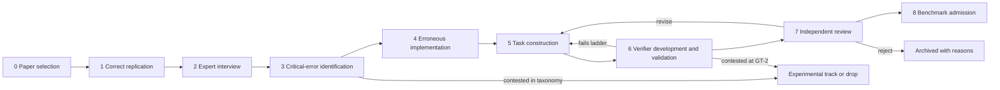

# Deliverable 2 — Benchmark Construction Protocol

| | |
|---|---|
| **Status** | **Proposed** v0.2.0 (2026-11-05). Not yet reviewed by the research lead. v0.2.0 integrates two independent reviews (§10). |
| **Scope** | The complete path from a published paper to an admitted benchmark task: paper selection → correct replication → expert interview → critical-error identification → erroneous implementation → task construction → verifier development → independent review → benchmark admission. |
| **Architecture independence** | Every stage is defined in terms of roles, artifacts, and gates, never in terms of a user interface. Options A and B implement Stages 1–4 differently; Stages 5–8 run in the project's internal pipeline under either option. The exposure rules (§8) bind both. |
| **Companion documents** | [Task-quality rubric](task-quality-rubric.md) · [Verifier validation protocol](verifier-validation-protocol.md) (**VVP**) · [Expert interview protocol](../interview/expert-interview-protocol.md) · [Contribution schema](../../schemas/README.md) · [Cost model](../architecture/cost-and-effort-model.md) · [Decision log](../decisions/decision-log.md) |

---

## 1. Principles

1. **Source materials are not tasks** (brief §3.5; D-003). Correct and flawed packages are evidence. Tasks are distilled from them: a short instruction, a controlled environment, and a hidden verifier.
2. **Quality over quantity** (*Good Benchmarks* §10). One to three strong tasks per paper is success. Expect most candidates not to survive.
3. **Separate the scientist from the task engineer** (*Good Benchmarks* §9: domain expertise and task-building skill differ). The contributing economist supplies scientific substance and sign-off; a **shepherd** from the benchmark team owns task and verifier engineering, from candidate to admission.
4. **Grade outcomes; test procedures through outcomes** (*Good Benchmarks* #6, §7; brief §10B). Agents deliver results *and* the code that produces them; verifiers re-run that code on hidden data (VVP §5).
5. **Distinguish validity layers** (D-013): computational (implementation fidelity), measurement, statistical, identification, and interpretation. Each failure mode has a primary layer and optional secondary layers; verifiability tiers (V1, V2a, V2b, V3, V4) are set per graded output, not by layer (VVP §9).
6. **Candidates until independently validated** (D-010).
7. **No leakage by construction** (D-009): four physically separated tiers; automated leakage scans; hidden-tier material only under no-training terms (§8).
8. **Blind first.** Outside economists solve the task from the agent tier alone (rubric SP-1); a port never serves as the reference's independent check (GT-1).

**Terms.**
- *Port:* the original code translated into R or Python for the task environment.
- *Clean twin:* the same restructured package without the planted error (Stage 4).
- *Conditional reference:* the correct answer given an accepted alternative choice or a declared convention (VVP §4).
- *Crux:* the decision the task is designed to test.
- *Four tiers* (D-009): contributor, internal, agent, and hidden; the evaluated agent sees only the agent tier.

## 2. Roles and staffing

| Role | Who | Blinding | Responsibilities | Effort [U] |
|---|---|---|---|---|
| Contributing economist | Top-5 / leading-field author (Path B: contributes their own paper) or expert replicator (Path A: reproduces a paper from the curated collection) | Unblinded | Scientific content: critical decisions, failure modes, consequences, realism warrants; approval of the dossier and of agent-facing wording | 3–8 h per contribution |
| Research assistant (optional) | Nominated by the contributor, or provided by the project | Unblinded | Runs code; builds flawed variants under the economist's direction; recorded as such | 5–20 h per contribution |
| Shepherd | Benchmark-team member with economics training and benchmark-engineering skill | Unblinded | Task and verifier engineering, from candidate to admission | ≈ 10 h (5–20) per contribution, **dropped candidates included**, plus ≈ 30 h (15–60) per admitted task |
| Clean-room implementer | An RA or engineer, not the shepherd | Has not read the original code | Independent re-implementation (GT-1), unless a correct blind solve serves | 5–20 h per target analysis, within shepherd-team hours |
| Blind outside economists | Two economists outside the contribution (fallback in rubric SP-1) | Agent tier only, until their work is recorded | Blind acceptance criteria and solve (SP-1); afterwards may classify status or serve as domain reviewer | 3–8 h each |
| Status classifiers | Outside economists | Blind to one another | GT-2 after RV-2, L4, and L7: one for a vetted-taxonomy item with a canonical citation, two for a novel item | 0.5–2 h per failure mode each |
| V3 raters and calibration panel | Outside economists, at least five per V3 item | Blind to one another | V3 keys, and the agreement study that qualifies each item type (VVP §9); experimental in the first release | 0.5–1 h per item per rater; the study once per item type |
| Independent domain reviewer | An outside economist who has attempted the task blind (PR-2) | Unblinded | Scientific correctness; confirms status; reviews hidden-variant data-generating processes (VVP §6) | 2–8 h |
| Independent benchmark reviewer | Has built benchmark tasks; qualified per VVP §11 | Unblinded | Specification, verifier fairness, shortcut resistance, leakage and exposure audit | 2–4 h |
| Release editor | Senior project member | Unblinded | Admission and release composition; deviations from the materiality rule; each release's difficulty band | — |

These are planning estimates for the pilot to measure: outside economists together need **about 15 h (5–35 h) per admitted task**, the two reviewers about 8 h (4–12 h); the [cost model](../architecture/cost-and-effort-model.md) aggregates them and adds validation-trial compute.

Paths A and B are the two contribution pathways defined in §3.1 of the research lead's brief (D-002); they are unrelated to architecture Options A and B.

## 3. Pipeline overview

Stages 2–4 interleave in practice: the interview identifies errors, the variant is built and run, and observed consequences feed back into the conversation.

## 4. Stages

Each stage has gate lines taken from the rubric's *Who / when* column: **Gate** lists the rubric criteria marked [G] that a task must pass at that stage; **Also assessed** lists the other rubric criteria checked there. Codes such as RV-2 or GT-1 are rubric criteria; L0–L13 are rungs of the VVP validation ladder (VVP §3); P-PRED, P-VALID, and P-1FACT are interview probes ([interview protocol](../interview/expert-interview-protocol.md#8-probe-library) §8).

### Stage 0 — Paper selection

**Goal.** A curated collection of papers (Path A) and a screen for author-submitted papers (Path B) that can yield verifiable tasks.

**Selection criteria (proposed).**

| Criterion | Requirement | Why |
|---|---|---|
| Venue | Top-5 at first (AER, Econometrica, JPE, QJE, REStud); leading field journals later | Brief §3 |
| Replication package | Public package (e.g., openICPSR, Dataverse, Zenodo) or author-held package (Path B) | Evidence base for Stage 1 |
| Data route | **Redistributable** for evaluation, checked file by file; or, for restricted data, **fully synthetic only** (every variable synthesized; disclosure review; provider permission where required). Effect-injected, perturbed, and semi-synthetic data on real covariates inherit the original licence, so they serve only as hidden-variant techniques for redistributable data (VVP §6). | Tasks must run in a controlled, offline environment (*Good Benchmarks* #7); restricted microdata never enter packages (P-015). Compliance with the Data and Code Availability Standard (DCAS) or a CC BY deposit does not prove a file can be redistributed: in November 2024, for example, PSID extracts were removed from many AEA packages; PSID and WRDS data cannot be redistributed, while IPUMS extracts may be published to meet journal requirements [P-full, R8]. About 72% of AEA intake cases involve some access restriction [P-full], so fully synthetic routes will be common. They lose real-data quirks (duplicates, miscoded treatment, unbalanced panels), so task counts are reported by **failure-mode category × data route**. |
| Compute | Target analysis runs in minutes on standard hardware; the exact screen is derived from a stated **re-execution budget** (one run × the hidden instances graded per trial) and the L9 replay budget | The verifier re-runs agent code on every hidden instance, and L9 replays each correct implementation at least 300 times (VVP §5.1, L9) |
| Software | Any for contributor-side work; task environments use open-source software (R or Python) unless a licensed track is created | Stata appears in 71.6% of packages [S, R8], so most tasks need an R or Python port, checked for numerical equivalence. A licensed Stata track has its own leakage problem (the evaluated agent could read the mounted licence file) and unclear terms for automated use [R8]. |
| Design | Coverage across designs: difference-in-differences and event studies, IV, RD, randomized experiments, shift-share, synthetic control, panel fixed effects; structural work later | Breadth of capabilities |
| Consequential decisions | At least one critical decision whose mis-handling is a known pitfall | Raw material for flawed variants |
| Contamination | Note how famous the paper is. For the **held-out split**, prefer Path B packages that are unpublished or published after the evaluated models' training cutoffs; record both dates | Perturbed data defeat memorized numbers, not memory of the paper (rubric LK-4) |
| Contributor | Ideally an original author (Path B) or an economist with deep knowledge of the paper | Tacit knowledge (brief §3.1) |

**Gate:** EN-3. **Automatable:** metadata harvesting, package availability and licence checks, compute screening. **Human judgment:** whether the paper has consequential, teachable decisions; data route; contamination risk.

**Output:** `paper` and `source_package` records, with the data route; Path A collection entry.

### Stage 1 — Correct replication

**Goal.** A validated **reference implementation** for one or more bounded **target analyses** (e.g., Table 2, column 1), not the whole paper (*Good Benchmarks* §3: avoid "too wide" tasks).

**Activities.**
1. Run the source package; record environment, outputs, and intermediate outputs (estimation-sample size, number of clusters, first-stage statistics, cohort sizes).
2. Compare to published values; explain discrepancies.
3. **Separate estimand, assumptions, and estimator** (VVP §4 item 1; Lundberg, Johnson & Stewart 2021 [U]): (a) the **estimand**, in potential-outcome terms, with explicit weights over treated (cohort, period) cells, the event window, and the population; (b) the **identifying assumptions** (comparison group, base period, anticipation), stated in the instruction or chosen from the benchmark-wide convention vocabulary; (c) the **estimator**, never part of the estimand. "Not-yet-treated counties as controls" is an assumption, not part of the estimand.
4. **Independent check** (GT-1): a **clean-room re-implementation** from the paper, the estimand statement, and the codebook by someone who has not read the original code, or a correct blind solve at Stage 5. The **open-source port** for task environments is a separate artifact, verified for numerical equivalence; it inherits the original's logic and natural errors (e.g., duplicated observations or a miscoded treatment [S, R8]), so it is not the check. Every disagreement is adjudicated and logged as a candidate natural error. Run reference implementations on at least two platforms, because Stata results can change with version and processor count [P-full, R8]. Passing a data-editor check is not proof of correctness: I4R found coding errors in about a quarter of economics studies it reproduced [S].
5. Record known limitations of the original analysis, including any genuine problems discovered (they may become tasks, or disqualify the target).

**Gate:** GT-1. **Automatable:** running, environment capture, output comparison, diffing implementations. **Human judgment:** estimand, assumptions, and estimator; explaining discrepancies; deciding that the reference is correct.

**Output:** `target_analyses`, `reference_implementations` (internal tier).

### Stage 2 — Expert interview

**Goal.** A contributor-approved **candidate dossier**: critical decisions, failure modes, consequences, evidence, and task ideas, with provenance for every statement.

The conversational protocol is specified in [Deliverable 3](../interview/expert-interview-protocol.md). Key properties: evidence-first (the interviewer reads the paper and code before asking), contributor-first (the contributor's own ideas before any LLM suggestion), one or two questions per turn, resumable sessions, explicit stopping rules, and human sign-off. Interview sessions create hidden-tier material, so they follow the exposure rules (§8).

**Gate:** RV-1, LK-5, PR-1 (including measured AI influence). **Automatable:** pre-reading, design-map drafting, transcription, structuring, provenance and exposure bookkeeping, consistency checks. **Human judgment:** everything scientific.

**Output:** `interview_records`, `critical_decisions`, preliminary `failure_modes`.

### Stage 3 — Critical-error identification

**Goal.** For each candidate failure mode: why it is wrong, why it is realistic, its validity layers, the contributor's status claim, a pre-registered predicted consequence, and a detection idea.

**Activities.**
1. Classify the **primary validity layer** and any secondary layers; the contributor classifies first (interview S4).
2. Record the contributor's **status claim**, with references; outside classification sets the status after RV-2, L4, and L7 (GT-2, Stage 6), when the conditions can be checked on the grading data. Items the vetted pitfall taxonomy marks contested leave the scored path here (D-013, X-003).
3. Record the **realism warrant** (RV-3).
4. Record the contributor's **predicted consequence** before any flawed code is run (P-PRED, including "changes the standard error or confidence interval without moving the estimate"), to test understanding and prevent post-hoc rationalization.
5. Record look-alike choices that are valid (P-VALID); they seed the decision space.
6. Record the contributor's **P-1FACT** answer only as a prediction; the test needs agents and runs at Stage 6 as the hint ladder (SP-3).

**Gate:** RV-3. **Automatable:** citation retrieval and verification in a fresh context, consistency checks. **Human judgment:** layers, realism, consequentiality.

### Stage 4 — Erroneous implementation

**Goal.** One **flawed variant** per failure mode: a minimal change to what the code computes, applied to a restructured copy of the reference, the *restructured presentation* (files, variables, and identifiers re-keyed; ported where needed). The same restructured copy without the change is the variant's **clean twin**, so the two differ only in the planted error. Originals are never modified (D-011).

**Activities.**
1. Build one restructured presentation from the reference (variables, files, and identifiers re-keyed; ported where needed), and derive the flawed variant and its clean twin from it, storing the patch and full files separately. The restructuring also disguises the paper (LK-4).
2. **Re-check realism in the port's language** (RV-3): a Stata-default pitfall may not be a realistic mistake in R.
3. Run the variant; compare with the reference under the rubric's **materiality rule** (RV-2), fixed before the run.
4. Compare observed with predicted consequences. A mismatch is informative: it can reveal a misunderstanding, data-equivalence (VVP §2, type 2), or a new insight.
5. **Robustness of the consequence:** check separation on resamples, previewing L7.
6. **Naturalness review** (LK-3): remove tell-tale signs (comments, names, formatting asymmetries).

**Gate:** RV-2, RV-3. **Also assessed:** LK-3. **Automatable:** applying patches, running, comparing, robustness simulations, tell-tale scans. **Human judgment:** the variant's fidelity, and its realism in the port's language; whether the consequence is scientifically meaningful.

**Output:** `flawed_variants` with `consequence` evidence (hidden tier).

### Stage 5 — Task construction

**Goal.** Turn source materials into a task: a brief, human-authored instruction; a controlled environment; a benchmark-wide output contract; and a hidden verifier design.

**Task-type patterns (proposed for the first release; see §6):**

| Task type | What the agent receives | What the agent must deliver | How it is verified | Role of flawed variants |
|---|---|---|---|---|
| **Research execution** | Data (per the data route), codebook, research question, estimand, and identifying assumptions. Not the estimator. | Results in the type's output schema, and the code producing them | Re-execution of the agent's code on the main data and answer-changing hidden variants, plus invariances, against conditional references (VVP §5) | Negative controls: implementing the flawed approach must fail |
| **Error correction (diagnose and repair)** | A package presented as a colleague's implementation of a stated estimand, with an audit-and-correct instruction. Some instances are **clean twins** (Stage 4), in a share fixed per release and not disclosed. | Corrected results and code, or the unchanged result when nothing is wrong | **Repair** on flawed instances (matches the reference or a conditional reference); **preservation** on clean twins (unchanged, valid but unnecessary, or false alarm), reported separately (VVP §7). The instruction says whether valid changes count as unnecessary. | The presented package itself |
| **Error detection (structured)** | Same as error correction | Findings in a fixed format: location (file and step), category from a fixed taxonomy, severity | A key of **groups of equivalent locations and categories**, applied by a validated matcher; decoys must not be flagged; recall, false-alarm rate, and localization reported separately; unmatched findings adjudicated as possible natural errors (VVP §7) | The presented package itself |
| **Identification reasoning** (experimental) | Design description and results | Structured answers (e.g., which threat a given test addresses); computational falsification tests | V1 or V2a for computations; V3 key (VVP §9) | Optional |
| **Research interpretation** (experimental) | Results and candidate claims | Classification of claims as supported or unsupported | V3 key (VVP §9); contested claims excluded | — |

**Instruction authorship.** The final agent-facing instruction is written or substantially edited by a human (shepherd and contributor) and is short: goal first, practitioner language, "as broad as possible and as specific as necessary" (*Good Benchmarks* §4, §9). The authorship is recorded; unedited LLM-drafted instructions are not admissible (rubric SP-2).

**Output contract and environment.** One results schema and one environment per task type (rubric SP-4, EN-1); the contract never names a crux decision (VVP §4 item 4). For restricted sources, a person with authorized data access (normally on the contributor's team), working outside any model session (P-015), runs the original-data steps (the Stage 1 reproduction and the Stage 4 materiality run) and, at this stage, builds the fully synthetic data, which pass disclosure review before the project receives them; GT-1 and RV-2 are then re-run on the synthetic data (EN-3).

**Blind specification test** (rubric SP-1). After the leakage scan (LK-1) and before verifier engineering, two outside economists who have seen only the agent tier write acceptance criteria and attempt the task (`expert_solve` runs); only then are they unblinded. Disagreements tighten the instruction. A correct blind solve can be GT-1's independent check and an L3 witness; solve times give DC-2's time estimate. Fallback: one blind solve per task, two on a random quarter of each task type.

**Gate:** RV-4, GT-1 (if a blind solve is the check), SP-1, EN-1, EN-3, LK-1. **Also assessed:** GT-3, SP-2, SP-4. **Automatable:** environment building, leakage scan, format validators. **Human judgment:** instruction wording, task-type choice, estimand framing, blind solves.

### Stage 6 — Verifier development and validation

Build the verifier, then climb the VVP ladder L0–L11. After any change, re-run the rungs named in the VVP re-run matrix (VVP §3.1; an instruction or environment change re-runs L0–L12, Stage 7 review included); no edit is justified only by an agent's success. **Status classification** (GT-2: one or two outside classifiers, diagnostics on all grading data) follows L7 and precedes L8, so that no agent trials are spent on a contested item. Contested items leave the scored path.

**Gate:** GT-2, SP-3, SO-1, VE-1, VE-2, VE-4, EN-1, EN-4, LK-1, LK-4. **Also assessed:** GT-4, SP-4, SO-2, SO-3, VE-3, VE-5, DF-1, DF-3, EN-2, LK-2, DC-1, DC-2. **Automatable:** nearly all runs. **Human judgment:** choosing alternatives and hidden variants, triaging mutants and failures, status, crux alignment.

### Stage 7 — Independent review

The independent domain reviewer (a blind solver, now unblinded) and the independent benchmark reviewer assess the task against the full rubric (L12). The Stage 5 acceptance criteria and blind solves are re-checked against the L11 agent outputs (SP-1). Disputes about "standard practice" are settled by authoritative evidence, not assertion (*Good Benchmarks* §9). Reviews that keep producing critical concerns after two or three rounds are a red flag (*Good Benchmarks* §8).

**Gate:** RV-3, RV-4, GT-1, GT-2, SP-1, VE-4, EN-4, PR-2. **Also assessed:** GT-4, SP-2, DF-2, EN-2, LK-3, DC-1. **Human judgment:** entirely.

### Stage 8 — Benchmark admission

The release editor, with the benchmark reviewer, admits tasks to a release or to the experimental track, or rejects them, with reasons recorded. Admitted tasks carry versioned metadata. Each release lists its calibration models, reports task counts by failure-mode category × data route, and is frozen; a withdrawal takes effect at the next version (VVP §8). After admission (L13), issue reports trigger task repair (as in Terminal-Bench-Science's repair pull requests), statuses are re-classified at each release, and new rubric gates reach admitted tasks before the next release.

**Gate:** LK-1, LK-5.

**Release policy** depends on Open question O-001 (public, private, or split benchmark) and is not decided here.

## 5. Automation versus human judgment (summary)

| Stage | Can be automated | Requires human scientific judgment |
|---|---|---|
| 0 Selection | Metadata, licence and package checks, compute screens | Scientific suitability, data route, contamination risk |
| 1 Replication | Running, environment capture, comparisons | Estimand, assumptions, and estimator; accepting the reference as correct |
| 2 Interview | Pre-reading, structuring, bookkeeping, consistency checks | All scientific content |
| 3 Error identification | Citation retrieval and verification | Layers, realism, consequentiality |
| 4 Flawed implementation | Patching, running, robustness simulations | Fidelity of the variant; realism in the port's language |
| 5 Task construction | Environment, leakage and format checks | Instruction wording, task-type choice, blind solves |
| 6 Verification | Nearly all runs | Alternatives, hidden variants, status, failure triage, crux alignment |
| 7 Review | — | Entirely human |
| 8 Admission | Packaging, release metadata | Admission decision |

## 6. First-release task scope (proposal; requires the research lead's decision)

**Proposal.** Score the first release on **error correction** and **research execution** (tiers V1, V2a, and V2b), with **structured error detection** scored only alongside clean controls. Keep **identification reasoning** and **research interpretation** in an unscored experimental track until their V3 item types pass the agreement study (VVP §9).

**Why.** These two types are outcome-verifiable (*Good Benchmarks* #1, #6) and directly test failure modes 1, 4, and 6 in the brief (estimator–implementation mismatch, incorrect inference, substantive implementation errors). Error correction covers failure mode 2 (unaddressed identification threats) **only** when the instruction states the design and the flaw violates it with a unique, design-implied repair (e.g., already-treated units used as controls). Other repairs (unit-specific trends, a new comparison group, bounds) rest on assumptions, and keying one would impose a binary answer on a contested question (X-003); such threats go to the experimental track, graded on recognition and sensitivity outputs.

**Constraint from the literature.** Plain reproduction — re-running a package when code and data are supplied — is close to saturated for frontier agents: Claude Code reaches 93.4% task-level accuracy on SocSci-Repro-Bench, and CORE-Bench Hard is treated as solved ([evidence note R4](../research/evidence/R4-replication-benchmarks.md), summary) [P-page/S]. A research-execution task therefore qualifies only when **an expert-identified failure mode is its crux**: the obvious approach reproduces a flawed variant's answer, so the task tests the critical decision, not the ability to run code. Plain reproduction tasks may serve at most as a calibration floor.

**What this costs.** Failure modes 3 (irrelevant methodological discussion) and 5 (misleading causal interpretation) are under-measured in a first release scored this way. They are central to the brief's motivation, and the evidence suggests interpretation is the layer most open to manipulation: in one 2026 study, a confirmatory prompt moved Claude Code's support verdicts from 10% to 90% while its estimates barely changed (R4, summary) [S]. The experimental track and the V3 agreement study should therefore start in parallel, not later. A middle path is to include **structured claim-classification tasks** with consensus keys in the first release as a separately reported score. This trade-off is logged as Open question O-003 for the research lead.

**Scoring** follows VVP §8: binary, conjunctive rewards for execution and correction tasks; at least five trials per evaluated configuration; per task type, a mean with a 95% confidence interval from a bootstrap that resamples tasks (each task's trials kept together), never pooled; repair and preservation reported separately; the clean-control share fixed per release and undisclosed; models that touched construction marked *calibration-exposed*.

## 7. The "what makes a top-journal paper" objective (brief §3.4)

Journal placement is not a ground-truth label (X-001). Instead, the interview elicits **why** specific decisions made the paper convincing (Stage 2), and each such decision is recorded as a `critical_decision` with its validity layer and rationale. Aggregated across contributions, these records form a **credibility-criteria catalogue**: explicit, citable statements such as "clusters at the level of treatment assignment," "addresses heterogeneous effects under staggered adoption," "reports pre-trend evidence together with its power." The catalogue is a research output in its own right and a source of future task designs. It is never used to predict journal rankings, and while a paper has held-out tasks it omits that paper's identifiers (§8).

## 8. Contamination, leakage, and exposure (summary)

| Threat | Control |
|---|---|
| Published coefficients memorized or retrievable | No internet; perturbed or fully synthetic data; re-execution of agent code on answer-changing hidden variants with unseen bases (rubric LK-2; VVP §5.1) |
| Paper or package recognized from the agent tier | Shared restructured presentation (Stage 4); recognition probe (LK-4); unpublished or post-cutoff packages for the held-out split (Stage 0) |
| Flawed code compared against the public source package | Restructured or ported presented code; no internet; naturalness review (LK-3) |
| Hidden-tier material reaching model providers (VVP §10) | Every session, trial, or LLM call that sees hidden-tier material, interviews included, runs under commercial no-training terms (zero data retention where available); consumer accounts, even after an opt-out, handle only agent-tier or public material. Option A meets this by construction; Option B needs project-provided (if O-018 permits) or institutional commercial access ([Option B](../architecture/option-b-local-skill.md) §10.2). Terms are recorded in `consent.contributor_account_terms`, exposures in the log (LK-5) |
| Held-out split worn down or leaked | Run only by the project, vetted evaluators, or locally hosted open-weight models; exposures logged (LK-5); refresh after a set number of external evaluations; all tasks from one paper, twins included, in the same split; catalogue without those papers' identifiers (§7); disclosure embargo in contributor agreements |
| Task materials entering training data after release | Canary string; held-out split (O-001); periodic refresh |
| Hidden material in agent-facing text | Physical tier separation; automated leakage scan (LK-1) |
| Public submission channels | Private channels for any package containing hidden-tier material |

## 9. Parts of this protocol that need methodological validation

These are untested proposals. The pilot's methodology arm takes every candidate whose flawed variant has been run and shows a material consequence (or, beyond capacity, a random sample of at least six, stratified by arm) through the validation ladder up to independent review (VVP rungs L0–L12) and reports attrition by rung ([pilot plan](../pilot/pilot-evaluation-plan.md)); Phase 6 tests the rest.

1. **Yield and attrition:** consequential, realistic, discriminating failure modes per paper, and the rungs where candidates fail.
2. **Synthetic-data realism:** whether fully synthetic data and hidden-variant generators keep the error's consequence without encoding the contributor's assumptions (*Good Benchmarks* §7), and which failure-mode categories they lose.
3. **Data-equivalence:** how often flagship variants are data-equivalent to the reference (VVP §2, type 2).
4. **Re-execution in practice:** whether agents' code runs reliably under the output contract without the task degenerating into format compliance.
5. **Clean controls:** whether clean twins make audit-and-correct tasks measure judgment rather than over-caution or over-confidence.
6. **Blind specification:** whether two blind economists agree on SP-1, and what blind solves cost.
7. **V3 agreement** on identification and interpretation items.
8. **Effort:** shepherd and outside-economist hours per admitted task, dropped candidates included.
9. **One-sentence-fact tension:** how often failures disappear at hint H2 (`recognition_task`); their treatment is O-004 (Open).

## 10. Changes

**v0.2.0** (independent reviews, 2026-11-05): staffing with blinding and hours; data routes; re-execution budget; held-out preference; estimand separation; clean-room check; classification after L7; P-1FACT as a prediction; shared restructured presentation; blind solves; benchmark-wide contract; repair and preservation scoring; gate lines from the rubric; per-output tiers; narrower failure mode 2; scoring; exposure rules; the pilot's methodology arm.

- Cross-document consistency pass (2026-11-05): terms defined (§1); Paths A and B told apart from Options A and B (§2); gate lines and codes explained (§4); compute screen derived from the re-execution and L9 budgets (Stage 0); flawed variant and clean twin stated plainly (Stage 4); original-data steps for restricted sources assigned (Stage 5); re-run wording (Stage 6); task-resampling bootstrap (§6); methodology-arm wording (§9).

**v0.1.0** (2026-11-05): first version.
