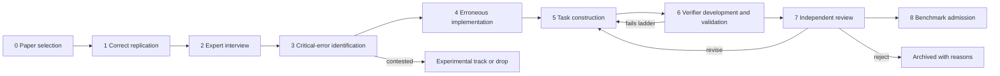

# Deliverable 2 — Benchmark Construction Protocol

| | |
|---|---|
| **Status** | **Proposed** v0.1.0 (2026-11-05). Not yet reviewed by the research lead. |
| **Scope** | The complete path from a published paper to an admitted benchmark task: paper selection → correct replication → expert interview → critical-error identification → erroneous implementation → task construction → verifier development → independent review → benchmark admission. |
| **Architecture independence** | Every stage is defined in terms of roles, artifacts, and gates, never in terms of a user interface. Options A and B implement Stages 1–4 differently; Stages 5–8 run in the project's internal pipeline under either option. |
| **Companion documents** | [Task-quality rubric](task-quality-rubric.md) · [Verifier validation protocol](verifier-validation-protocol.md) · [Expert interview protocol](../interview/expert-interview-protocol.md) · [Contribution schema](../../schemas/README.md) · [Decision log](../decisions/decision-log.md) |

---

## 1. Principles

1. **Source materials are not tasks** (brief §3.5; D-003). Correct and flawed packages are evidence. Tasks are distilled from them: a short instruction, a controlled environment, and a hidden verifier.
2. **Quality over quantity** (*Good Benchmarks* §10). One to three strong tasks per paper is success. Expect most candidates not to survive.
3. **Separate the scientist from the task engineer** (*Good Benchmarks* §9: domain expertise and task-building skill differ). The contributing economist supplies scientific substance and sign-off; a **shepherd** from the benchmark team owns task and verifier engineering, from candidate to admission.
4. **Grade outcomes; test procedures through outcomes** (*Good Benchmarks* #6, §7; brief §10B). Agents deliver results *and* the code that produces them; verifiers re-run that code on hidden data.
5. **Distinguish validity layers** (D-013): computational, statistical, identification, interpretation. The verifiability tier follows from the layer.
6. **Candidates until independently validated** (D-010).
7. **No leakage by construction** (D-009): four physically separated tiers; automated leakage scans.

## 2. Roles

| Role | Who | Responsibilities | Approximate effort per contribution [U: planning estimates, to be measured in the pilot] |
|---|---|---|---|
| Contributing economist | Top-5 / leading-field author (Path B) or expert replicator (Path A) | Scientific content: critical decisions, failure modes, consequences, realism warrants; approval of the dossier and of agent-facing wording | 3–8 hours |
| Research assistant (optional) | Nominated by the contributor, or provided by the project | Runs code; builds flawed variants under the economist's direction; recorded as such | 5–20 hours |
| Shepherd | Benchmark team member with economics training and benchmark-engineering skill | Task design, verifier engineering, validation ladder, iteration with the contributor | 10–40 hours per admitted task (*Good Benchmarks* §10 reports more than 40 hours for hard tasks) |
| Independent domain reviewer | Economist not involved in the contribution, able to solve the task | Scientific correctness; status of failure modes (established / conditional / contested) | 2–6 hours |
| Independent benchmark reviewer | Has built benchmark tasks before (*Good Benchmarks* §9 bar) | Specification, verifier fairness, shortcut resistance, leakage | 2–4 hours |
| Release editor | Senior project member | Admission decisions; release composition | — |

## 3. Pipeline overview

Stages 2–4 interleave in practice: the interview identifies errors, the variant is built and run, and observed consequences feed back into the conversation.

## 4. Stages

### Stage 0 — Paper selection

**Goal.** A curated collection of papers (Path A) and a screen for author-submitted papers (Path B) that can yield verifiable tasks.

**Selection criteria (proposed).**

| Criterion | Requirement | Why |
|---|---|---|
| Venue | Top-5 at first (AER, Econometrica, JPE, QJE, REStud); leading field journals later | Brief §3 |
| Replication package | Public package (e.g., openICPSR, Dataverse, Zenodo) or author-held package (Path B) | Evidence base for Stage 1 |
| Data | Redistributable for evaluation, **or** substitutable by semi-synthetic data preserving the design | Tasks must run in a controlled, offline environment (*Good Benchmarks* #7); restricted microdata never enter packages (DP-28) |
| Compute | Target analysis runs in under ~1 hour on standard hardware | Agent-trial and verifier budgets |
| Software | Any for contributor-side work; task environments use open-source software (R or Python) unless a licensed track is created | Proprietary licences break reproducible evaluation environments |
| Design | Coverage across designs: difference-in-differences and event studies, IV, RD, randomized experiments, shift-share, synthetic control, panel fixed effects; structural work later | Breadth of capabilities |
| Consequential decisions | At least one critical decision whose mis-handling is a known pitfall | Raw material for flawed variants |
| Contamination | Note how famous the paper is; prefer designs where perturbed or semi-synthetic data neutralize memorized results | Leakage (Safeguard F) |
| Contributor | Ideally an original author (Path B) or an economist with deep knowledge of the paper | Tacit knowledge (§3.1) |

**Automatable:** metadata harvesting, package availability and licence checks, compute screening. **Human judgment:** whether the paper has consequential, teachable decisions; contamination risk.

**Output:** `paper`, `source_package` records; Path A collection entry.

### Stage 1 — Correct replication

**Goal.** A validated **reference implementation** for one or more bounded **target analyses** (e.g., Table 2, column 1), not the whole paper (*Good Benchmarks* §3: avoid "too wide" tasks).

**Activities.**
1. Run the source package; record environment, outputs, and intermediate outputs (estimation-sample size, number of clusters, first-stage statistics, cohort sizes).
2. Compare to published values; explain discrepancies.
3. Define each target analysis's **estimand** precisely (parameter, population, treatment, outcome, design).
4. **Independent check** (GT-1): a cross-language re-implementation (e.g., Stata → R) or a line-by-line review by someone other than the implementation's author. A cross-language implementation also yields the open-source version that task environments need.
5. Record known limitations of the original analysis, including any genuine problems discovered (they may become tasks, or disqualify the target).

**Gate:** GT-1. **Automatable:** running, environment capture, output comparison, diffing implementations. **Human judgment:** estimand definition, explaining discrepancies, deciding that the reference is correct.

**Output:** `target_analyses`, `reference_implementations` (internal tier).

### Stage 2 — Expert interview

**Goal.** A contributor-approved **candidate dossier**: critical decisions, failure modes, consequences, evidence, and task ideas, with provenance for every statement.

The conversational protocol is specified in [Deliverable 3](../interview/expert-interview-protocol.md). Key properties: evidence-first (the interviewer reads the paper and code before asking), contributor-first (the contributor's own ideas before any LLM suggestion), one or two questions per turn, resumable sessions, explicit stopping rules, and human sign-off.

**Gate:** RV-1 and RV-3 (preliminary), PR-1. **Automatable:** pre-reading, design-map drafting, transcription, structuring, provenance bookkeeping, consistency checks. **Human judgment:** everything scientific.

**Output:** `interview_records`, `critical_decisions`, preliminary `failure_modes`.

### Stage 3 — Critical-error identification

**Goal.** For each candidate failure mode: why it is wrong, why it is realistic, its validity layer, its status (established / conditional / contested), a pre-registered predicted consequence, and a detection idea.

**Activities.**
1. Classify the validity layer.
2. Assign a status with a **standard of evidence** (*Good Benchmarks* §9): citations for established pitfalls; demonstrated conditions for conditional ones. Contested items leave the scored path (D-013, X-003).
3. Record the **realism warrant** (RV-3).
4. Record the contributor's **predicted consequence** before any flawed code is run, to test understanding and prevent post-hoc rationalization.
5. Record look-alike choices that are valid, so verifiers do not penalize them.
6. Run the **one-sentence-fact probe** (*Good Benchmarks* §9) on the failure mode.

**Gate:** GT-2, RV-3. **Automatable:** citation retrieval and verification in a fresh context (as in `interview-me`'s post-flight verification), consistency checks. **Human judgment:** status, realism, consequentiality.

### Stage 4 — Erroneous implementation

**Goal.** One **flawed variant** per failure mode: a minimal, documented diff applied to a copy of the reference implementation. Originals are never modified (D-011).

**Activities.**
1. Create the variant in a separate location; store the patch and full files.
2. Run it; record observed outputs; compare with the reference under the pre-registered **materiality rule** (RV-2).
3. Compare observed with predicted consequences. A mismatch is informative: it can reveal a misunderstanding, an equivalent-mutant situation, or a new insight.
4. **Robustness of the consequence:** check separation on resamples or semi-synthetic variants (the equivalent-mutant check, verifier ladder L7).
5. **Naturalness review:** remove tell-tale signs (comments, names, formatting asymmetries).

**Gate:** RV-2. **Automatable:** applying patches, running, comparing, robustness simulations, tell-tale scans. **Human judgment:** whether the variant faithfully represents the failure mode, and whether the observed consequence is scientifically meaningful.

**Output:** `flawed_variants` with `consequence` evidence (hidden tier).

### Stage 5 — Task construction

**Goal.** Turn source materials into a task: a brief, human-authored instruction; a controlled environment; an output contract; and a hidden verifier design.

**Task-type patterns (proposed for the first release; see §6):**

| Task type | What the agent receives | What the agent must deliver | How it is verified | Role of flawed variants |
|---|---|---|---|---|
| **Research execution** | Data (perturbed or semi-synthetic where needed), codebook, research question, precise estimand. Not the method. | Estimates and the code producing them | Acceptance region calibrated on reference and alternatives; re-execution on hidden variants; metamorphic relations | Negative controls: implementing the flawed approach must fail |
| **Error correction (diagnose and repair)** | A package presented as a colleague's implementation of a stated estimand, with an audit-and-correct instruction. Some instances are **clean controls** with no planted error. | Corrected estimates and corrected code (or the unchanged result when nothing is wrong) | Output must match the reference on main data and hidden variants. Clean controls penalize unnecessary "fixes". | The presented package itself |
| **Error detection (structured)** | Same as error correction | Findings in a fixed format: location (file and step), category from a fixed taxonomy, severity | Location-plus-category match against the hidden key; false-alarm rate measured on clean controls; unmatched findings triaged by a human (they may reveal real issues → task repair) | The presented package itself |
| **Identification reasoning** (experimental) | Design description and results | Structured answers (e.g., which threat a given test addresses); computational falsification tests | V2 for computations; V3 structured key validated by inter-expert agreement | Optional |
| **Research interpretation** (experimental) | Results and candidate claims | Classification of claims as supported or unsupported | V3 consensus key; contested claims excluded | — |

**Instruction authorship.** The final agent-facing instruction is written or substantially edited by a human (shepherd and contributor) and is short: goal first, practitioner language, "as broad as possible and as specific as necessary" (*Good Benchmarks* §4, §9). The authorship is recorded; unedited LLM-drafted instructions are not admissible (rubric SP-2).

**Environment.** Pinned, offline, open-source; data baked in; resource limits stated (rubric EN-1).

**Gate:** SP-1 to SP-4, RV-4. **Automatable:** environment building, leakage scan, format validators. **Human judgment:** instruction wording, task-type choice, estimand framing.

### Stage 6 — Verifier development and validation

Build the verifier, then climb the [validation ladder](verifier-validation-protocol.md) L0–L11: oracle, null, alternatives, negative controls, mutation analysis, metamorphic relations, hidden-variant separation, shortcut and cheat attacks, repeat stability, guided-agent fairness, agent trials with crux alignment.

**Gate:** VE-1 to VE-5, SO-1 to SO-3, DF-1, EN-2, LK-1, LK-2. **Automatable:** nearly all runs. **Human judgment:** choosing alternatives and hidden variants, triaging mutants and failures, crux alignment.

### Stage 7 — Independent review

An independent domain reviewer and an independent benchmark reviewer assess the task against the full rubric, including the **dual-verifier specification test** (SP-1: two economists write acceptance criteria from the instruction alone and must agree). Disputes about "standard practice" are settled by authoritative evidence, not assertion (*Good Benchmarks* §9). Reviews that keep producing critical concerns after two or three rounds are a red flag (§8).

**Gate:** PR-2, GT-2 (confirmed), LK-3. **Human judgment:** entirely.

### Stage 8 — Benchmark admission

The release editor admits tasks to a release, to the experimental track, or rejects them, with reasons recorded. Admitted tasks carry versioned metadata; post-admission issue reports trigger task repair (the Terminal-Bench-Science model of repair pull requests).

**Release policy** depends on Open question O-001 (public, private, or split benchmark) and is not decided here.

## 5. Automation versus human judgment (summary)

| Stage | Can be automated | Requires human scientific judgment |
|---|---|---|
| 0 Selection | Metadata, licence and package checks, compute screens | Scientific suitability, contamination risk |
| 1 Replication | Running, environment capture, comparisons | Estimand definition, accepting the reference as correct |
| 2 Interview | Pre-reading, structuring, bookkeeping, consistency checks | All scientific content |
| 3 Error identification | Citation retrieval and verification | Status, realism, consequentiality |
| 4 Flawed implementation | Patching, running, robustness simulations | Fidelity of the variant to the failure mode |
| 5 Task construction | Environment, leakage and format checks | Instruction wording, task-type choice |
| 6 Verification | Nearly all runs | Alternatives, hidden variants, failure triage, crux alignment |
| 7 Review | — | Entirely human |
| 8 Admission | Packaging, release metadata | Admission decision |

## 6. First-release task scope (proposal; requires the research lead's decision)

**Proposal.** Score the first release on **error correction** and **research execution** (tiers V1–V2), with **structured error detection** scored only alongside clean controls. Keep **identification reasoning** and **research interpretation** in an unscored experimental track until a V3 inter-expert agreement study shows that keys are reliable.

**Why.** These two types are outcome-verifiable (*Good Benchmarks* #1, #6) and directly test failure modes 1, 4, and 6 in the brief (estimator–implementation mismatch, incorrect inference, substantive implementation errors). Error correction also captures much of failure mode 2 (unaddressed identification threats) when the threat has a computational signature.

**Constraint from the literature.** Plain reproduction — re-running a package when code and data are supplied — is close to saturated for frontier agents: Claude Code reaches 93.4% task-level accuracy on SocSci-Repro-Bench, and CORE-Bench Hard is treated as solved ([evidence note R4](../research/evidence/R4-replication-benchmarks.md), summary) [P-page/S]. A research-execution task therefore qualifies only when **an expert-identified failure mode is its crux**: the obvious approach reproduces a flawed variant's answer, so the task tests the critical decision, not the ability to run code. Plain reproduction tasks may serve at most as a calibration floor.

**What this costs.** Failure modes 3 (irrelevant methodological discussion) and 5 (misleading causal interpretation) are under-measured in a first release scored this way. They are central to the brief's motivation, and the evidence suggests interpretation is the layer most open to manipulation: in one 2026 study, a confirmatory prompt moved Claude Code's support verdicts from 10% to 90% while its estimates barely changed (R4, summary) [S]. The experimental track and the V3 agreement study should therefore start in parallel, not later. A middle path is to include **structured claim-classification tasks** with consensus keys in the first release as a separately reported score. This trade-off is logged as Open question O-003 for the research lead.

## 7. The "what makes a top-journal paper" objective (brief §3.4)

Journal placement is not a ground-truth label (X-001). Instead, the interview elicits **why** specific decisions made the paper convincing (Stage 2), and each such decision is recorded as a `critical_decision` with its validity layer and rationale. Aggregated across contributions, these records form a **credibility-criteria catalogue**: explicit, citable statements such as "clusters at the level of treatment assignment," "addresses heterogeneous effects under staggered adoption," "reports pre-trend evidence together with its power." The catalogue is a research output in its own right and a source of future task designs. It is never used to predict journal rankings.

## 8. Contamination and leakage strategy (summary)

| Threat | Control |
|---|---|
| Published coefficients memorized or retrievable | No internet in task environments; perturbed or semi-synthetic data; re-execution of agent code on hidden variants (rubric LK-2) |
| Flawed code compared against the public source package | Restructure or re-implement presented code; no internet; naturalness review (LK-3) |
| Task materials entering training data after release | Canary string; private held-out split (O-001); periodic refresh |
| Contributor sessions entering model training | Model access under terms that exclude training (project account, or contributor opt-out), recorded in `consent.contributor_account_terms` |
| Hidden material in agent-facing text | Physical tier separation; automated leakage scan (LK-1) |
| Public submission channels | Private channels for any package containing hidden-tier material |

## 9. Parts of this protocol that need methodological validation

These are untested proposals; the pilot (Deliverable 8) and Phase 6 should test them.

1. **Yield.** How many consequential, realistic, discriminating failure modes an interview produces per paper.
2. **Semi-synthetic realism.** Whether semi-synthetic variants preserve what makes the error consequential without encoding the contributor's assumptions (*Good Benchmarks* §7).
3. **Hidden-variant re-execution in practice.** Whether agents' code runs reliably under a minimal I/O contract without the task degenerating into format compliance.
4. **Clean controls.** Whether audit-and-correct tasks with clean controls measure judgment rather than over-caution or over-confidence.
5. **V3 agreement.** Whether economists agree enough on identification and interpretation items to key them.
6. **Shepherd effort.** Hours per admitted task, and which stages dominate.
7. **One-sentence-fact tension.** Whether "recognize the need for X" tasks measure capability (the brief's motivating failure modes) or a single fact (*Good Benchmarks* §9). Requires a decision on how to treat them.
